# Smart Tutor V4

Smart Tutor V4 is an enterprise AI-powered learning platform built with **FastAPI**. Organizations define **processes** (business units); **trainers** upload course materials and publish structured modules with assessments; **trainees** learn through guided content, an AI tutor, quizzes, and progress tracking; **super admins** govern users, analytics, sharing policy, and platform settings org-wide.

| Module | Who uses it | What it does |
|--------|-------------|--------------|
| **Core learning** | Trainer, Trainee, Super Admin | Document → AI modules → publish → study → assessments → tutor |
| **Video Analysis** | Trainer, Super Admin | MP4 + PDF/DOCX → SOP report → PDF/DOCX export → scoped Chat with Reports |
| **Voice Agent Training** | Trainer, Super Admin, Trainee (published) | Customer-support call practice/assessment, AI scenarios, rubric scoring, SOP PDFs |

Shared platform services: PostgreSQL, S3, Pinecone, AWS Bedrock (**`amazon.nova-pro-v1:0`** generation/vision, **`amazon.titan-embed-text-v2:0`** embeddings / 1024-dim), Polly (TTS), Transcribe (STT). Voice Training and Video Analysis timestamps use **IST (Asia/Kolkata)**.

This document is the primary reference for **architecture**, **role capabilities**, **end-to-end workflows**, and **operational patterns** across the entire application.

---

## Table of contents

1. [Platform overview](#platform-overview)
2. [Organizational model](#organizational-model)
3. [Roles and navigation](#roles-and-navigation)
4. [Authentication and session lifecycle](#authentication-and-session-lifecycle)
5. [Super Administrator workflows](#super-administrator-workflows)
6. [Trainer workflows](#trainer-workflows)
7. [Trainee workflows](#trainee-workflows)
8. [Assessment system (all roles)](#assessment-system-all-roles)
9. [AI tutor, chat, and voice](#ai-tutor-chat-and-voice)
10. [Video Analysis](#video-analysis)
11. [Voice Agent Training](#voice-agent-training)
    - [Architecture](#vt-architecture)
    - [End-to-end workflow](#vt-end-to-end-workflow)
    - [Script repair and name roles](#vt-script-repair-and-name-roles)
    - [Backend module](#vt-backend-module)
    - [Frontend integration](#vt-frontend-integration)
    - [Data model and storage](#vt-data-model-and-storage)
    - [Evaluation rubric and PDF](#vt-evaluation-rubric-and-pdf)
    - [API reference](#vt-api-reference)
    - [Configuration](#vt-configuration)
12. [Collaboration and sharing](#collaboration-and-sharing)
13. [Notifications and Review Center](#notifications-and-review-center)
14. [Analytics and token tracking](#analytics-and-token-tracking)
    - [Module counts and dashboard latency](#module-counts-and-dashboard-latency)
15. [Cross-role connectivity](#cross-role-connectivity)
16. [End-to-end lifecycle](#end-to-end-lifecycle)
17. [Security and code-scan hardening](#security-and-code-scan-hardening)
    - [VAPT tracker status](docs/VAPT.md)
18. [Project structure](#project-structure)
19. [Technology stack](#technology-stack)
20. [Getting started](#getting-started)
21. [API surface reference](#api-surface-reference)
22. [Key business rules](#key-business-rules)
23. [Deployment and CI](#deployment-and-ci)
    - [Configuration from AWS Secrets Manager](#configuration-from-aws-secrets-manager)

---

## Platform overview

Smart Tutor is a single-page web application (Vanilla JS + Jinja2 shell) backed by a modular FastAPI service layer. Content flows from document upload through AI module generation, human curation, assessment configuration, and publication to trainees.

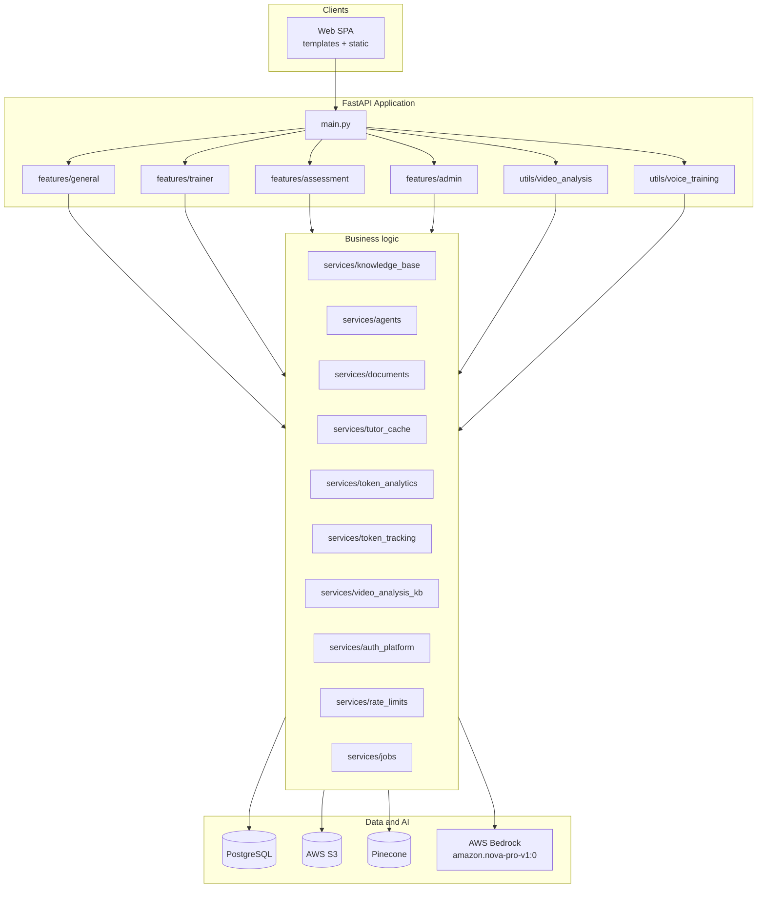

| Layer | Responsibility |
|-------|----------------|
| **core** | App bootstrap, database, AWS/Bedrock/Pinecone clients, logging, middleware |
| **models** | SQLAlchemy ORM entities (`User`, `Course`, `VoiceScenario`, `VoiceSession`, `VoiceAssessment`, etc.) |
| **schemas** | Pydantic request/response models |
| **services** | Reusable business logic (KB, agents, auth, caching, jobs, token tracking/analytics) |
| **features** | HTTP route families grouped by domain |
| **utils** | Technical helpers (`timezone_helpers`, `security_helpers`, `aws_helper`, …), Video Analysis (`/video-analysis`), Voice Agent Training (`/voice-training`) |
| **static / templates** | Single-page web UI (`script.js`, `voice_training.js`, `video_analysis_chat.js`, Jinja2 shell) |

---

## Organizational model

```text
Organization
 └── Process (business unit / team)          ← Super Admin creates
      ├── Super Admin(s)                       ← org-wide governance
      ├── Trainer(s)                           ← content owners (1 process each)
      └── Trainee(s)                           ← learners (1 process each)
           └── Batch (optional)                ← Trainer cohort for targeted publish
```

| Concept | Description |
|---------|-------------|
| **Process** | Segments users and content. Each user belongs to exactly one process. |
| **Course** | Publishable learning package from source document(s) + AI-generated modules. Stored as `Course` row + S3 markdown + Pinecone vectors. |
| **Module** | Single learning unit (markdown report) within a course. |
| **Batch** | Named trainee group for cohort-based course assignment. |
| **Knowledge Base (KB)** | Trainer-owned documents, modules, images, and vector index. |
| **TraineeAttempt** | Enrollment linking trainee to live course (batch, attempts, progress). |
| **VoiceScenario / VoiceSession / VoiceAssessment** | Voice Agent Training scenarios, live call sessions, and graded assessments (RDS + S3). |
| **AssessmentConfig** | Per-course quiz settings: scope, question type, pass %, attempts, time limit. |
| **AssessmentQuestion** | Trainer-reviewed question bank with `is_approved` and `is_rejected` flags. |
| **TraineeQuestionSet** | Cached unique question variants per trainee per course (retakes reuse same set). |

---

## Roles and navigation

### Role summary

| Role | Code | Approval | Default landing | Primary scope |
|------|------|----------|-----------------|---------------|
| **Super Administrator** | `super_admin` | Created via **Create Users** | Super Admin Panel | Organization-wide |
| **Trainer** | `trainer` | Self-signup pending until approved | Module Generation | Own process + shared content |
| **Trainee** | `trainee` | Auto-approved on signup | Trainee Dashboard | Published courses only |

**Important:** Super Admin **also acts as Trainer** for their own content (module generation, My Modules, publish, tutor, video analysis) and additionally has the **Super Admin Panel** for cross-user governance.

### API guards

| Guard | Who passes | Effect |
|-------|------------|--------|
| `get_current_active_user` | Any logged-in user | Blocks unapproved non-trainee accounts (403) |
| `trainer_required` | `trainer` or `super_admin` | KB, module gen, publish, assessments, video analysis |
| `super_admin_required` | `super_admin` only | Pending approvals, org analytics, rate limits, processes |

### Sidebar navigation by role

| View (`data-view`) | Super Admin | Trainer | Trainee |
|--------------------|:-----------:|:-------:|:-------:|
| Super Admin Panel | ✓ | — | — |
| Trainer Dashboard | ✓ (own trainees) | ✓ | — |
| Module Generation | ✓ | ✓ | — |
| My Modules | ✓ | ✓ | — |
| Trainee Dashboard | — | — | ✓ |
| My Stats | — | — | ✓ |
| Notifications | ✓ | ✓ | ✓ |
| Review Center | ✓ | ✓ | — |
| Shared With Me | ✓ | ✓ | — |
| Chat Agent | ✓ | ✓ | ✓ (enrolled only) |
| Video Analysis | ✓ | ✓ | — |
| Voice Training | ✓ | ✓ | ✓ (published scenarios only) |

Trainees do not see **Video Analysis** in the sidebar. Trainees see **Voice Training** only when at least one scenario is published to them; they can practice and assess published scenarios but cannot create, publish, or administer scenarios. Trainees cannot access `/video-analysis/*` or trainer-only voice-training management APIs.

### Super Admin Panel tabs

| Tab | Purpose |
|-----|---------|
| Pending Approvals | Approve/reject self-registered trainers |
| Create Users | Provision super_admin, trainer, or trainee |
| System Stats | Org KPIs |
| Token Analytics | Bedrock usage by user, course, feature |
| Settings | Global sharing toggle |
| All Users | Browse/manage any user's KB or trainee detail |
| View Batches | Cross-trainer batch visibility — **same BAM modal** as trainer; courses + voice scenarios per batch |
| Processes | Process CRUD |
| Sharing Log | Trainer-to-trainer share audit |
| Activity Log | Historical audit (all roles) |
| Live Activity | Active sessions (30-minute window) |
| Rate Limiting | Per-role API limits |
| Trainer Analytics | Production metrics + detail modal |
| Trainee Analytics | Learner engagement |
| Video Analysis Reports | Org-wide video reports and indexing |
| Voice Training Reports | Org-wide voice assessment scores and grades |

### Trainer Dashboard tabs

| Tab | Purpose |
|-----|---------|
| Trainer Overview | Trainee list with progress |
| Trainer Batches | Batch management |
| Attempt Requests | Extra assessment attempt approvals |
| Trainer Analytics | Trainer-level metrics |
| Token Analytics | Own AI token usage breakdown |

---

## Authentication and session lifecycle

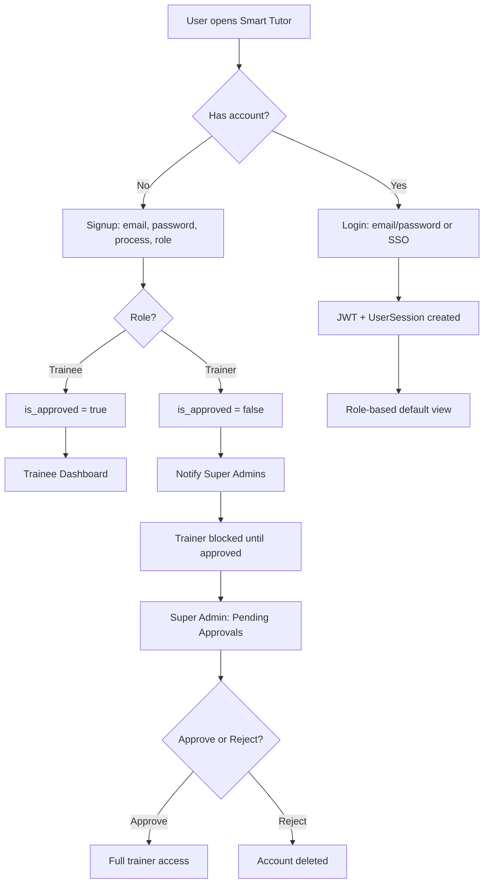

| Step | API / behavior |
|------|----------------|
| Signup | `POST /auth/signup` with **JSON body** (`UserCreate` via `Body(...)`): `email`, `password`, `process_id`, `role` (`trainee` \| `trainer`) |
| Signup UX | SPA clears the Create Account form after success and whenever switching Sign in ↔ Create one; reloads `GET /processes` each time Create one opens (safe DOM option build — no `innerHTML` injection) |
| Signup rate limit | `20/hour` per IP (`limiter_with_db`); client does **not** retry signup on 500 (avoids duplicate-user races) |
| Password strength | Enforced server-side by `safe_password()` before any hash or DB write: **12+ characters**, at least **3 of 4** character classes (lower / upper / digit / symbol), 5+ distinct characters, and not a breached, sequential or base-word-plus-suffix string (`Welcome@123456`, `P@ssw0rd2025` are all refused). A rejection is a **422** whose body explains the rule but **omits the submitted password**. The same policy applies to the super-admin *Create User* panel, since `UserCreate` and `AdminUserCreate` share the one validator — an admin cannot provision a weaker password than a user could choose. The browser pre-checks the identical rules (`validateNewPassword()` in `static/script.js`) purely so the user sees the requirement before submitting; `scripts/check_weak_password.py` asserts the two agree on every sample, because a form that accepts what the server refuses is worse than no hint at all. Tunable upward via `MIN_PASSWORD_LENGTH` / `PASSWORD_MIN_CHARACTER_CLASSES` in [Setup](#setup) |
| Email domain | Registration is limited to **company addresses** — by default `@testenvhexa.com` and `@hexaware.com` (`SIGNUP_ALLOWED_EMAIL_DOMAINS` in [Setup](#setup)); anything else, including every disposable-inbox provider, is a **422** before any DB write. Enforced by `safe_registration_email()` on **both** `UserCreate` and `AdminUserCreate`, so an admin cannot provision an address a user could not. The match is exact set membership, never a suffix test, so a look-alike domain like `x-hexaware.com` is refused. The browser pre-checks the same list (`validateRegistrationEmail()` in `static/script.js`) only so the user sees the rule before submitting — and it reads that list from a server-rendered `<meta>` tag, so adding a domain is an `.env` change plus a restart with **no code edit**. Both forms show the allowed domains as a wrapping hint line under the field rather than inside the placeholder, which the field was too narrow to display in full |
| Existing accounts | The strength policy is applied only where a **new** password is chosen. Sign-in never re-checks strength, so accounts created under the old 8-character rule keep working and no password reset is forced. Every account created from now on must satisfy the 12-character rule. The **email-domain** rule is scoped the same way: it gates registration only, so an existing account on any other domain still signs in normally |
| Login | `POST /auth/token` or `POST /auth/sso` |
| Email casing | Email identity is **case-insensitive in both directions**: an account registered as `Phani@st.com` signs in as `phani@st.com` and vice versa. New rows are stored lower-cased and the lookup compares `lower(email)` on both sides, so accounts already stored mixed-case are reachable with any casing. Re-casing an address is treated as a duplicate at signup and admin-create instead of creating a second account |
| Login throttling | `POST /auth/token` counts failures **per account and per IP** in the `login_attempts` table (defaults 5 / 20 per 15-minute window). Past the limit it returns **429** with `Retry-After` and a generic message — checked before `verify_password`, so a throttled guess never reaches bcrypt. Failures also incur a progressive delay. A successful sign-in clears that account's failures (the IP budget is kept, so one success cannot reset a shared NAT). Tunable via the `LOGIN_*` variables in [Setup](#setup) |
| Login errors | An unknown email and a wrong password return the **same** 401 body (`Incorrect email or password`), so login cannot be used to enumerate accounts |
| Profile | `GET /auth/me` |
| Logout | `POST /auth/logout` — ends session, logs activity. The client revokes the bearer token **before** clearing its own state, so a copied token is dead the moment the user signs out (VAPT), and flushes tutor progress and any open assessment draft **before** either, so nothing typed is lost. See *Logout is a quiet teardown* below |
| SSO config | `GET /auth/sso-config` |

**Signup implementation notes (`features/general/router.py`):** email is canonicalized by `normalize_email()` (NFKC, control characters dropped, trimmed, lower-cased) and the duplicate check is case-insensitive; trainer accounts are pending (`is_approved=false`) with best-effort admin notifications; response is a plain `UserInDB` JSON payload (not an ORM instance). Activity logging uses a **side DB session** so it cannot expire the request session (`services/auth_platform.py`).

**Logout is a quiet teardown.** `handleLogout()` revokes the token server-side and only then calls `location.reload()`, so for a fraction of a second the page is live with a token the server has already rejected. Every request still in flight across that window therefore comes back **401 by design** — most often the `/notifications` poll, whose interval `stopNotificationPolling()` clears but whose already-awaiting `fetch` it cannot recall. `apiCall()` used to read that expected 401 as an expired session, so an ordinary trainee logout flashed the red *"Session expired. Any unsubmitted work has been saved"* toast on the way out and re-entered `handleLogout()` (returning immediately at its own guard). Three things now make the window silent:

| Layer | Behaviour |
|-------|-----------|
| The 401 branch | Skipped while `logoutInProgress`, alongside the existing `sessionRestore` and `loginInProgress` exemptions. Note the poll's `suppressErrorNotification=true` did **not** help here — the expiry toast is deliberately *not* gated by that flag, because a real expiry must always be announced |
| The other two `apiCall` toasts | `location.reload()` aborts in-flight requests, which surfaces as a network error, and a 5xx body may not be JSON. Telling someone who just clicked *Log out* to "check your connection" is both wrong and alarming, so both are suppressed during logout too |
| `showNotification()` | A single choke point: `error` and `warning` toasts raised while `logoutInProgress` are logged to the console and dropped. This covers each **caller's own** message — "Audio unavailable for this paragraph", "Could not load your courses", "Rate limit exceeded" — which `apiCall`'s guards cannot reach |

A genuine expiry is unaffected: it shows its toast **before** calling `handleLogout()`, which is where the flag is set. The outcome is still reported after the reload from the `logoutFlash` (green *"You have been logged out successfully."*) and `idleLogoutFlash` (informational) flags. Pinned by `scripts/check_logout_is_quiet.py`, which also asserts the teardown ordering — flag set, work flushed, token revoked, client state wiped, reload — since a save issued after the wipe has no effect.

**Failure messages must be true and actionable.** Whatever the role, a message that misdescribes what happened costs more than no message. Three from UAT did, and are fixed alongside the rate-limit defaults above (`scripts/check_error_messages_are_actionable.py`):

| Was | Now | Why it was wrong |
|-----|-----|------------------|
| *"Rate limit exceeded: Rate limit exceeded: 100/minute"* | *"Too many requests — please wait about 60 seconds and try again."* | The server's `detail` already starts with those words and `apiCall` prefixed them again; the wait now comes from the `Retry-After` header, and the raw quota stays in the console |
| *"Error: Invalid JSON response from server."* | *"The server response could not be read. Please try again."* | A parser diagnostic carried on the `Error` object that `apiCall` returns, which callers render straight into a toast with `error.message` |
| *"No modules found for this shared course"* on a request that **failed** | *"Could not load the modules for this shared course. Please try again."* | The sibling of a bug already fixed on the normal course path — it sent the user looking for content that was there and only needed the call retried. The genuinely-empty case still says no modules were found, on both paths |

**Session restore on refresh:** The SPA persists `sessionStorage.lastActiveView` and sub-tabs so users return to their last screen without a login flash. A loader overlay displays until view data finishes loading.

---

## Super Administrator workflows

### Governance overview

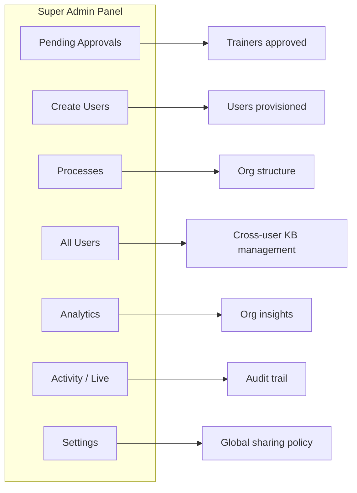

### User lifecycle

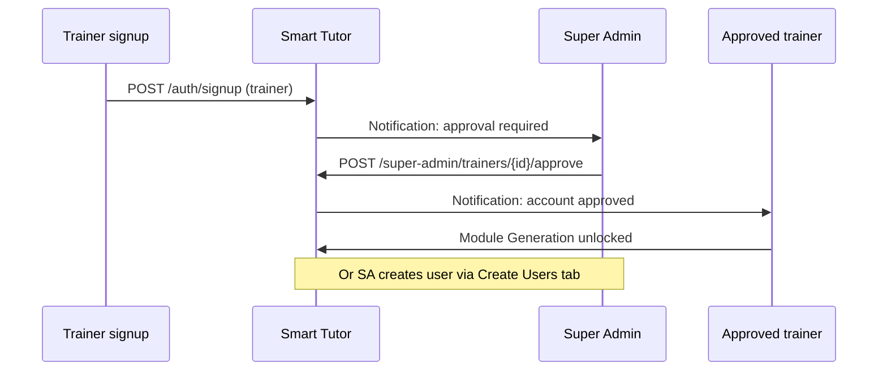

| Super Admin action | Effect |
|--------------------|--------|
| Approve trainer | Trainer unlocks Module Generation, My Modules, publish |
| Reject trainer | User and related records removed |
| Delete user (All Users) | Cascading cleanup |
| Create any role | Immediate or pending per `is_approved` |
| Cross-process publish | Publishes trainer course to another process's trainees |
| Toggle global sharing | Enables/disables process-wide publish for trainers |

### View Batches (Super Admin)

Super Admin **View Batches** reuses the trainer batch analytics stack — no separate voice-training report. Flow:

```text
1. Super Admin Panel → View Batches → filter by process/role.
2. Click View Batches on a trainer row → GET /super-admin/batches/trainer/{trainer_id}.
3. Each batch card shows: trainees, courses count, voice scenarios count, published lists.
4. View Analytics → GET /super-admin/batches/{batch_id}/analytics (delegates to trainer analytics + voice enrich).
5. Same BAM modal: Overview / Trainees / Analytics tabs, Export Excel, Detailed Report.
6. Per-trainee AI coaching → GET /super-admin/batches/{batch_id}/trainee/{trainee_id}/summary.
```

| Super Admin API | Trainer equivalent | Voice training |
|-----------------|-------------------|----------------|
| `GET /super-admin/batches/view` | — | Trainer/batch overview |
| `GET /super-admin/batches/trainer/{id}` | `GET /trainer/batches` | `batch_voice_scenarios` on each batch |
| `GET /super-admin/batches/{id}/analytics` | `GET /trainer/batches/{id}/analytics` | Full voice metrics in response |
| `GET /super-admin/batches/{id}/trainee/{tid}/summary` | `GET /trainer/batches/{id}/trainee/{tid}/summary` | Voice practice/assessment in AI prompt |

If a batch has **only voice scenarios** (no courses), course sections show empty states and voice sections populate analytics, exports, and AI summary accordingly.

### All Users — managing trainer content

Super Admin selects a trainer in **All Users** and sees the **same My Modules UI** routed through admin APIs.

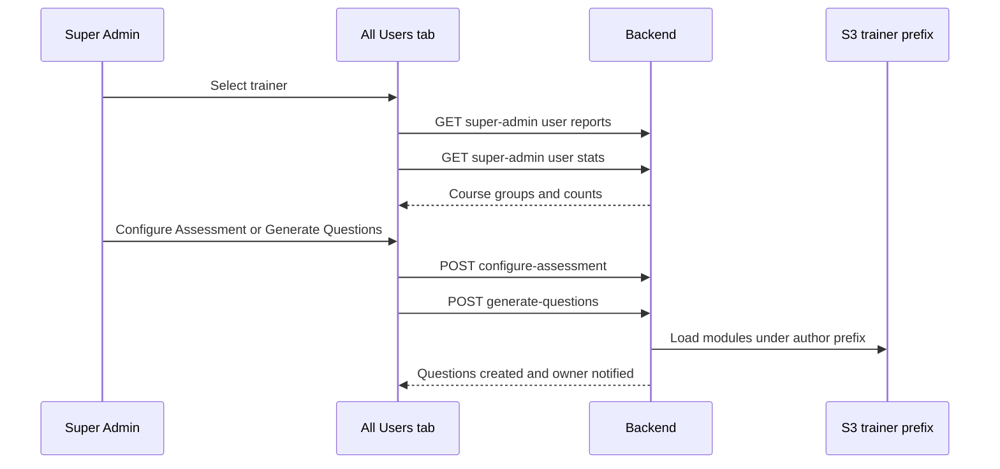

| Capability | Notes |
|------------|-------|
| View/edit modules | `POST /super-admin/users/{id}/reports/{filename}/update` — owner notified on edit |
| Delete module | `POST /super-admin/users/{id}/reports/{filename}/delete` — reindexes source; **owner notified** |
| Delete course | `POST /super-admin/users/{id}/source-document/{doc_name}/delete` — full wipe via `delete_source_document_completely` (DB + S3 + Pinecone for all course docs); **owner notified**; shared-report recipients also notified |
| Configure assessment | Same as trainer; blocked if course published |
| Generate/review questions | Full assessment delegation on behalf of owner |
| Publish / share | Trainer action buttons enabled in admin context |
| Trainee users | Dedicated trainee detail view (enrollments, progress, scores) |

When Super Admin **edits or deletes** another trainer's modules or courses, the **owner trainer receives in-app notifications**. Shared-report recipients are also notified when a course document they received is deleted.

### Activity Log and Live Activity

| Feature | Behavior |
|---------|----------|
| **Activity Log** | `GET /super-admin/activity-log` — up to 1000 entries; filter by role/hours; all roles logged |
| **Live Activity** | Active `UserSession` rows with `last_activity` within 30 minutes; auto-refresh while tab open |

### Super Admin analytics flow

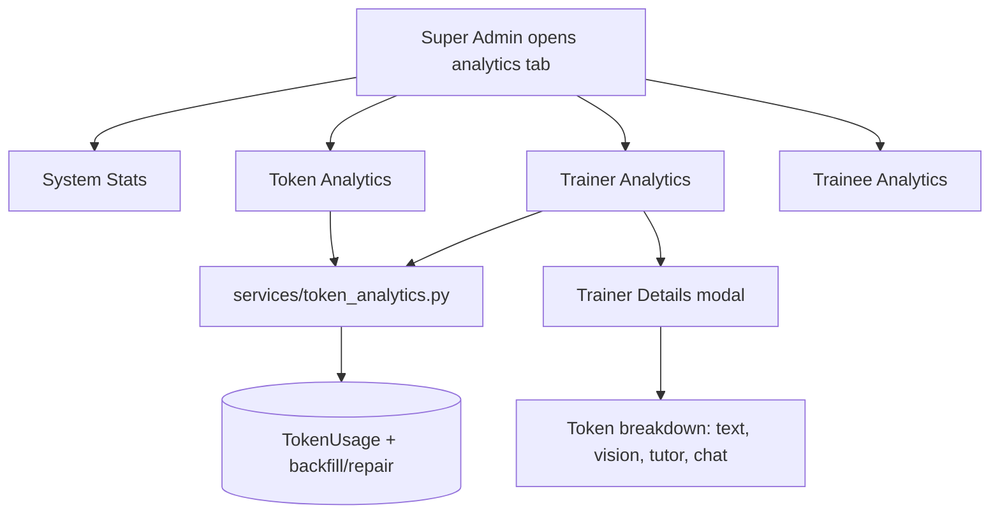

### Creating users (single and bulk)

**Super Admin → Create Users** creates trainees, trainers and super admins one at a time or in bulk. Every admin-created account starts on the login **`St@<Employee ID>#2026`** and must set its own password at first sign-in. Smart Tutor sends no email, so the admin shares the starting login with each user (e.g. by an Outlook mail merge).

| Step | Single user | Bulk |
|---|---|---|
| Input | Email, **Employee ID**, Role, Process | **Download Template** → fill the `Users` sheet (Role and Process are dropdowns; see the `Example` sheet) |
| Check | Same rules as signup: company email domain, duplicate (case-insensitive), process exists | **Check File**: every row is validated and previewed; nothing is created |
| Create | Immediately | **Create Users**: the file is validated again server-side, then valid rows are created by a background job with progress (`GET /workflow/jobs/{job_id}/status`); rows with errors are skipped |

Template: sheets `Instructions`, `Users`, `Example`, plus a hidden `Lists` sheet feeding the dropdowns. The process list is generated on each download, so it always matches the live processes. Up to **500** users and **2 MB** per file. Only the `Users` sheet is read.

**First login.** `must_change_password` is set on every admin-created account. While it is set, `get_current_active_user` answers every request with `403 PASSWORD_CHANGE_REQUIRED`, which covers all routes behind it, including `trainer_required`, `super_admin_required` and the `*_without_holding_db` helpers. The only routes still open are `/auth/me`, `/auth/logout`, `/auth/refresh` and `POST /auth/change-password` (current + new password, the normal password policy, rate-limited like login). The front end shows a **Set Your Password** screen instead of the app until it succeeds. Self-signup accounts, SSO-only use and existing users are never flagged; the column defaults to `false`.

| Endpoint | Purpose |
|---|---|
| `POST /super-admin/users` | Single create (`employee_id`; an explicit `password` is still accepted from API callers) |
| `GET /super-admin/users/bulk-template` | Download the template |
| `POST /super-admin/users/bulk-validate` | Check an uploaded file, create nothing |
| `POST /super-admin/users/bulk-create` | Create the valid rows as a background job |
| `POST /auth/change-password` | Replace the current password; clears `must_change_password` |

---

## Trainer workflows

### Content creation pipeline

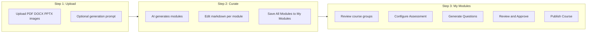

| Step | UI | API | Output |
|------|-----|-----|--------|
| Upload | Module Generation | `POST /workflow/process` | Background job ID |
| Poll | Step 2 curation | `GET /workflow/jobs/{id}/status` | Progress + draft modules |
| Commit | Save All Modules | `POST /workflow/commit` | S3 modules + course row + Pinecone index |
| List | My Modules | `GET /kb/reports` | Course cards with question counts |
| Edit | Edit button | `POST /kb/reports/{filename}/update` | Re-indexed content |
| Delete course | Course **Delete** | `POST /kb/source-document/{doc_name}/delete` | Full wipe via `delete_source_document_completely` — course DB rows, assessment/shares/cache, S3 modules + uploads/images for **all** docs in a multi-doc course, Pinecone embeddings, then verify/retry |
| Clear all | Danger Zone | `POST /kb/clear-user-data/delete` | Irreversible wipe of that trainer's documents, modules, and KB vectors (`clear_all_data_for_user`); UI requires typing `DELETE` |
| Regenerate | Follow-up prompt | `POST /workflow/regenerate` | Selective module regen (images preserved) |
| Cancel | Cancel generation | `POST /workflow/jobs/{id}/cancel` | Returns to Step 1; no false error on completed jobs |

**Supported uploads:** PDF, DOCX, DOC, PPTX, PPT, PNG, JPG, JPEG.

**PowerPoint extraction:** every slide contributes its own text, not just the title slide. A slide is captured as a full-slide *image* for layout fidelity, so the words on that snapshot are pixels — `_extract_pptx_slide_texts` therefore reads each slide's native text straight from the `.pptx` (including table cells and grouped shapes, where `shape.text` is empty, plus chart titles and speaker notes) and `_build_ppt_slide_source_text` interleaves it with the slide images. That interleave iterates over the **union** of slide numbers rather than over the snapshots, because LibreOffice sometimes exports fewer PNGs than the deck has slides (and an individual per-slide upload can fail) — keying on the images would drop the text of every slide with no snapshot, which is the same "only the first slide" symptom. Module count still follows the trainer's instructions and is not 1:1 with slides. The legacy binary `.ppt` format cannot be opened by python-pptx, so that path keeps the text extracted from the LibreOffice-converted PDF instead of discarding it.

**Slide snapshot count is never trusted as the slide count.** LibreOffice's `--convert-to png` frequently writes only the *first* slide of a deck, so three separate places had to stop measuring off the rendered images: `render_pptx_slides_as_png_list` (`services/documents.py`) no longer returns a partial direct export — it falls through to rendering one page per slide from the LibreOffice PDF and keeps whichever route covers more slides; `_direct_slide_export_is_truncated` makes the caller hand over to the per-PDF-page snapshot loop when the export covered fewer slides than the PDF has pages, instead of marking slides "done" after the first; and module count is derived from `_count_pptx_slides` (the deck's own slide count) rather than `len(extracted_images)`, because a one-image export otherwise made a whole deck generate a single module about the title slide. `_ppt_group_note` states the slide count and the image count separately so the model covers slides that have text but no snapshot. Regression coverage: the PowerPoint section of `scripts/check_module_source_filenames.py`.

**Regeneration:** Module regen merges PDF extraction, S3 image catalog, and existing `[IMAGE:]` tags so images are not lost during prompt-based regeneration.

**Course delete completeness:** Trainer My Modules Delete and Super Admin All Users Delete share `services/knowledge_base.delete_source_document_completely`. Documents still referenced by another of the same author's courses are preserved (backup + skip vector/file wipe for those shared sources).

### Assessment configuration and question review

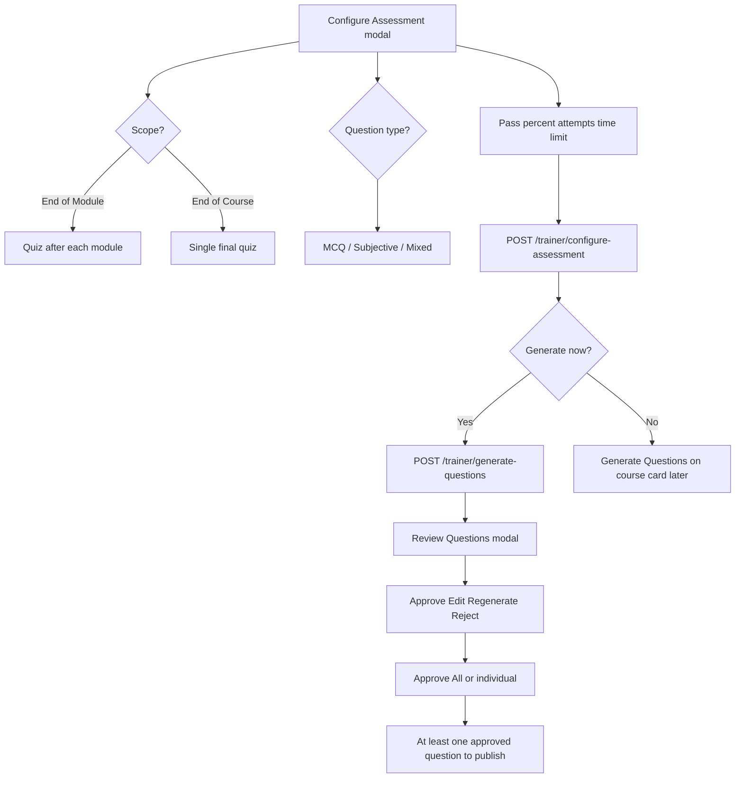

**Review Questions modal (current UX):**

| Element | Behavior |
|---------|----------|
| Scope banner | Shows **End of Course** or **End of Module** at top with explanation |
| Question cards | Separated header, module badge, action toolbar, 2×2 option grid |
| Regenerate | Highlight banner + scroll to question; can regenerate again until satisfied |
| Rejected section | Archived questions with **Restore** |
| Add Question | Manual entry; Module Index is a single dropdown (no duplicate preview label) |
| Scroll | Modal resets to top on close/reopen |
| Approve All | Bulk approve; counts refresh on course card |
| Close | Re-reads the card list, so **My Modules** and the super-admin **All Users** detail pane show the new question count without a page reload. A modal opened straight from generation is marked changed on open (`markDirty`), because the questions behind the card are new even if the reviewer touches nothing; the refresh goes through `refreshCourseReportsView()`, which falls back to the selected row in **All Users** when no owner id was passed in |

| Rule | Behavior |
|------|----------|
| Publish prerequisite | Assessment configured + ≥1 approved non-rejected question |
| Reject | Archives question; excluded from trainee generation |
| Restore | Returns to review queue (not auto-approved) |
| Edit | Updates content; clears approval — must re-approve |
| Regenerate | AI replaces question; `is_approved=false`; pending review |
| Unique questions | Approved templates guide per-trainee unique variants |
| Retake | Same trainee sees same question set on every retake |

**Question generation cancel:** After cancel, **Generate Questions** remains available on the course card (trainer, admin, super admin All Users).

### Publish course

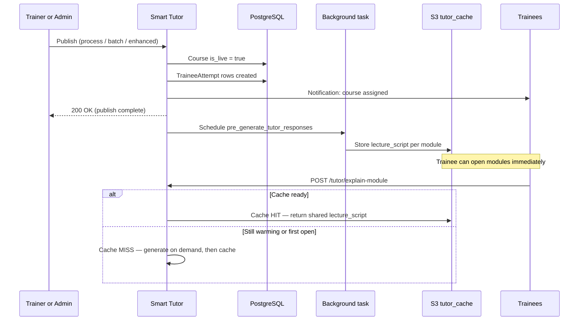

Publish returns as soon as the course is **live and trainees are enrolled**. Tutor lecture pre-generation runs **in the background** (`BackgroundTasks` → `_run_tutor_pre_generation_background` in `features/trainer/router.py`) so gateways do not 504 on long Bedrock runs. Enhanced publish loads modules from the **course owner's** S3 prefix (`course.author_id/generated_reports/`), so admin publish still warms the correct cache. Cached payloads live at:

`tutor_cache/{course_id}/{module_index}/{query_hash}.json`

Module indices are normalized with `normalize_module_index()` (shared by publish pre-gen and `POST /tutor/explain-module`) so `"3"` and `3` hit the same S3 path.

| Publish mode | Who receives enrollment |
|--------------|-------------------------|
| Single batch | Trainees in selected batch |
| Multi-batch | Union of batch members |
| Entire process | All trainees in process (requires global sharing) |
| Super Admin cross-process | All trainees in target process |
| Add trainees (live) | Manual additional assignments |
| Unpublish selective | Remove selected trainees |

**Trainee tutor behavior after publish:** A published module is always usable. If background pre-gen has finished (or any user already generated that module once), trainees get the **shared S3 cache**. If they open a module while pre-gen is still running, they get an **on-demand** lecture that is then written to the same cache for later opens.

### Trainer Dashboard and batches

Trainers and Super Admins use the **same Batch Analytics Modal (BAM)** for cohort management. Courses link via `TraineeAttempt.batch_id`; voice scenarios link via `VoiceScenario.content.publish.batch_ids`. Analytics, AI summaries, **Export Excel**, and **Detailed Report** include **both** course and voice training data when published to the batch.

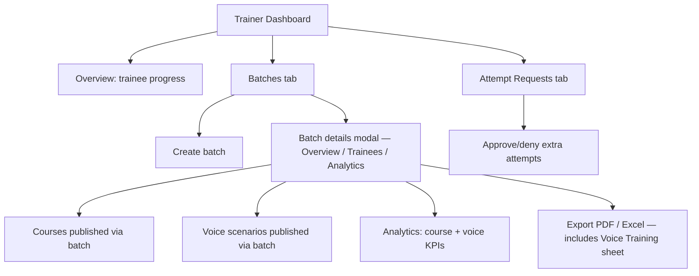

**Attempt requests:** Trainers and **super admins** can approve or deny trainee extra-attempt requests for courses they own (or admin-managed content). Deny uses the same ownership checks as approve; `HTTPException` is re-raised (not swallowed as a generic 500). Role checks accept `trainer` and `super_admin`.

| BAM tab | Course data | Voice training data |
|---------|-------------|---------------------|
| **Overview** | Published courses list, avg progress/score | Voice scenarios list, avg voice score donut |
| **Trainees** | Per-trainee course progress + AI coaching | Per-trainee practice/assessment attempts + pass status |
| **Analytics** | Expandable course rows with module/quiz chips | Voice scenario rows with attempt chips |
| **Export Excel** | Batch Overview, Course Detail, Assessment Breakdown | **Voice Training** sheet (when scenarios exist) |
| **Detailed Report** | PDF tables per trainee | Voice scenario table per trainee |

**API:** `GET /trainer/batches/{id}`, `GET /trainer/batches/{id}/analytics`, `GET /trainer/batches/{id}/trainee/{trainee_id}/summary` — voice metrics from `services/batch_voice_analytics.py`.

### Trainer collaboration

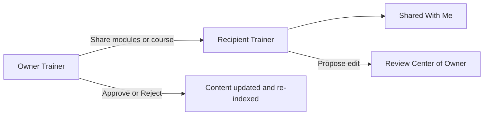

| Share type | Recipient gets |
|------------|----------------|
| Modules only | Content + propose module edits (no assessment questions) |
| Complete course | Modules + questions + propose module and question edits |

### Trainer AI features

| Feature | Entry | API |
|---------|-------|-----|
| Chat Agent | Sidebar → Chat | `POST /chat/query` |
| Module Tutor | My Modules → Tutor | `POST /tutor/explain-module` |
| Voice | Tutor modal | `POST /chat/voice-query`, `POST /speech/synthesize` |
| Voice Agent Training | Sidebar → Voice Training | `/voice-training/*` (practice + assess calls) |
| Token Analytics | Trainer Dashboard tab | `GET /trainer/token-analytics` |

---

## Trainee workflows

### Enrollment and dashboard

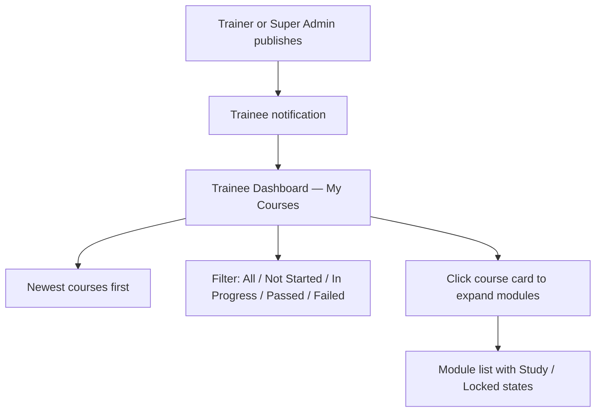

| Access source | Mechanism |
|---------------|-----------|
| Batch publish | `TraineeAttempt` for batch members |
| Process-wide publish | All trainees in process |
| Cross-process publish | Super Admin target process |
| Manual add | `POST /trainer/add-trainees-to-course` |

**Dashboard API:** `GET /trainee/dashboard` — live courses with progress, `course_created_at`, ordered newest-first (`Course.created_at` desc). Filter counts update on load.

**My Courses UI:** Course cards start **collapsed** (progress + assessment summary only). Clicking the course card (title, progress, or **Show modules**) expands the full **Modules & Assessments** list. Study / lock / request-attempt controls keep working; only interactive buttons inside the card are excluded from the expand toggle. Titles and emails are escaped via `escapeHtmlText()`; DOM ids use `sanitizeDomIdToken()`.

### Learning path and module unlock

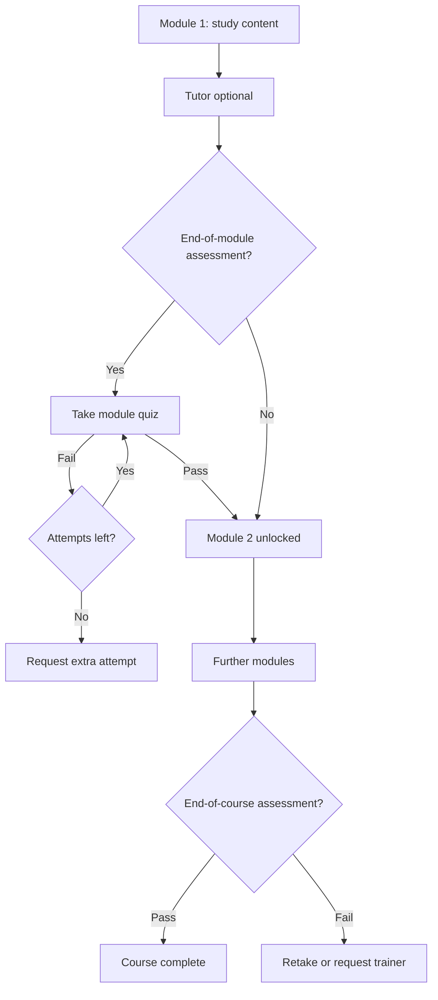

| Rule | Implementation |
|------|----------------|
| `end_of_module` scope | Module N+1 locked until trainee **passes** Module N quiz |
| `end_of_course` scope | Module N+1 locked until Module N **study-complete** |
| Unique questions | Per-trainee set in `TraineeQuestionSet`; same set on retake |
| MCQ grading | Instant via `features/assessment/grading.py` |
| Subjective grading | AI scoring + feedback |
| Partial save | Resume in-progress assessments |
| Extra attempts | Request → trainer **Attempt Requests** tab |

### Trainee assessment APIs

| Action | Endpoint |
|--------|----------|
| Module list + locks | `GET /trainee/course/{course_id}/modules` |
| Course progress | `GET /trainee/course/{course_id}/progress` |
| Load module quiz | `GET /trainee/module-assessment/{course_id}/{module_index}` |
| Submit module quiz | `POST /trainee/submit-module-assessment/{course_id}/{module_index}` |
| Load final quiz | `GET /trainee/assessment/{course_id}` |
| Submit final quiz | `POST /trainee/submit-assessment/{course_id}` |
| Results | `GET /trainee/assessment-results/...` |
| Request attempts | `POST /trainee/request-additional-attempt/{course_id}` |

### Trainee AI (scoped)

| Feature | Access rule |
|---------|-------------|
| Module Tutor | Enrolled live courses only |
| Chat Agent | RAG restricted to enrolled course content |
| My Stats | Personal progress and assessment summaries |

### Voice Agent Training (trainee)

When a trainer or super admin **publishes** a voice scenario to a trainee (via batch or individual audience), the trainee sees **Voice Training** in the sidebar and a **Training Scenarios** home view.

| Element | Description |
|---------|-------------|
| **Shared by** banner | Each scenario card shows who published it (email, role, date) |
| **My Completed Assessments** | Table of all graded attempts with View results and PDF |
| **Practice** | Gated learning mode with hints; must **submit** a completed practice session (`conversation_complete`) to count toward assessment unlock |
| **Assessment** | Unlocked after required practice sessions; scored with rubric + PDF |
| **Pass freeze** | Passing at or above the configured pass % within max attempts **freezes** further assessment retakes |
| **View results / PDF** | Available per attempt after assessment is graded (same as trainer) |

Trainees **cannot** access Module Generation, course publish, Review Center, Video Analysis, scenario creation, publish configuration, or unpublished voice scenarios.

---

## Assessment system (all roles)

### Unique questions per trainee

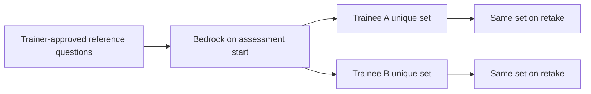

1. Trainer generates and approves **reference templates** in Review Questions.
2. Course is published to trainees.
3. When a trainee starts an assessment, AI generates a **personalised unique set** on-the-fly (rephrased questions, different distractors, same concepts).
4. The same trainee always sees the same questions on retakes; different trainees get different questions.

### Grading

Shared logic in `features/assessment/grading.py`:

- **MCQ** — automatic letter matching (with content adjudication when needed)
- **Subjective** — AI-assisted scoring with feedback (module and end-of-course)

Grading runs **once, at submit**, and writes its verdicts (`mcq_results`) and the answer key it settled on (`resolved_correct_answers`) onto the attempt. Every later view — the trainee's own results, the trainer's and the super admin's — reads those stored values; reviewing an attempt makes no model call and cannot restate its score. See [Assessment review reads the record](#assessment-review-reads-the-record-one-attempt-at-a-time).

### Trainee answer-key privacy (My Courses)

Applies to **end-of-module** and **end-of-course** assessments for the **trainee** role only.

| Outcome | UI | API / Network tab |
|---------|----|-------------------|
| **Failed** attempt | No correct answers, explanations, or evaluator feedback | Submit + results payloads **omit** `correct_answer`, `explanation`, and feedback fields (`sanitize_detailed_results_for_trainee`, `hide_correct_answers`) |
| **Passed** attempt | Correct answers + explanations shown | Full answer keys included |
| **Trainer / Admin** review | Full answer keys always available | `reveal_correct_answers=True` on staff result builders |

While taking the quiz, question fetch endpoints never include answer keys. Failed attempts still show the trainee's own selections and (for MCQ) whether each item was right/wrong — without revealing the key.

### Super Admin assessment delegation

Super Admin uses the same `/trainer/*` assessment endpoints via **All Users**. Backend loads modules from the **course owner's S3 prefix** and notifies the owner on changes.

---

## AI tutor, chat, and voice

### AI models (AWS Bedrock)

| Use case | Model |
|----------|-------|
| Text generation, tutor, chat, vision | **`amazon.nova-pro-v1:0`** (`core/runtime.py`) |
| Embeddings (Pinecone) | **`amazon.titan-embed-text-v2:0`** (1024 dimensions) |
| Token cost estimation | Nova Pro pricing in `services/tutor_cache.py` |
| Usage parsing | `utils/aws_helper.py` |
| TTS | Amazon Polly (Joanna/Ruth neural; browser fallback) |
| STT | AWS Transcribe (browser SpeechRecognition fallback) — Voice Training, **and** the Chat Agent / tutor Raise Hand microphone for every role |

### Tutor session flow

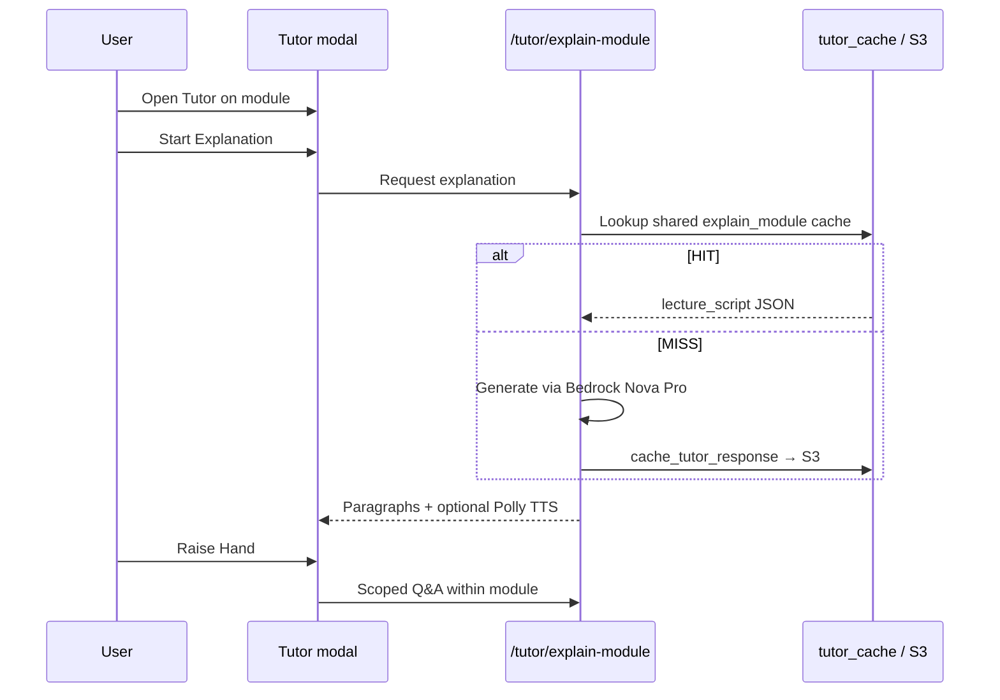

| Topic | Behavior |
|-------|----------|
| Cache key | Hash of `explain_module` + normalized module content (`build_tutor_cache_module_content`) |
| Module index | `normalize_module_index()` — same int key for pre-gen and explain-module |
| S3 object | `tutor_cache/{course_id}/{module_index}/{query_hash}.json` with `lecture_script` |
| Sharing | One cache entry serves **trainee, trainer, and admin** for the same course/module content (role ACL runs first; cache has no user/role in the key) |
| Warm-up | On publish, `pre_generate_tutor_responses` runs **asynchronously** after `is_live` + enroll |
| Cold open | Cache miss generates live, then caches — trainee still receives a lecture |

**Response hygiene:** Backend `strip_agent_meta_commentary()` and frontend `stripAgentThinking()` remove model preamble from tutor/chat responses.

### Tutor speech synthesis (Amazon Polly)

`POST /speech/synthesize` reads the lecture aloud. Which engine it asks for is `POLLY_ENGINE` (default `generative`), and the same value drives the voice picker at `GET /speech/generative-voices` — asking the catalogue for one engine while synthesising with another is how a listed voice ends up failing with `EngineNotSupportedException`.

The engine decides whether SSML may be sent at all. Polly's **generative** engine rejects it outright:

```
InvalidSsmlException: An error occurred when calling the SynthesizeSpeech operation:
Unsupported Generative feature
```

The endpoint used to try SSML first regardless, so **every** voice request burned a failed Polly call and logged that warning before its plain-text retry succeeded. It now asks for SSML only when the configured engine is in `POLLY_SSML_ENGINES` (`standard`, `neural`).

That does not mean the generative engine gets the raw text. `enhance_text_for_natural_speech()` does two jobs, and only one of them is SSML: it adds `<prosody>` and `<break>` tags, but it also converts markdown to speech-friendly wording (backticks, bold, headings, list markers). `strip_ssml_tags()` therefore removes the tags and keeps the wording — including closing up the `" ."` a removed `<break/>` leaves behind, which would otherwise be read as its own beat. Identical payloads are de-duplicated, so the fallback never repeats a call that just failed.

**The tutor speaks every word it shows.** The lecture pane renders a paragraph and posts that same paragraph here, so anything the speech path dropped or added was text the learner could read but never hear, or hear but never read. Three separate causes of that were removed:

| Was | Now |
|-----|-----|
| The enhancer ended with a loop that "unwrapped nested prosody blocks". Nothing was ever nested — there is exactly one wrapper per sentence, laid out **consecutively** — so it read sentence N as being inside sentence N-1, rewrote a three-block span down to its middle block, and repeated. **Five sentences in, one sentence out**, on every multi-sentence paragraph and for every role | The pass is gone and must not return. Nesting is structurally impossible: every `<` is stripped before wrapping, so a sentence handed to `_contextual_prosody()` cannot contain a tag |
| Two hard clips — the endpoint cut at `[:2400] + "..."` and the enhancer cut the SSML at `[:2700]`, the latter mid-tag, which is where the `InvalidSsmlException` in the logs came from | `split_text_for_synthesis()` splits on sentence boundaries into `SPEECH_CHUNK_MAX_CHARS` (1200) pieces, synthesises each in order and concatenates the mp3 bodies. mp3 frames are self-contained, so the browser still gets one audio element per paragraph. A word longer than the whole budget is broken on characters — cut, never dropped. No regex, so no backtracking (`_split_sentences()` is a linear character scan) |
| A rotating closing question ("Would you like a real-world example…?") was appended to **every** paragraph. The tutor asked it aloud, the pane never showed it, and the narration moved on by itself | Removed. The same interaction is already offered by **Raise Hand** and the end-of-module actions, which are on screen |

Polly's stream is also read to the end server-side rather than handed to `StreamingResponse`: a streamed handle that fails half way through reaches the browser as a **short but perfectly successful** download — narration that stops mid-sentence with nothing logged anywhere and no `Content-Length` to detect it. Buffered, that failure is an HTTP failure the client's retry can fix.

**A failed synthesis must not end the lecture.** The generative engine's request quota is far lower than the standard engines', and the tutor asks for the current paragraph plus `SPEECH_PREFETCH_AHEAD` more at nearly the same instant — so a Polly throttle is an ordinary event, not a fault. It used to end the session: the endpoint mapped `ThrottlingException` to **429**, `apiCall` retries only `>= 500`, and the tutor's failure branch showed *"Error generating audio."* and paused, so the learner got part of a module and had to press Play again. Three layers now absorb it:

| Layer | Behaviour |
|---|---|
| Server | `POLLY_RETRYABLE_ERROR_CODES` (throttling, `SlowDown`, `ServiceUnavailable`, `InternalServiceError`, `RequestTimeout`, …) are retried per payload with exponential backoff — `POLLY_MAX_RETRIES_PER_PAYLOAD` (2) × `POLLY_RETRY_BASE_DELAY_SECONDS` (0.5), so at most 1.5 s, well inside the client's 45 s speech timeout. A non-retryable code (bad voice, bad SSML) is **not** slept on: it falls straight through to the next distinct payload |
| Client | One extra backoff retry on a synthesis that came back without audio, which is what covers the 429 `apiCall` won't retry. A 400 is not retried — that text will never synthesise |
| Tutor | A paragraph whose audio still fails is **read silently**: it holds on screen for its reading time (`SPEECH_SILENT_READ_WPM`, clamped between `SPEECH_SILENT_MIN_MS` and `SPEECH_SILENT_MAX_MS`) and then fires the same `ended` event a narrated paragraph would, so progress, question pauses and module end behave identically. Only `SPEECH_MAX_CONSECUTIVE_FAILURES` (3) in a row stops the tutor, and then it says narration is unavailable rather than blaming audio generation. Any success — or pressing Play — resets the streak. The resume-after-Raise-Hand path had the identical bug and got the identical fix |

**Related client fix.** `apiCall` retried a 5xx **only when the error body parsed as JSON**, because the retry branch sits inside `try { JSON.parse(responseText) }`. A 502/503 whose body is the load balancer's HTML — a task restarting, no healthy target yet, i.e. the most retryable failure there is — landed in `catch (jsonError)` and was abandoned on the first try, with *"An unexpected error occurred. Please check the browser console for details."* on top. That path now retries with the same backoff and abort checks as the JSON path, and **503** joins 502/504 as a status whose caller renders its own retryable message instead of pointing a learner at the browser console.

There is a single Polly call site in Python and every frontend call site passes the text it just displayed, so **super admin, trainer and trainee** are covered by the same code with no role branching.

`scripts/check_db_pool_and_polly.py` pins the engine selection: the attempt list is transcribed and asserted to contain no SSML attempt for `generative` and to lead with SSML for `neural`, `strip_ssml_tags` is lifted from the router by AST and driven over tags/breaks/empty input, and negative controls confirm the enhancement pass and the prosody rules are still there for an SSML-capable engine. `scripts/check_tutor_speech_sync.py` pins the sync: it runs the real extracted functions over 2-, 3-, 5- and 40-sentence paragraphs asserting no word is lost and none is invented, splits an 8500-character paragraph and rejoins the chunks to the original words, checks each chunk against Polly's 3000 billed / 6000 total limits, re-times the pathological ReDoS payloads, and mirrors the progressive-reveal arithmetic for both list shapes. `scripts/check_tutor_audio_resilience.py` pins the recovery: it drives the real `_synthesize_speech_chunk()` against a stub Polly that throttles on demand, asserting a throttle ends in audio, that the backoff is exponential and bounded, that a non-retryable code is never slept on, and that the stream is closed either way — plus the client assertions that the non-JSON 5xx retry exists and that no path pauses the lecture on a single failure.

### Microphone input (Chat Agent + tutor Raise Hand)

Both microphone buttons — the Chat Agent's and the tutor's **Raise Hand** panel — post recorded
audio to `POST /chat/voice-query`, which transcribes with **AWS Transcribe**. The buttons are
role-independent, so **trainee, trainer and super admin** all follow the identical path with no
role branching.

| Topic | Behavior |
|-------|----------|
| Primary STT | **AWS Transcribe**, via the same `VoiceTranscribeService.transcribe_reply_bytes_async()` the Voice Training agent uses (streaming first, batch fallback). Recorded audio therefore stays inside our own AWS account |
| Fallback STT | The browser **Web Speech API** captures in parallel and posts what it heard as `browser_transcript`. Used only when Transcribe is unconfigured, errors, or returns nothing — a failed transcription is a **400 asking the user to repeat**, never a 500 |
| Both transcripts are untrusted | `browser_transcript` is a plain form field anyone can post, so it gets the **same** treatment as typed chat input: `normalize_voice_transcript()` folds newlines, strips control characters and caps at `MAX_QUERY_LENGTH`. It **clamps rather than raises**, because a garbled transcript should prompt a retry, not abort a streaming response mid-flight |
| Rendered as text, never as HTML | The transcript is **plain speech, never markup**, so every render path writes it with `textContent`. This matters because the chat bubbles are otherwise filled via `markdownConverter.makeHtml()`, and showdown passes raw HTML **straight through** — a `browser_transcript` of `` would have executed in the bubble. `normalize_voice_transcript()` does **not** close this: it clamps length and folds newlines, it does not strip tags (deliberately — its other consumer is the LLM prompt). The render side is therefore the control: the success path, the failure path and the no-bubble path all use `textContent`, the last via a dedicated `addTextMessageToChat()` helper that builds the same bubble with `createElement` so a caller cannot pass HTML by mistake. Asserted by six harness checks that fail if a transcript ever reaches an HTML sink again |
| Never logged | Neither the audio nor either transcript is written to logs; a Transcribe failure logs only `log_safe(exc)`, so no AWS internals reach the caller either |
| Turn order | The user's own words render **first, on the right**; the agent's answer follows **on the left** — the same order as a typed turn. The user bubble is created *before* the agent bubble and filled in when the server streams `transcribed_query:`, which is what fixes the old behaviour where the question appeared *below* the answer |
| Transcribing indicator | That same bubble shows a spinner and *"Transcribing your question…"* until the transcript lands. It is built with `createElement`/`textContent` (never an HTML string), and it always clears — a request that fails before the transcript arrives falls back to the browser transcript rather than leaving a spinner stuck |
| Language | `CHAT_TRANSCRIBE_LANGUAGE` (default `en-IN`) drives Transcribe; the browser fallback reads the same value from a server-rendered `<meta>` tag, so the two cannot drift. The client re-validates it as a BCP-47 tag before handing it to the Web Speech API |

Proven end to end by `scripts/check_voice_chat_ux.py`.

---

## Video Analysis

The **Video Analysis** sidebar view has two module tabs: **New Analysis** and **Chat with Reports**. **Voice Training** is a separate sidebar item directly below Video Analysis (trainer and super admin only).

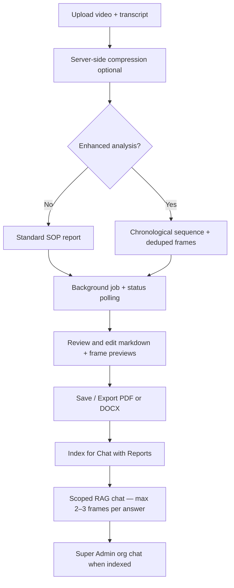

| Step | API |
|------|-----|
| Upload | `POST /video-analysis/upload` |
| Process | `POST /video-analysis/process/{session_id}` |
| Poll | `GET /video-analysis/status/{session_id}` |
| Cancel | `POST /video-analysis/cancel/{session_id}` (idempotent; cleans in-flight jobs) |
| Export | `POST /video-analysis/generate-pdf/{session_id}` |
| Index | `POST /video-analysis/index/{history_id}` |
| Chat | `POST /video-analysis/chat/query` (scoped to indexed reports) |

### Upload validation

| Input | Allowed | Rejected |
|-------|---------|----------|
| **Video** | **`.mp4` only** (extension + MP4/ISO BMFF magic bytes) | PNG/images, MOV, AVI, renamed non-MP4 files |
| **Transcript** | **`.pdf` or `.docx` only** (extension + PDF/`DOCX` zip content checks) | TXT, DOC, images, and other formats |
| **Pairing** | Video and transcript **names must match** the same meeting (stem match; suffixes like `_transcript` / `_recording` ignored) | Different meeting names |
| **On failure** | API returns **HTTP 400** with a clear message; UI stays on upload (or returns to upload) with a notification — processing does not start | |

Export downloads use a **length-safe** name based on the **PDF cover title** (markdown H1) + `YYYYMMDD_HHMMSS` + `.pdf`/`.docx` (max 100 characters). Long Teams names (dates / `Meeting_Recording` tails) are stripped when falling back to the video stem; if the name is still too long or empty, the server falls back to `Meeting_Documentation_…` then `VA_Report_…`. The browser also clamps filenames on download. **All Generated Reports** and Super Admin **Video Analysis Reports** show the same document title as the PDF/DOCX cover (from markdown H1, not a separate short AI label). The source-video line is cleaned separately (spaces, no `.mp4` / dates / `Meeting Recording`; tempfile / underscore slugs fall back to the report title). After export, local source video/transcript working files are cleared and the New Analysis form resets.

### Processing UI

The **New Analysis** flow shows stepped progress: upload → **compress** (when applicable) → AI analysis → review. Compression displays *"This may take a few minutes depending on the size of the video."* Cancel during processing returns to the upload screen without duplicate error toasts. While upload, SOP processing, or PDF/DOCX export is in progress, trainers and super admins are warned before navigating to another app page, logging out, or closing/refreshing the browser — leaving may lose processing progress.

### Review, export, and chat

| Feature | Behavior |
|---------|----------|
| **Review & Edit** | Sync-scroll between markdown editor and live preview; double-click a preview block to highlight the matching editor region |
| **Cancel on edit** | Returns to the New Analysis upload tab |
| **PDF/DOCX export** | Progress panel with readable contrast; after download, navigates back to **New Analysis** |
| **Chat with Reports** | RAG over indexed reports; relevance filter caps screenshots at **2–3 per answer** (`VA_CHAT_MAX_IMAGES_PER_QUERY`); auto-index after PDF/DOCX export |

**Chat with Reports layout** (trainer and super admin alike). The panel is a **height-bounded**
grid, which is the whole fix: it previously set only `min-height`, so with many sessions the panes
grew to fit their content and the *page* scrolled instead — carrying the message box off the
bottom of the screen, so every answer meant scrolling down to type and back up to read. Now:

| Behavior | How |
|----------|-----|
| The message box is **always visible** | The composer is a fixed row (`flex: 0 0 auto`) at the bottom of a bounded column, so it cannot be pushed off-screen. The transcript above it carries `min-height: 0` — a floor there is exactly what displaced the composer on short screens |
| Each pane scrolls **independently** | `.va-chat-layout` clips its own overflow and both columns set `min-height: 0`, which is what actually lets a flex child scroll internally instead of stretching. The session list and the transcript own separate scrollbars; neither scrolls the page |
| Finding a session in a long list | A pinned **search box** filters the list as you type (re-rendered from already-loaded state, so no request per keystroke) with a live match count, and the open conversation is scrolled into view with `block: 'nearest'` — the **list** scrolls, never the page |
| Still XSS-safe | Session names are user data and remain `createElement`/`textContent`, including the empty and no-match states |
| Narrow screens | Under 900px the columns stack and the height bounds are released, so the page scrolls normally |

**Multi-worker deployment:** Status in PostgreSQL (`status_store.py`); frames and session video in S3 (`frame_store.py`). Timestamps are stored and displayed in **IST (Asia/Kolkata)** via `utils/timezone_helpers.py`.

For voice call practice and assessment, see [Voice Agent Training](#voice-agent-training).

---

## Voice Agent Training

Voice Agent Training is **integrated into Smart Tutor V4** — not a separate Angular app or standalone service. Trainers and super admins create, configure, and publish customer-support call scenarios; **trainees** practice and assess scenarios published to them. All data is stored in the **same PostgreSQL (RDS)** and **S3 bucket** as the rest of the platform (no local JSON files). Production code lives under `utils/voice_training/` with UI in `static/voice_training.js` and `templates/index.html`.

### VT architecture

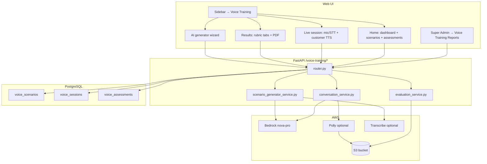

Wired in `main.py` via `VoiceTrainingDependencies` — reuses Bedrock, Polly, **Transcribe** (`transcribe_client` in `core/runtime.py`), S3, auth, and DB from `core/runtime.py`.

**Timestamps:** All voice-training session, assessment, and PDF timestamps use **IST (Asia/Kolkata)** through `utils/timezone_helpers.now_ist()`. The UI formats dates via `formatDateIST` / `formatDateTimeIST` in `static/script.js` and `parseVtIsoDate()` in `static/voice_training.js`.

### Access by role

| Role | UI | API |
|------|-----|-----|
| **Trainer** | Sidebar → **Voice Training**; create/edit scenarios; **Configure Assessment** + **Publish** modals; **My Graded Assessments** with filter (All / My assessments / Trainee assessments); trainee scores on published scenario cards | All `/voice-training/*` except admin reports and `/trainee/scenarios` |
| **Super Admin** | Same as trainer + **Voice Training Reports** tab; preview/edit any scenario; view any assessment/PDF | All endpoints including `GET /voice-training/admin/reports` and admin delete/restore |
| **Trainee** | Sidebar → **Voice Training** (when scenarios published); **Training Scenarios** grid with publisher banner; **My Completed Assessments** table | `GET /trainee/scenarios`, session/assessment routes for **published** scenarios only; no create/publish/admin |

### Publish and assessment gating

Trainers publish scenarios to trainee batches or individual trainees via modal UI (no browser `prompt()`). Flow:

```text
1. Trainer creates/edits scenario → Configure Assessment (min practice, max attempts, pass %).
2. Publish → select batches and/or individual trainees → confirm audience summary.
3. Trainees receive notification; scenario appears on trainee Voice Training home.
4. Trainee must complete required practice session(s) — opening practice alone does not count;
   session must reach conversation_complete and be submitted via POST /sessions/{id}/complete.
5. Assessment unlocks → trainee takes graded call → View results + PDF per attempt.
6. Pass at/above pass_percentage within max attempts → assessment frozen (no further retakes).
7. Unpublish / republish / audience change → trainee progress cleared for affected trainees.
```

| Action | Behavior |
|--------|----------|
| **Configure Assessment** | Sets `min_practice_sessions`, `max_assessment_attempts`, `pass_percentage` in scenario content. If `min_practice_sessions` is **0**, **Practice** is disabled for published **trainees** only (trainers/admins can still practice) and assessment unlocks immediately |
| **Publish** | Sets `is_published`, audience (`batch_ids`, `trainee_ids`), `published_by`, `published_at` |
| **Manage trainees** | Add/remove audience; removing all trainees unpublishes and clears progress |
| **Republish** | Clears practice sessions + assessments for all current audience trainees |
| **Pass freeze** | `get_assessment_pass_status()` blocks new assessment starts when passed |

---

### VT end-to-end workflow

```text
1. Trainer opens Voice Training → dashboard stats and scenario grid load.
2. Scenarios:
   a. Auto-generate standard categories (Bedrock) via toolbar or first visit (if VOICE_TRAINING_AUTO_GENERATE=true).
   b. AI Generator wizard — 4-step flow: category → prompt → optional files → review & create.
   c. Rich upload — PDF/DOCX/TXT/WAV/MP3; audio transcribed with AWS Transcribe (speaker diarization → Agent/Customer lines) or paired `.txt` transcript. **File-primary mode:** uploaded content drives the scenario timeline (names, amounts, dialogue); category is a tag only. Generic AI templates are not used when uploads are present.
3. Preview scenario — Overview / **Full Script** (timeline) / SOP tabs; edit script/SOP; Practice or Assess buttons show an in-button **Loading…** spinner while the scenario loads. Preview stays open with a spinner until the session actually starts (does not close immediately on click).
4. **Practice / Assessment start** — session opens with an **empty conversation**; the **trainee (agent) speaks the opening greeting first**, then the AI customer replies. Practice: hints, suggested replies, SOP checklist. Assessment: no hints/suggestions; trainee responds in their own words. Both modes use **AWS Transcribe** for voice replies (browser Web Speech for live preview); typed input fallback.
5. **Off-script hold (`script_hold`)** — if the trainee reply drifts too far from the expected beat (no thematic/paraphrase match), the customer **does not advance**; the turn is not saved; UI shows a warning/toast and practice re-shows the suggested line. Closing-phase and certain service prompts are exempt.
6. **Cancel Assessment** — returns to Voice Training home with **no score** (`POST /sessions/{id}/cancel`). **Submit for evaluation** requires at least one agent turn; empty sessions are rejected (no phantom ~60% scores).
7. Submit for evaluation → `POST /assessments/evaluate` → rubric scoring + SOP compliance + contextual turn analysis → PDF stored in S3.
8. Results UI — Summary, Evaluation, Context, Transcript tabs; download PDF (regenerated on each request).
9. Super Admin — org-wide reports; archive scenarios; edit scenarios (owner notified).
```

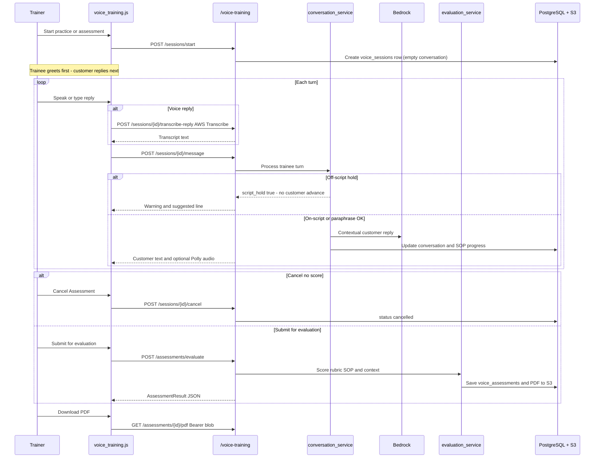

### Scenario categories

| Category | Code | Description |
|----------|------|-------------|
| Billing Disputes | `billing_disputes` | Renewal pricing, charges, refunds |
| Technical Troubleshooting | `technical_troubleshooting` | Product issues, setup, errors |
| Escalations | `escalations` | Angry customers, supervisor requests |
| Account Activation | `account_activation` | New accounts, verification, onboarding |
| Custom | `custom` | User-defined category label and use case |

Each scenario includes: `title`, `description`, `customer_persona`, `success_script` (25–30 short alternating customer/agent turns after repair), `sop_activities` (checklist with keywords), and `opening_sentiment` (`frustrated` for new/generated scenarios).

**Script repair on load:** When a scenario is opened or listed, `scenario_repository._prepare_scenario_data()` runs `repair_script_continuity()` — fixes dialogue flow, removes duplicate summaries/closings, pads to `MIN_SCRIPT_TURNS` (25), and persists the repaired script back to RDS when changed.

**Trainer data isolation:** `GET /scenarios` and staff scenario management endpoints scope listings and mutations to `author_id == current_user.id`. Super Admin org-wide reports remain under `GET /admin/reports`.

### Session modes

| Mode | Trainee opens | Hints | Suggested replies | Scored | Use case |
|------|:-------------:|:-----:|:-----------------:|:------:|----------|
| **Practice** | Yes | Yes | Yes | No | Learn the script and SOP flow |
| **Assessment** | Yes | No | No | Yes | Graded call simulation |

Both modes start with an **empty transcript**; the **trainee greets first**, then the AI customer responds. Assessment has **Cancel Assessment** (exit without score) and **Submit for evaluation** (graded only after at least one agent utterance).

#### Off-script hold (`script_hold`)

| Behavior | Detail |
|----------|--------|
| Gate | `script_turns.should_hold_for_script_drift` / `agent_follows_expected_script` — requires **strong topic overlap** (not weak words alone like "what"/"which") against the expected agent line |
| On hold | Trainee turn **not** saved; **no** customer reply; `script_hold: true` + reason; practice re-shows suggested response |
| Continues | Near-match / paraphrase of the expected beat (e.g. "Can you tell me your first pet's name?" for a pet security question) |
| Does **not** continue | Unrelated questions (e.g. "What is MCP?") that only share filler words with the script |
| Exempt | Missing expected line, closing phase, certain resolution/goodbye prompts |
| Safety net | If an off-script turn somehow reaches customer generation, `resolve_customer_turn_text` returns a redirect nudge — never the next scripted customer beat |
| UI | Warning toast + status bar; conversation history stays on the same customer beat |

#### Practice timeline = preview script

| Rule | Implementation |
|------|----------------|
| Suggested reply | Exact next trainee line from the preview timeline (`get_practice_guidance`) — not shortened/rewritten |
| Customer replies | Advance in preview order (`skip_filler=False`); billing follow-up beats (statement match, timing, etc.) are **not** skipped |
| Empathy | Strong scripted empathy (e.g. "I'm sorry you're dealing with this billing issue…") is preserved through `repair_dialogue_flow`; weak "I understand…" spam is replaced |
| SOP cues | `map_sop_to_script_cues` maps Verify Identity to security/pet questions, not monitoring tips |
| Turn counter | `count_expected_session_turns` matches playable canonical beats |
| TTS dates | Ordinals like "15th" / "October 19th" spoken as words (`tts_helpers.py` + Polly / browser TTS) |

#### Live session UI (current)

| Visible | Hidden / unused in live stage |
|---------|-------------------------------|
| SOP checklist, practice hints, conversation history (auto-scroll to latest), suggested reply (practice), reply dock + mic, processing status spinner | Escalations/context card, “Customer says” card, sentiment ring (session context data still feeds sidebar SOP/hints) |

Practice / Assessment / Preview buttons show a small **in-button spinner** (`setActionButtonLoading`) while loading, across trainer, trainee, and super-admin entry points.

### VT script repair and name roles

Every scenario (billing, technical, custom, escalation, file-primary upload, etc.) is normalized through `repair_script_continuity` in `script_turns.py`. List and detail loads in `scenario_repository.py` **always** run this repair so existing stored scripts pick up fixes without regeneration.

| Concern | Behavior |
|---------|----------|
| **Customer vs agent names** | Customer has one real first name (from self-intro or `customer_persona` / description). Agent has a **different** name only if a trainee turn introduces it (e.g. `My name is Alex` / `this is Alex from…`). |
| **Closing thanks** | After the summary, the customer thanks the **agent** (`That sounds great, Alex — …`). Never the customer's own name (`That sounds great, Jane` when Jane is the caller). |
| **Severity / mood words are not names** | Phrases like `this is critical`, `this is urgent`, `this is ridiculous!` are complaint language — **not** name intros. Blocked tokens include `critical`, `urgent`, `frustrated`, `ridiculous`, `unacceptable`, `absurd`, and similar. |
| **Empathy / summary address** | Agent lines must not address the caller as a mood word (`I hear your frustration, ridiculous` → strip or replace with the real persona name). Closing summary is `To summarize:` or `To summarize, {RealFirstName}:` — never `To summarize, ridiculous:`. |
| **Persona injection** | If the persona has a real first name and the first customer turn never introduces it, repair injects `Hi, this is {Name}.` |
| **Duplicate agent thanks** | Collapses `Thanks …, Jane. Thank you, Jane.` into a single thanks. |
| **Manual edits** | Scenarios marked `script_editor_preserved` skip automatic continuity rewrite (normalize only). |
| **Generation prompts** | `bedrock_service._voice_dialogue_rules_block()` encodes the same name-role rules for future AI / custom / transcript scenarios. |
| **UI safety net** | Preview applies `repairScriptNameRoles()` in `voice_training.js` (escaped regex; text-only) so Full Script timeline never shows false names even if a stale payload slips through. |

### VT backend module

All files under `utils/voice_training/`:

| File | Purpose |
|------|---------|
| `__init__.py` | Exports `VoiceTrainingDependencies`, `create_voice_training_router` |
| `router.py` | REST API (`/voice-training/*`); role guards; session ownership checks |
| `dependencies.py` | Frozen dataclass injecting logger, auth, DB, AWS clients, ORM models |
| `config.py` | `VOICE_TRAINING_*` env settings (Polly, AWS agent STT, transcribe language, auto-generate, rubric weights) |
| `schemas.py` | Pydantic models: scenarios, sessions, assessments, enums, requests (IST default timestamps) |
| `storage.py` | `VoiceTrainingStore` — PostgreSQL CRUD + S3 upload/download |
| `scenario_repository.py` | DB-backed scenario repo; process-scoped listing; **always runs `repair_script_continuity` on list/get** (persists on detail get when script changes) |
| `scenario_helpers.py` | `scenario_to_summary()` for API list responses |
| `scenario_uniqueness.py` | Org-wide dedupe: avoid-list prompts + similarity checks before generation |
| `scenario_generator_service.py` | Bedrock scenario generation (`ai_auto` or `prompt_guided`); **file-primary** path from uploads |
| `fallback_scenarios.py` | Built-in templates when Bedrock fails or is unavailable (skipped when uploads are present) |
| `bedrock_service.py` | Bedrock prompts for scenario JSON, **transcript-first** generation from uploads, contextual customer replies, prompt examples; **name-role rules** in shared dialogue block |
| `conversation_service.py` | Session lifecycle, trainee/customer turns, **off-script hold (`script_hold`)**, hints, Polly TTS, contextual customer sync |
| `script_turns.py` | Script normalization, `MIN_SCRIPT_TURNS=25`, dialogue repair, **name-role repair**, **empathy preservation**, **timeline-aligned practice** (`skip_filler=False`), **script-drift hold**, fact extraction, closing/summary dedupe, guidance helpers |
| `polly_service.py` | Amazon Polly TTS → S3 MP3; customer SSML prosody; date/ordinal expansion via `tts_helpers` |
| `transcribe_service.py` | AWS Transcribe — **live agent replies** (streaming STT, batch fallback) and **uploaded audio** (speaker diarization, SSRF-safe result fetch, S3 audio retained) |
| `transcript_parser.py` | Parse labeled/numbered transcripts and diarized turns into `success_script` turns; file-primary detection |
| `document_parser.py` | Extract text from PDF/DOCX/TXT/MD/CSV (preserves line breaks for transcript parsing) |
| `evaluation_service.py` | Post-call rubric scoring → `AssessmentResult` |
| `evaluation_context.py` | Contextual turn analysis, SOP keyword matching, empathy/tone markers |
| `evaluation_rubric.py` | 11-parameter rubric matrix + grade mapping (A–F) |
| `assessment_helpers.py` | Coerce stored JSON to valid `AssessmentResult` for PDF/API |
| `transcript_summary.py` | Human-readable call summary, highlights, key actions |
| `pdf_service.py` | ReportLab multi-page SOP-style assessment PDF (IST timestamps in headers/footers) |
| `publish.py` | Publish audience resolution, assessment gating, practice/assessment access, publisher metadata |
| `notifications.py` | Trainee/trainer notifications for publish, pass/fail, admin actions |
| `tts_helpers.py` | Shared TTS text cleanup; expands ordinals/dates/emails to spoken words; linear email span finder (ReDoS-safe) for Polly/browser speech |
| `s3_keys.py` | S3 key builders under `{user_id}/voice_training/` |

ORM models in `models/domain.py`: `VoiceScenario`, `VoiceSession`, `VoiceAssessment` (all use `now_ist()` column defaults).

### VT frontend integration

| Asset | Purpose |
|-------|---------|
| `templates/index.html` | `#voice-training-view` — home, session, results; preview modal; AI generator modal |
| `static/voice_training.js` | Voice Training SPA — API client, views, speech/STT hybrid, empty-speech fast-fail, auto-scroll transcript, button loading spinners, off-script hold UI, **name-role preview repair**, publish modals, admin hooks, IST dates |
| `static/script.js` | Role nav (`nav-voice-training`); `switchView('voice-training')`; admin reports tab; My Modules course delete; shared IST/`escapeHtmlText` helpers |
| `static/style.css` | `.vt-*` styles — layout, cards, session history scroll, reply status spinner, button loading |

`voice_training.js` loads **after** `script.js` so JWT-authenticated `window.apiCall()` is available. PDF downloads use `vtApiBlob()` with Bearer token (not raw `<a href>`). Button loading restore uses `WeakMap` + `cloneNode` / `replaceChildren` (no `innerHTML` from dataset). Fact chips and script bubbles render through `escapeHtml()`.

#### UI views and key elements

| View / container | ID | Features |
|------------------|-----|----------|
| **Home** | `#vt-home-view` | Hero stats, dashboard KPIs (Mastered, Assessments, Avg Empathy, SOP Compliance), **My Graded Assessments** table (trainee: all attempts; trainer: filter All/My/Trainee), scenario grid with **Shared by** banner (trainees), category filter, archive toggle, AI generate button |
| **Live session** | `#vt-session-view` | SOP sidebar (`#vt-sop-list`), hints (practice), **conversation history** (`#vt-transcript`, auto-pins to latest), mic + processing status spinner; assessment: **Cancel Assessment** + **Submit for evaluation**. Context / Customer Says cards hidden to maximize history space. |
| **Results** | `#vt-results-view` | Score gauge, grade, tabs: Summary / Evaluation / Context / Transcript, PDF download |
| **Preview modal** | `#vt-preview-modal` | Overview, Full Script (timeline with turn navigation; name-role repair applied on load), SOP tabs; edit script; Practice / Assess stay open with spinner until session start; super admin edit without practice |
| **Generator modal** | `#vt-generator-modal` | 4-step wizard: category → prompt/examples → file dropzone → review |
| **Admin reports** | `#admin-voice-training-reports-tab` | Org-wide scenarios, sessions, assessments; Preview, Edit, View assessment, PDF |

#### Speech and audio

| Feature | Implementation |
|---------|----------------|
| Trainee voice input (practice/assessment) | **Primary:** AWS Transcribe via `POST /voice-training/sessions/{id}/transcribe-reply` (MediaRecorder → server; streaming with batch fallback). **Parallel:** browser Web Speech API for live “You’re saying” preview. **Pick:** prefer AWS transcript; use browser text if AWS empty/fragmentary (`pickAgentTranscriptText`). **Typed** input always available. |
| Empty / silent speech | Fast-fail: short silent recording with no browser preview → “No speech detected” (no long AWS wait). No browser preview → one AWS attempt (~3.5s). With browser preview → configured wait (`VOICE_TRAINING_AGENT_STT_MAX_WAIT_MS`, default 12s) and up to 2 attempts. |
| Status UX | Processing spinner only in the **status bar** above the mic (not on the mic icon). Practice/Assess/Preview show in-button loading spinners while starting. |
| Customer voice | Amazon Polly via `GET /voice-training/audio/{session_id}/{turn_id}` when `VOICE_TRAINING_USE_POLLY=true`; else browser TTS |
| Agent hint voice | Polly or browser TTS for suggested practice lines |
| Autoplay | AudioContext unlock pattern for browser autoplay policies |

**How to confirm AWS STT in the browser console:** after each mic turn you should see successful `POST /voice-training/sessions/.../transcribe-reply` before `POST .../message`. `GET /voice-training/health` reports `agent_stt_mode: "aws_transcribe"` when `VOICE_TRAINING_USE_AWS_AGENT_STT=true` (default) and Transcribe is configured.

### VT data model and storage

#### PostgreSQL tables

| Table | Key columns | JSON `content` holds |
|-------|-------------|----------------------|
| `voice_scenarios` | `id`, `author_id`, `process_id`, `category`, `title` | Full `ScenarioScript`: script turns, SOP activities, persona, archive flags |
| `voice_sessions` | `id`, `user_id`, `scenario_id`, `mode`, `status` | Conversation turns, sentiment, hints used, voice metrics, SOP progress |
| `voice_assessments` | `id`, `user_id`, `session_id`, `scenario_id`, `pdf_s3_key`, `final_percentage`, `grade` | `AssessmentResult` + metadata (turn analysis, sop_activities, transcript_summary) |

**Scoping:** Scenarios are filtered by user's `process_id` plus global scenarios (`process_id IS NULL`).

**Archive:** Soft delete via `content.archived = true` in scenario JSON (not row deletion). Restore via `POST /scenarios/{id}/restore`.

#### S3 layout (`s3_keys.py`)

```text
{user_id}/voice_training/scenarios/{scenario_id}/docs/{filename}
{user_id}/voice_training/sessions/{session_id}/tts/{turn_id}.mp3
{user_id}/voice_training/assessments/{assessment_id}_report.pdf
{user_id}/voice_training/transcribe/{job_id}/{filename}
```

No local file persistence — all assets go to the shared Smart Tutor S3 bucket.

### VT evaluation rubric and PDF

#### Rubric parameters (11 total)

| Category | Parameter | Weight env var |
|----------|-----------|----------------|
| Intent Understanding | Intent Accuracy | `VOICE_TRAINING_WEIGHT_INTENT` (0.15) |
| Resolution | Issue Resolution | `VOICE_TRAINING_WEIGHT_RESOLUTION` (0.20) |
| SOP Compliance | Process Adherence | `VOICE_TRAINING_WEIGHT_SOP` (0.20) |
| SOP Compliance | Hallucination Control | (shared SOP weight) |
| Tone | Politeness | `VOICE_TRAINING_WEIGHT_TONE` (0.15) |
| Tone | Empathy | (shared tone weight) |
| Tone | Professionalism | (shared tone weight) |
| Voice Quality | Speech Clarity | `VOICE_TRAINING_WEIGHT_VOICE` (0.10) |
| Voice Quality | Speech Pace | (shared voice weight) |
| Dialogue Management | Conversation Flow | `VOICE_TRAINING_WEIGHT_DIALOGUE` (0.10) |
| Performance | Response Time | `VOICE_TRAINING_WEIGHT_PERFORMANCE` (0.10) |

**Grades:** A ≥ 90%, B ≥ 80%, C ≥ 70%, D ≥ 60%, F &lt; 60%.

**Additional metrics:** SOP compliance rate, FCR (first contact resolution), sentiment start → end, contextual turn match %.

**Empty-session guard:** Evaluation requires at least one trainee (agent) turn. Sessions with zero agent speech return HTTP 400 — no default metric inflation. Cancelled sessions (`status=cancelled`) are never scored.

#### PDF report structure (`pdf_service.py`)

Multi-page ReportLab document with headers/footers:

1. **Cover** — scenario title, grade box, KPI row (SOP %, FCR, sentiment, context match, turns)
2. **Call summary** — outcome bar, narrative, **Key Highlights** (✓ Strengths / × Areas to Improve / missed SOP bullets), **Agent Actions**
3. **Metrics** — rubric table by category with scores and progress bars
4. **SOP Compliance & Coaching** — checklist table (Activity, Description, Required, Status); coaching boxes
5. **Turn analysis** — per-turn context match, keywords, empathy markers (when available)
6. **Transcript** — full conversation with speaker labels

PDFs are **regenerated on every download** via `coerce_assessment_result()` + `generate_assessment_pdf_bytes()` (not served from stale S3 only). PDF generation failures return a generic HTTP 500 message; details are logged with `log_safe()`.

### VT API reference

**Base prefix:** `/voice-training`  
**Auth:** JWT on every route (`Depends(get_current_user)`). Trainees may only access published scenarios and their own sessions/assessments.

| Method | Path | Roles | Description |
|--------|------|-------|-------------|
| GET | `/health` | trainer, super_admin, trainee | Bedrock/Polly/Transcribe status, `agent_stt_mode`, scenario count |
| GET | `/dashboard` | trainer, super_admin, trainee | Stats: mastered scenarios, empathy, SOP compliance, assessments |
| GET | `/scenarios` | trainer, super_admin | List **own** scenarios (`author_id` scoped); query: `category`, `include_archived`, `archived_only` |
| GET | `/trainee/scenarios` | **trainee** | Published scenarios visible to current trainee (includes `publisher` metadata) |
| GET | `/scenarios/{scenario_id}` | trainer, super_admin, trainee¹ | Full scenario detail |
| GET | `/scenarios/{scenario_id}/access` | trainer, super_admin, trainee¹ | Practice/assessment access flags and block reasons |
| GET | `/scenarios/{scenario_id}/assessment-config` | trainer, super_admin | Read assessment configuration |
| POST | `/scenarios/{scenario_id}/assessment-config` | trainer, super_admin | Configure min practice, max attempts, pass % |
| POST | `/scenarios/{scenario_id}/publish` | trainer, super_admin | Publish to audience; republish clears trainee progress |
| GET | `/scenarios/{scenario_id}/publish-audience` | trainer, super_admin | Current audience summary (batches + trainees) |
| POST | `/scenarios/{scenario_id}/publish-audience/update` | trainer, super_admin | Update audience; clears progress for removed trainees |
| GET | `/trainer/trainee-assessments` | trainer, super_admin | All trainee assessment attempts for trainer's published scenarios |
| POST | `/scenarios/{scenario_id}/update` | trainer, super_admin | Update title, script, SOP; super_admin edit notifies author |
| POST | `/scenarios/{scenario_id}/delete` | trainer, super_admin | Soft-archive scenario |
| POST | `/scenarios/{scenario_id}/restore` | trainer, super_admin | Restore archived scenario |
| POST | `/scenarios/prompt-examples` | trainer, super_admin | Bedrock prompt suggestions for generator |
| POST | `/scenarios/generate` | trainer, super_admin | JSON body — Bedrock scenario generation |
| POST | `/scenarios/generate-rich` | trainer, super_admin | Multipart: prompt + optional PDF/DOCX/TXT/audio |
| POST | `/sessions/start` | trainer, super_admin, trainee¹ | Start practice or assessment session (empty conversation; agent opens) |
| POST | `/sessions/{session_id}/transcribe-reply` | owner² | Transcribe agent voice reply (multipart audio → AWS Transcribe streaming) |
| POST | `/sessions/{session_id}/message` | owner² | Send trainee utterance; receive customer reply |
| GET | `/sessions/{session_id}` | owner² | Get session state |
| POST | `/sessions/{session_id}/cancel` | owner² | Abandon session without evaluation (`status=cancelled`) |
| POST | `/sessions/{session_id}/complete` | owner² | Mark practice session complete (required for practice gating) |
| POST | `/assessments/evaluate` | owner² | Score assessment session (requires ≥1 agent turn); generate PDF |
| GET | `/assessments` | trainer, super_admin, trainee | List current user's graded assessments |
| GET | `/assessments/{assessment_id}` | owner³ | Assessment JSON detail |
| POST | `/assessments/{assessment_id}/delete` | owner³ | Delete user's assessment + PDF |
| GET | `/assessments/{assessment_id}/pdf` | owner³ | Download assessment PDF (blob) |
| GET | `/audio/{session_id}/{turn_id}` | owner² | Stream Polly MP3 from S3 |
| GET | `/admin/reports` | **super_admin** | Org-wide scenarios, sessions, assessments |
| POST | `/admin/scenarios/{scenario_id}/delete` | **super_admin** | Archive scenario + notify author |
| POST | `/admin/scenarios/{scenario_id}/restore` | **super_admin** | Restore archived scenario |
| POST | `/admin/scenarios/{scenario_id}/permanent/delete` | **super_admin** | Permanently delete scenario |
| POST | `/admin/assessments/{assessment_id}/delete` | **super_admin** | Delete any user's assessment |
| POST | `/admin/scenarios/bulk-archive` | **super_admin** | Archive multiple scenarios + notify authors |
| POST | `/admin/scenarios/bulk-permanent-delete` | **super_admin** | Permanently delete multiple scenarios |
| POST | `/admin/assessments/bulk-delete` | **super_admin** | Delete multiple assessments |
| POST | `/scenarios/{scenario_id}/permanent/delete` | trainer, super_admin | Permanently delete own scenario |

¹ Trainee only if scenario is published to them (`scenario_visible_to_trainee`).  
² Session owner required; super_admin bypasses ownership check.  
³ Assessment owner or super_admin.

### VT configuration

Add to root `.env` (see `utils/voice_training/config.py`):

| Variable | Default | Purpose |
|----------|---------|---------|
| `VOICE_TRAINING_USE_POLLY` | `true` | Amazon Polly for customer/agent voice; `false` = browser TTS |
| `VOICE_TRAINING_USE_AWS_AGENT_STT` | `true` | **Agent live speech-to-text** in practice/assessment — AWS Transcribe (streaming); `false` = browser Web Speech API only |
| `VOICE_TRAINING_TRANSCRIBE_LANGUAGE` | `en-IN` | Transcribe language for agent replies and uploads (`en-US` for US English) |
| `VOICE_TRAINING_AGENT_STT_MAX_WAIT_MS` | `12000` | Browser wait (ms) for AWS Transcribe before browser STT fallback |
| `VOICE_TRAINING_POLLY_VOICE` | `Joanna` | Agent/hint Polly voice |
| `VOICE_TRAINING_POLLY_CUSTOMER_VOICE` | `Ruth` | Customer Polly voice |
| `VOICE_TRAINING_POLLY_ENGINE` | `neural` | Polly engine (`neural` or `standard`) |
| `VOICE_TRAINING_AUTO_GENERATE` | `true` | Auto-generate standard scenarios on first access |
| `VOICE_TRAINING_WEIGHT_INTENT` | `0.15` | Rubric category weight |
| `VOICE_TRAINING_WEIGHT_RESOLUTION` | `0.20` | Rubric category weight |
| `VOICE_TRAINING_WEIGHT_SOP` | `0.20` | Rubric category weight |
| `VOICE_TRAINING_WEIGHT_TONE` | `0.15` | Rubric category weight |
| `VOICE_TRAINING_WEIGHT_VOICE` | `0.10` | Rubric category weight |
| `VOICE_TRAINING_WEIGHT_DIALOGUE` | `0.10` | Rubric category weight |
| `VOICE_TRAINING_WEIGHT_PERFORMANCE` | `0.10` | Rubric category weight |

**Shared infrastructure** (same as main app): `AWS_ACCESS_KEY_ID`, `AWS_SECRET_ACCESS_KEY`, optional `AWS_SESSION_TOKEN` (temporary keys), `AWS_REGION`, `S3_BUCKET_NAME`, PostgreSQL (`DB_*` / `POSTGRES_*` / `username`+`password`), JWT (`JWT_SECRET_KEY`), optional SSO (`SSO_PROVIDER`, MSAL `TENANT_ID`/`CLIENT_ID`, Okta `OKTA_CLIENT_ID`/`OKTA_ISSUER`), `SUPER_ADMIN_EMAIL` / `SUPER_ADMIN_PASSWORD`. Bedrock: generation/vision `amazon.nova-pro-v1:0`, embeddings `amazon.titan-embed-text-v2:0` (configured in `core/runtime.py`). AWS Transcribe client is initialized in `core/runtime.py` as `transcribe_client`. IAM role needs `transcribe:StartStreamTranscription` (live agent STT), `transcribe:StartTranscriptionJob` / `GetTranscriptionJob` / `DeleteTranscriptionJob` (uploads and batch reply fallback), and `s3:PutObject` / `s3:GetObject` on `{bucket}/*/voice_training/transcribe/*`. Server requires **ffmpeg** (via `pydub`) to convert browser WebM/M4A recordings to PCM for streaming **and** for Video Analysis. For uploads, you can alternatively provide a paired `.txt` transcript with audio files.

---

## Collaboration and sharing

| Step | Owner | Recipient |
|------|-------|-----------|
| 1 | Share from My Modules | — |
| 2 | — | Notification → Shared With Me |
| 3 | — | Study; optionally **Propose Edit** |
| 4 | **Review Center** pending edits | — |
| 5 | Approve → merged + re-indexed | Reject → no change |

- **Same-process only** for trainer-to-trainer sharing.
- Trainees receive access only via **publish**, not shares.
- Super Admin shares logged in **Sharing Log**.

---

## Notifications and Review Center

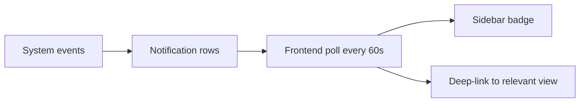

| Trigger | Recipient |
|---------|-----------|
| Trainer signup | Super Admin |
| Trainer approved/rejected | Trainer |
| Course published | Trainee |
| Admin edited questions | Owner trainer |
| Share / edit proposal | Recipient / owner |
| Attempt request | Trainer |
| Attempt approved/denied | Trainee |
| Voice scenario published / republished | Trainee audience |
| Voice assessment pass / fail | Trainee (+ trainer on pass freeze) |
| Super Admin edited / archived / deleted voice scenario | Scenario author |
| Super Admin deleted course / module | Owner trainer (+ shared recipients when applicable) |
| Video Analysis report indexed (org) | Super Admin Chat with Reports catalog |

**Review Center:** Content owners approve or reject **module** and **question** edit proposals from share recipients.

---

## Analytics and token tracking

### Architecture

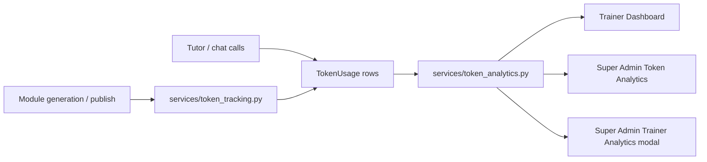

| Operation type | Tracked |
|----------------|---------|
| Module text | Document processing tokens |
| Module vision | Image analysis tokens |
| Tutor | Per-module explanation queries |
| Chat | Agent conversation tokens |

- **`get_user_token_analytics()`** — shared aggregation for trainer list, super admin tabs, and trainer detail modal (aligned totals).
- **Chat backfill** — idempotent repair for legacy over-count rows.
- **Per-course Total** = text + vision + tutor + chat for that course.

### Module counts and dashboard latency

Almost every tab in the product shows a module count — "3 / 8 modules", a completion ring, a token cost per course. That number is **not in Postgres**: a generated module is an S3 object at `{author_id}/generated_reports/{module_id}.json`, and the course it belongs to is recorded *inside* the object body (`course_id`, with a legacy `source_doc` fallback for modules generated before that field existed). The only way to count a course's modules is therefore to read the author's report metadata.

Each caller used to do that for itself: list the prefix, then one `get_object` per JSON, **once per course**. A trainee with N courses cost N × (1 + M) S3 round-trips, and the token analytics tabs — which walk every course of every trainer — cost trainers × N × (1 + M). Since the same prefix also holds **video-analysis** reports, M grows with activity that has nothing to do with courses. Past a few hundred sequential round-trips the request outlives the 30 s the browser waits (`API_FETCH_TIMEOUT_MS` in `static/script.js`), the call is aborted, and the user sees *"Request timed out. The server may be busy."*

`services/module_index.py` replaces that with **one pass per author per request**:

- **Read once, share within the request.** The index is cached on `Session.info`, and `get_db()` creates a Session per request and closes it after, so the cache lives exactly as long as one HTTP request. It is deliberately **not** a TTL cache: nothing survives the request, so a module generated or deleted since the previous request is counted immediately and the numbers are never stale.
- **Fetch concurrently.** The metadata objects are tiny — latency, not payload, is the cost — so they are fetched on a thread pool (`S3_METADATA_MAX_WORKERS`) over a widened connection pool (`S3_MAX_POOL_CONNECTIONS`). boto3 *clients* are thread-safe; resources are not, and none are used here.
- **No course logic in the index.** It returns raw `(s3_key, metadata)` pairs, because the callers genuinely disagree on the rules: `get_total_modules_count()` matches a legacy module by **exact** normalized document name, the analytics tabs and `_count_course_modules_s3()` also accept **either substring**, and `get_trainee_batch_summary()` matches on `course_id` only. Each rule stayed at its own call site, which is what makes the counts identical to before rather than merely similar.
- **Invalidation where metadata is rewritten.** `POST /super-admin/migrate-module-metadata` rewrites the very objects the index caches, so it calls `invalidate_author_report_metadata(db)` when done. That endpoint keeps its own direct scan, since it writes inside its loop.
- **Caches built *on* the index are invalidated with it.** The routers memoise module counts per course on the same `Session.info` (`_module_count_by_course`, `_s3_module_counts`, `_admin_loose_module_count_by_course`), which are only valid while the index they were computed from is. Rather than have each write path remember those key names — the list that went stale the moment a fourth cache was added — the owners call `register_derived_cache_key()` at import time and `invalidate_author_report_metadata()` clears every registered dict. It clears them **whole and in place**: whole because they key by course while invalidation is by author, in place so a caller already holding the dict sees it empty.
- **One S3 pass per author, up front.** `prefetch_s3_module_counts(db, author_ids)` runs `build_s3_module_counts_for_authors` once for a page and seeds both caches, so Trainee *My Courses* / *My Stats*, Super Admin → *All Users* → selected trainee, and the trainer's trainee-progress views no longer re-filter the index once per course. The batched counter reproduces `get_total_modules_count`'s rule exactly, including the case that rule makes easy to miss: because it tests `source_doc in course_docs_normalized` **per course**, a legacy module of a document that two multi-document courses both list counts for **both**. The document → course map is therefore a `defaultdict(set)`, not first-wins.

The same request also lost the per-attempt and per-trainee `db.query()` calls in the four heaviest endpoints (trainee dashboard and stats, `/super-admin/courses-analytics`, `/super-admin/trainee-analytics`), replaced by grouped pre-queries and `joinedload`, and a `db.commit()` was moved out of the trainee-dashboard loop — committing mid-loop expired every eagerly loaded course and author, forcing a re-fetch on the next iteration.

A timed-out request is also no longer drawn as an empty result. `apiCall` now reports `timedOut`, and `renderLoadFailureState()` shows a failure state with a **Try Again** button, so a slow dashboard can never again render "No Courses Available" to a trainee who has courses.

`scripts/check_module_index.py` proves both halves: the old per-course scan is reimplemented and run against the same synthetic bucket for all three matching rules (multi-document courses, legacy metadata, unreadable objects, cross-author bleed) and must produce **byte-identical counts**, while every S3 call is counted to show the round-trips collapsing. It also drives the derived caches against a stub bucket — an unregistered dict survives, a registered one is emptied in place, an author-scoped invalidation drops only that author from the index but clears the course-keyed counts whole — and asserts from the router sources that every declared count-cache key is registered and that no write path pops one by hand. A separate fixture with two courses sharing a document pins the batched counter to the per-course rule, which is what caught the shared document being counted once instead of twice.

### One query per page, not one per row

With S3 handled, what was left was the same shape in Postgres, spread across the whole app: a router loaded its rows, then issued a query *inside the loop* for each one — a progress count, an assessment config, the author of a course, the latest attempt of a module. The cost of a page therefore grew with the amount of data it displayed, which is why `/super-admin/users/{id}/trainee-courses` returned an outright **504** for a trainee with a full course list while the same page loaded instantly for a new account.

Every read path now prefetches instead:

- **Group, then look up.** One `group_by` count or one `IN (...)` query per page, collected into a dict (`defaultdict(list)` where a row can repeat), and the loop does dictionary lookups. The batched builders live next to what they serve: `build_trainee_latest_assessments`, `build_trainee_question_sets` and `build_module_assessment_attempts` in `features/assessment/router.py`.
- **Prefetch arguments are optional.** Helpers such as `_is_course_fully_completed`, `_parse_assessment_questions` and `_get_trainee_course_assessment_state` take the maps as keyword arguments that default to `None`, and keep their original query behind `if <map> is None:`. A single-course detail view passes nothing and behaves exactly as before — one course, one query — so batching a dashboard cannot change what a detail page shows.
- **The same row, not merely a similar one.** A batched replacement for `.order_by(completed_at.desc()).first()` reuses that exact ordering and takes the **first row seen** per key. This matters in Postgres, where `ORDER BY completed_at DESC` puts **NULLs first**; a naive "max timestamp" grouping would silently pick a different attempt. Where the comparison itself moved into Python, `_is_newer_assessment()` handles the nullable column explicitly — the old inline `a.completed_at > b.completed_at` raised `TypeError` on a row written before the column was filled, which failed a whole analytics tab rather than one row.
- **Relationships eager-loaded.** `s.sharer.process.name`, `s.recipient.email`, `course.author.email` are lazy loads an audit of `db.query` cannot see, so the sharing log, the shared-reports list and the video-analysis report list attach `joinedload(...)` to the query that fetches the rows.
- **Bulk writes widened, not looped.** `bulk_approve_trainers`, `bulk_reject_trainers`, `add_trainees_to_course`, `publish_course`, `publish_course_enhanced` and `unpublish_course_selective` ran 1–14 statements *per selected user*. They now issue one `IN (...)` statement per table. Where the old code relied on re-querying to notice a row it had just written, the batched version tracks it in the prefetched map, so a trainee listed twice (duplicate batch membership, a repeated id in the form data) is still handled exactly once.

`scripts/check_page_query_batching.py` is the regression guard. It parses **every** function in the repo and fails on any session query inside a loop *body*, with a short allowlist of paths that are not page loads — the destructive "clear all data" cleanup, document processing, startup seeding, the rate-limit settings write, and the deliberate fallback branch in `_get_trainee_course_assessment_state`. Each allowlist entry must still name a function that exists, so a rename cannot widen it. The script also transcribes the batched helpers and compares them against the per-item queries they replace over synthetic rows covering null timestamps, ties, course-level question sets stored under both `NULL` and the `-1` sentinel, rejected attempt requests, and duplicate ids.

### Assessment review reads the record, one attempt at a time

Opening a graded assessment — **View Assessment (21 attempts)** in Super Admin → *All Users* → *View Module Progress*, the trainer's equivalent, or a trainee's own **View results** — used to return nothing but *"Request timed out. The server may be busy"* after three 30 s tries. The attempt count looked like the cause and was not: the routes had always detailed only the focused attempt. Two other things made that GET unbounded, and the per-attempt lazy load that was supposed to cover the rest was only half-wired.

- **Review renders the verdict; it no longer re-derives it.** `_build_trainee_assessment_question_results()` used to rebuild the MCQ answer key at *display* time: when an attempt carried no stored per-question verdict it read the module markdown from S3 (for end-of-course, **every** module, concatenated) and then spent up to two Bedrock calls per MCQ. A 15-question set is up to 30 sequential model calls inside one GET, which is why raising timeouts and batching queries had not helped. Grading already persists `mcq_results` and `resolved_correct_answers` on the attempt at submit time, so the answer was in the row being read — and re-adjudicating was worse than slow, since a fresh answer key could contradict the score printed in the header. The builder is now read-only, and adjudication stays where it belongs, in `grade_trainee_assessment_answers()`.
- **Attempts written before `mcq_results` existed are resolved deterministically.** The fallback prefers the key the grader resolved over the question template and passes **both** sides through `normalize_mcq_selections`, so an answer stored as option *text* compares equal to a stored letter — the rule `_parse_assessment_questions()` in `features/trainer/router.py` already used. The old non-AI branch compared raw upper-cased strings and marked such a row wrong.
- **One attempt, parsed once.** The two reviewer `..._with_history` builders and the trainee end-of-course endpoint built the focused attempt's rows twice — once in the attempt-history builder, then again in `_build_module_assessment_results()` / `_build_course_assessment_results_data()` — and discarded the second copy. Both data builders now take an optional `question_results`, defaulting to `None` so any other caller still builds its own.
- **Older attempts load when their tab is clicked.** All six result routes accept `?attempt_number=N`, and the modal's other tabs render a placeholder — but no client code ever asked for one: `fetchContext` was read in two places and supplied by nobody, so the tabs only toggled CSS and the first tab could sit on a spinner forever. `ensureAttemptQuestionsLoaded()` now fetches exactly the clicked attempt, caches it, and runs once on open for the tab shown first. A tab whose request fails shows its own **Try Again** row rather than a toast, so one bad attempt does not take the modal with it.

All four openers pass `fetchContext` — trainee end-of-module, trainee end-of-course, and the trainer / super-admin views at both scopes — so a trainee with 21 attempts costs the same to open as one with a single attempt, in every role.

`scripts/check_assessment_attempt_lazy_load.py` guards it: the review builder must reach none of the adjudication, S3 or Bedrock entry points and the unused import must be gone; `normalize_mcq_selections` is lifted out of `grading.py` by AST and driven through the fallback's cases (stored flag wins either way, text/letter equivalence, resolved key beats a stale template, an unanswered question is never credited), with source-fragment assertions so the transcription cannot drift from the real branch. Negative controls check the opposite risk — that adjudication still runs at submit time and that nothing loops the attempt list issuing one request per attempt.

### Database connections: pool size, request concurrency, and one real leak

Every role was hitting the same wall on whatever page it happened to be loading:

```
sqlalchemy.exc.TimeoutError: QueuePool limit of size 5 overflow 10 reached,
connection timed out, timeout 30.00
```

Those numbers are SQLAlchemy's **implicit defaults** — `create_engine()` was called without any pool arguments. Against them stands FastAPI's concurrency model: every sync (`def`) endpoint runs in **AnyIO's worker-thread pool, 40 threads by default**, and each of those threads holds its `get_db()` connection for the whole request, including the S3 and Bedrock work inside it. Around forty possible holders against fifteen connections is not a leak, it is a sizing mismatch: the sixteenth concurrent request waited the full `pool_timeout` and then failed, which is what the user saw as *"Request timed out. The server may be busy."*

- **The pool states its own size.** `DB_POOL_SIZE` (20), `DB_MAX_OVERFLOW` (10), `DB_POOL_TIMEOUT` (30 s) and `DB_POOL_RECYCLE` (1800 s) are read through `_env_int_or_default()`, so a blank entry in the secret store falls back to the default instead of taking the process down at import, and each has a floor so a `0` cannot wedge the pool. `pool_pre_ping=True` stays — it is what survives an idle disconnect or an RDS failover — and `pool_use_lifo=True` lets connections opened during a spike go idle and be recycled instead of every socket being kept warm.
- **Concurrency is capped to the pool, not to AnyIO's default.** `_limit_request_concurrency_to_db_pool()` lowers AnyIO's default thread limiter to `REQUEST_THREAD_LIMIT` (defaults to `DB_POOL_SIZE`) at startup — a startup hook rather than module level, because the limiter lives in a run-scoped variable that only exists once the event loop is running. The point is *where* a burst waits: waiting for a **thread** costs nothing and is invisible, while waiting for a **connection** costs a thread, thirty seconds, and then a 500. The overflow is left as headroom for the short side sessions (`log_activity`) and background jobs that check out a connection while a request is already in flight.
- **Capacity is a database number, not an app number.** `(DB_POOL_SIZE + DB_MAX_OVERFLOW) × uvicorn workers` — 30 × 3 = **90** with the shipped defaults and `--workers 3` from the `Dockerfile` — has to stay below the instance's `max_connections`. Raise the workers or the pool and that ceiling moves with it, so the two settings are documented together in `.env`.
- **The app checks that arithmetic itself, at every boot.** `_report_db_connection_budget()` asks the server for `max_connections` and `superuser_reserved_connections`, subtracts a margin for psql/migrations/monitoring, and logs one line: `Database pool budget: 90 connections (30 per worker x 3 workers), 92 usable of max_connections=112 - 2 spare.` If the budget does not fit it logs an **error naming the two values to set** instead of leaving the instance to refuse connections with `FATAL: sorry, too many clients already`, which is both worse than a queue and harder to read in a log. It is diagnostic only — it never changes a setting, and a database that is briefly unreachable at boot costs a warning and nothing else.
- **Nothing has to be configured for this to work.** The five values above are the defaults in code, not entries something has to supply; `.env`, the task definition and the secret can all leave them unset. Re-sizing the pool for a different instance class is then a pure infra change with no code deploy.
- **`async def` endpoints are bounded by the pool, not by the thread limit.** Voice training, video analysis and chat hold their session on the event loop without occupying one of the capped threads, so the thread limit does not cover them. This is why the overflow is never spent on sync requests, and why saturation had to degrade into a retryable 503 rather than a 500.
- **Saturation is a 503, and it says why.** A pool checkout timeout used to fall through to the generic handler as `Unhandled Exception … 500`, which reads like a crash. It is now branched on ahead of that fallback and answered with **503 + `Retry-After: 5`** — a status `apiCall` already retries with backoff — while the log gets `describe_db_pool()`: pool size, checked out, overflow, idle. That line is the diagnosis: the ceiling maxed out means `DB_POOL_SIZE` is genuinely too small for the traffic, a low count means something is holding a session far longer than it should.
- **The one genuine leak was in the agent tools.** `services/knowledge_base.py` keeps a single module-level `tool_context`, and three tools assigned `tool_context.db = SessionLocal()` and then closed the session **through that shared attribute**. Two concurrent tutor questions therefore closed the same session twice and leaked the other one — a connection removed from the pool for the lifetime of the process, so the symptom got worse the more the tutor was used. Each tool now takes its session from `_open_tool_session()`, which publishes it on the context *and returns it*, and closes that local reference in its `finally`. The singleton itself no longer opens a session at import time.

`scripts/check_db_pool_and_polly.py` checks the sizing by AST (every pool argument present, every value env-backed with a floor, `pool_pre_ping` and the `search_path` listener intact, the limiter hook only ever *lowering* the limit) and the rest functionally: a stub 2 + 1 `QueuePool` is driven past its ceiling to prove the class the handler branches on is the class an exhausted pool actually raises, with the same message text as the incident; and both the old and the new session shapes are transcribed and run under an interleaving of two calls, where the old one closes `B` twice and leaks `A` while the new one closes each exactly once.

---

## Cross-role connectivity

### Who triggers what for whom

| From → To | Event | Channel |
|-----------|-------|---------|
| Trainer signup → Super Admin | Approval needed | Notification + Pending Approvals |
| Super Admin → Trainer | Approved / content edited | Notification |
| Trainer → Trainee | Course published | Notification + TraineeAttempt |
| Trainer ↔ Trainer | Share / edit proposal | Shared With Me + Review Center |
| Trainee → Trainer | Extra attempt request | Attempt Requests tab |
| System → Super Admin | Significant actions | Activity Log |
| System → Super Admin | Active sessions | Live Activity |
| Trainer → Self | Voice practice / assessment | Voice Training sidebar |

### Role capability overlap

```mermaid
graph TB
    subgraph SA [Super Admin]
        SA1[Governance]
        SA2[Analytics]
        SA3[All Users KB]
    end
    subgraph TR [Trainer]
        TR1[Content pipeline]
        TR2[Publish]
        TR3[Assessments]
    end
    subgraph TN [Trainee]
        TN1[Learn]
        TN2[Assess]
        TN3[Progress]
    end
    SA -->|approves| TR
    TR -->|publishes| TN
    TR -->|shares| TR
    TN -->|requests attempts| TR
    SA -->|can publish for| TR
    SA -->|views/edits| TR
    SA -.->|also acts as| TR
```

---

## End-to-end lifecycle

### Happy path: document to certified trainee

```text
1. Super Admin creates Process and approves Trainers.
2. Trainer uploads SOP.pdf → AI generates modules → saves to My Modules.
3. Trainer configures end-of-module MCQ assessments → generates questions.
4. Trainer reviews: approves, rejects (archives), regenerates, or edits as needed.
5. Trainer creates Batch "Cohort-A" → publishes course to batch (trainees enrolled immediately; tutor cache warms in the background).
6. Trainees receive notification → open Trainee Dashboard (**My Courses**, newest first; expand a card to see modules).
7. Each trainee: studies Module 1 → Tutor (cached lecture when ready) → passes module quiz → Module 2 unlocks.
8. After all modules → end-of-course quiz (if configured).
9. Trainer monitors Dashboard and batch analytics; Super Admin views Activity Log.
10. Optional: Trainer shares course with peer; owner approves edits in Review Center.
11. Optional: Trainer publishes voice scenarios to trainee batches via **Voice Training** → Configure Assessment → Publish; trainees practice and assess; Super Admin views Voice Training Reports.
```

### Exception paths

| Situation | Resolution |
|-----------|------------|
| Trainer pending approval | Blocked until Super Admin approves |
| Assessment fail, no attempts | Trainee requests extra attempt → trainer/super admin approves or denies |
| Bad generated question | Reject → Restore or Regenerate |
| Question gen cancelled | Generate Questions button remains on course card |
| Published course assessment change | Blocked — unpublish first |
| Long publish / tutor warm-up | Publish returns immediately; tutor cache builds in background (avoids gateway 504) |
| Trainee opens module before cache warm | On-demand lecture, then cached for subsequent opens |
| Page refresh mid-work | Session restore to last view + sub-tab |
| Video analysis cancel mid-process | Idempotent cancel; single toast; returns to upload tab |
| Video analysis export | Auto-index for chat; navigates to New Analysis after PDF/DOCX download |
| Voice assessment cancelled | No score recorded; session `status=cancelled` |
| Voice assessment with no speech | Submit blocked (UI + API 400); use Cancel Assessment |
| Voice practice opened but not submitted | Does not count toward assessment unlock; use Cancel or complete + submit |
| Voice scenario republish / audience change | Trainee practice sessions and assessments cleared for affected trainees |
| Voice assessment pass within max attempts | Assessment frozen; trainee and trainer notified |
| Duplicate PDF upload | Modal: view existing or generate new |
| Module regen missing images | Image catalog merge preserves `[IMAGE:]` tags |
| Create Account reopened after signup | Form reset + `GET /processes` reload (blank fields, process list refreshed) |

---

## Security and code-scan hardening

The platform is hardened for **CodeQL** (`Codescan.yml`) and **SonarQube** (`sonarqubescan.yml`) static analysis. Custom CodeQL sanitizer models in `.github/codeql/security-sanitizers.yml` recognize `log_safe()` and path-validation helpers.

| Pattern | Location | Purpose |
|---------|----------|---------|
| Non-root container (`USER appuser`) | `Dockerfile` | Runtime does not run as root (Sonar `docker:S5674`) |
| Explicit `COPY` paths + `.dockerignore` | `Dockerfile`, `.dockerignore` | Image omits secrets, VCS, CI, local artifacts (Sonar `docker:S6520`) |
| CDN Subresource Integrity | `templates/index.html` | `integrity` + `crossorigin` on showdown / jsdiff CDN scripts |
| `crypto.getRandomValues` particles | `templates/index.html` | Non-predictable UI randomness |
| `escapeHtmlText()` / `escapeHtml()` | `static/script.js`, `static/voice_training.js` | Safe HTML text insertion (incl. `'` → `&#39;`) |
| `sanitizeDomIdToken()` | Trainee My Courses card/module element ids | Safe `getElementById` tokens (alphanumeric / `_` / `-`) |
| `escapeRegExp()` / `escapeReplace()` | `static/voice_training.js` | Safe dynamic RegExp + `String.replace` for name-role repair |
| `escapeAttr()` | Dynamic attributes | Attribute injection prevention |
| `escapeJsSingleQuoted()` | Inline `onclick` handlers | DOM XSS prevention in JS strings |
| `setActionButtonLoading` + `WeakMap` | `static/voice_training.js` | In-button spinners without restoring `innerHTML` from dataset |
| `normalizeAssessmentScope()` | Review Questions UI | Whitelist API enum values |
| `sanitizeNonNegativeInt()` | Display counts | Safe numeric rendering |
| `renderAssessmentMarkdown()` | Question content | Controlled markdown rendering |
| Linear parsers (ReDoS-safe) | `security_helpers`, `tts_helpers`, `script_turns`, `transcript_parser`, `aws_helper`, `pdf_processor`, `video_analysis_*`, KB services | Prefer O(n) scans over nested/backtracking regex (Sonar `python:S5852`) |
| Bounded repetition in client-side extractors | `static/voice_training.js` (`extractFactsFromText`) | The transcript fact-extractor's email pattern uses **bounded** quantifiers (`{1,64}@{1,63}\.{2,24}`) rather than open-ended `+` (Sonar `javascript:S2631`). The unbounded form was measurably quadratic — on a long run of word characters with no matching `@`, the engine retried from every start offset, costing **~4.8 s at 40 k characters** versus ~23 ms bounded. Verified by timing both forms at 5 k/10 k/20 k/40 k and by confirming identical matches on eight real transcript samples, so nothing extractable was traded away for the bound |
| `secrets.choice` | `utils/voice_training/bedrock_service.py` | Cryptographically safer sampling than `random.choice` |
| `log_safe()` / inline CR/LF strip | Python loggers / route args | Log injection prevention (CodeQL / Sonar) |
| `safe_client_error_detail()` | HTTP 400/404 details from `ValueError` | Only short, single-line validation messages; otherwise `GENERIC_API_ERROR_MESSAGE` |
| `_safe_person_token()` / `re.escape` | `utils/voice_training/script_turns.py` | Alphabetic-only name tokens in regex/replacements |
| `GENERIC_API_ERROR_MESSAGE` | HTTP 500 responses | No internal error leakage |
| `SERVICE_UNAVAILABLE_MESSAGE` | HTTP 503 responses (e.g. Bedrock unavailable) | No AWS/internal detail in API body |
| `now_ist()` / `format_ist_iso()` | `utils/timezone_helpers.py` | Consistent IST timestamps (Asia/Kolkata) |
| `validated_real_path_under_base()` / image-tag helpers | `utils/security_helpers.py` | Path traversal prevention; linear `[IMAGE:…]` / markdown image parsing |
| JWT (`JWT_SECRET_KEY`) + optional SSO | `services/auth_platform.py`, `features/general/sso_helper.py` | Password JWT + MSAL or Okta ID-token validation (`SSO_PROVIDER`) |
| Strict token decode | `utils/jwt_access.py` (`decode_access_token`) | Algorithm pinned to HS256 (rejects `alg=none` / RS-confusion); signature verified; `exp`, `iat`, `nbf`, `sub`, `iss`, `aud` all **required**; clock leeway via `JWT_LEEWAY_SECONDS` |
| Short-lived tokens + session timeouts | `core/runtime.py`, `services/auth_platform.py` (`validate_and_touch_session`) | `ACCESS_TOKEN_EXPIRE_MINUTES` (**15**) + idle (`SESSION_IDLE_TIMEOUT_MINUTES`, **60** = 1 h) and absolute (`SESSION_ABSOLUTE_TIMEOUT_MINUTES`, 480 = 8 h) timeouts; logout deactivates the session so a still-signed token is refused. The **token** lifetime stays 15 minutes regardless of the idle window — an active user's token is silently renewed rather than being issued for longer, so a stolen token is never valid for more than 15 minutes |
| Sliding-window renewal — so the idle timeout is the limit that actually binds | `features/general/router.py` (`POST /auth/refresh`), `services/auth_platform.py` (`rotate_session_token`) | The access token **is** the session token, and `get_current_user` validates the JWT *before* touching the session row. A JWT's `exp` is fixed at issue and nothing extended it, so the token always died first: the idle window's clock kept resetting while the token's did not, meaning `SESSION_IDLE_TIMEOUT_MINUTES` could **never fire** and the 8-hour ceiling was unreachable. Every user — including one actively typing — was logged out exactly one token lifetime after signing in, losing unsaved work. `POST /auth/refresh` now exchanges a *still-valid* token for a fresh one and moves the existing session row onto it (`SESSION_REFRESH_ENABLED`, `SESSION_REFRESH_LEAD_MINUTES`). This is not a bypass: the endpoint sits behind the full `get_current_active_user` chain, so an **expired** token cannot be renewed (sign-in required), a **revoked** session cannot be renewed (logout still ends it), and both the idle and absolute windows must still be satisfied. `rotate_session_token` reuses the same row and carries `login_time` over **untouched**, so no amount of refreshing can extend the absolute ceiling — verified by 12 consecutive renewals leaving `login_time` unchanged. Tokens are **rotated, not accumulated**: the previous token is refused the moment a new one is issued. The browser reads the lifetime from server-rendered `<meta>` tags and re-derives each deadline from the token's own `exp`, so changing the env value moves the client timer too |
| True idle logout — 1 idle hour signs the user out, tab open or closed | `static/script.js` (`startIdleWatch`, `onUserActivity`, `resetIdleWatch`), `core/runtime.py` (`CLIENT_IDLE_LOGOUT_MINUTES`, `_env_idle_minutes`), `templates/index.html` | `SESSION_IDLE_TIMEOUT_MINUTES` is enforced against `last_activity`, which `validate_and_touch_session` stamps on **every** authenticated request — and the UI polls `/notifications` once a minute, authenticated, for every role from the moment of login. A tab left open on an unattended machine therefore kept renewing its own idle window: the idle timeout could **never fire**, and only the 8-hour absolute cap bound such a session. Idleness is now measured from **real user interaction** (`mousedown`/`mousemove`/`keydown`/`wheel`/`touchstart`/`scroll`/`click`, plus returning to a hidden tab) rather than from HTTP traffic, so background polling, silent token renewal and the job-status poller deliberately do **not** reset it — a harness asserts each of those four does not call `resetIdleWatch`. After `CLIENT_IDLE_LOGOUT_MINUTES` with no interaction the browser warns for `CLIENT_IDLE_WARNING_SECONDS`, then stops its own polling and renewal **first** and signs out. Stopping its own traffic before logging out is what makes this hold when the tab is *closed* or the client is bypassed: once nothing is polling, `last_activity` stops moving and the **server's** idle timer ends the session by itself — the client half is defence-in-depth and convenience (a clear "signed out after inactivity" message), never the enforcement. Applies to **every** role with no branching; an actively working user is never logged out, because renewal keeps their token fresh. The window is **60 minutes** (30 → 120 → 60 across three requests) and both halves were always moved together — changing only the client value would re-create the original defect, because the poll would keep the server's timer from ever firing. Both halves **fail secure**: only an explicit, well-formed `0` disables the control, while a blank or mistyped value falls back to the server idle timeout — verified against blank/whitespace/garbage/negative/absurd inputs on the client (9 cases) and the server (8 cases), where a bare `int()` would instead have crashed the app at import |
| Session expiry no longer destroys unsaved work | `static/script.js` (`WORK_IN_PROGRESS_KEY_PREFIXES`, `handleLogout`, `saveDraftSilently`) | Three defects were fixed together. (1) Logout wiped **all** non-MSAL `localStorage`, including the assessment drafts written by the 2-minute autosave — a trainee mid-assessment lost answers that had already been "saved"; draft, tutor-progress and results keys are now explicitly preserved, while `authToken` is still always cleared. (2) The in-progress confirmation was gated on the *success-notification* flag, so it ran only on **voluntary** logout and was skipped on the forced 401 path where it was actually needed; a forced expiry now flushes work to storage before reloading, and the cancel-able prompt is reserved for voluntary logout, where cancelling still means something. (3) The tutor's progress was saved and then **immediately erased** by the same routine — the save was inert; work is now flushed *before* the clear, into keys that survive it |
| A generation interrupted by logout is recovered, not lost | `static/script.js` (`rememberActiveGenerationJob`, `checkForInterruptedModuleGeneration`), `services/jobs.py`, `models/domain.py` (`JobStatus`) | Module generation was **never** actually lost server-side: it runs as a background job whose status and finished modules are persisted to the `job_statuses` table, so it keeps running and completes regardless of what the browser does. What was volatile was the browser's in-memory `currentJobId` — once the tab reloaded, a *finished* generation had no UI attached to it and looked exactly like lost work. The job id is now persisted and re-checked after login: a job still `pending`/`running` resumes its progress bar, one that finished while the user was away hands the modules straight back to the curation view, and a stale or unknown pointer is dropped silently. This is why raising `ACCESS_TOKEN_EXPIRE_MINUTES` or `SESSION_ABSOLUTE_TIMEOUT_MINUTES` is **not** the fix for data loss and would only weaken the timeouts — the durable state is in Postgres, not in the token's lifetime. The stored id is a **pointer, not a capability**: recovery asks the server for the real state first, and the endpoint below authorizes it |
| Job status is scoped to its owner (IDOR) | `features/general/router.py` (`get_job_status`, `cancel_workflow_job`) | `GET /workflow/jobs/{job_id}/status` was authenticated but **not** scoped to the caller, and its `result` payload carries the generated modules — so any signed-in user could read another user's generation by replaying or guessing a job id. It now compares the job's stored `user_id` against the caller and answers **404 rather than 403**, so the response does not confirm that an id exists; `super_admin` keeps cross-user visibility for support. Every writer records an owner (`create_job_status`, the DB read-back, and both startup rehydrate blocks in `services/auth_platform.py`), and `JobStatus.user_id` is a non-null FK, so the check cannot fail open. `cancel_workflow_job` already enforced the same rule — a recovered job id therefore cannot be used to cancel someone else's generation either |
| Claim / DB cross-check | `services/auth_platform.py` (`get_current_user`) | `role`, `uid` and `token_use` claims must match the user record — a self-asserted role cannot escalate |
| SSO id-token validation + JWKS rotation | `features/general/sso_helper.py` | MSAL (Entra) and Okta OIDC: RS256 pinned, JWKS key iteration (no unverified header), `exp`/`iat`/`aud`/`iss` required, `nbf` verified when present, leeway applied; Okta issuer host allow-listed before JWKS fetch |
| Centralized input validation | `utils/input_validation.py`, bound in `schemas/domain.py` | Allow-list validators (`safe_name`, `safe_filename`, `safe_identifier`, `safe_int`, …) canonicalize with Unicode **NFKC** first (so full-width `＜script＞` cannot smuggle `<`), strip control characters (closes CR/LF log injection and NUL truncation), then apply length/type/range checks — rejection raises `ValueError`, which Pydantic surfaces as **422** before any DB write. No nested quantifiers, so no catastrophic backtracking (Sonar `python:S2631`). **Passwords are the one exception**: `safe_password()` does not canonicalize, trim or charset-filter, because rewriting a secret would silently change what the user typed — it inspects whole-string properties only (see the strength-policy row below) |
| Parameterized queries | All routers / services | Every query goes through the SQLAlchemy ORM (bound parameters). The only raw `text()` SQL is static startup DDL in `core/runtime.py` and the advisory-lock calls in `core/schema_lock.py` (a fixed integer key, bound as a parameter), all with **no** user input, so string-based SQL injection has no reachable sink |
| Upload allow-list + magic bytes | `utils/upload_validation.py` (`validate_module_document_upload`, `validate_voice_scenario_upload`), `utils/video_analysis/file_validation.py` | Final extension allow-listed, deceptive middle segments (`.exe.pdf`, `.php.jpg`) rejected, content verified by magic bytes / ZIP structure — the client `Content-Type` is never trusted. Module generation, Video Analysis, and Voice Training scenario uploads all share the double-extension gate |
| Randomized storage names | `utils/upload_validation.py` (`randomized_storage_name`) | Stored as `<uuid4hex>.<ext>` with exactly one extension, in S3 under `{user}/uploaded_docs/` (outside the web root; no static mount exposes it), SSE-AES256 |
| Storage name is the join key; display name is render-only | `services/knowledge_base.py` (`course_document_display_map`, `friendly_document_name`), `models/domain.py` (`Course.source_document_display_names`), `features/general/router.py` (`_resolve_course_for_commit`, `_course_contains_document`) | Because the stored name is deliberately randomized, the filename the user uploaded **cannot be derived from the key** — the two names are tracked in separate columns and must not be interchanged. The **storage name** (`<uuid>.<ext>`) is the only thing joined or authorized on: the S3 object name, the `source_doc` in module metadata, and `Course.source_doc_name` / `Course.source_documents`. The **display name** lives in `Course.source_document_display_names` (JSON list, positionally aligned with `source_documents`) and, for freshly generated modules, in the transient `doc_display_name` field; it is user-controlled text, so it is escaped and rendered, never used to look up or grant access. Writing original filenames into `source_documents` silently broke every lookup over that column at once — a multi-document generation committed documents 2..N with `course_id=None` so their modules stopped appearing in My Modules, `head_object()` on the original name returned `NoSuchKey` so View Docs listed each document as "(not found)", and the curation UI and progress feed had no field to show but the UUID. Membership tests go through `_course_contains_document()`, which matches a **normalized** storage *or* display name, so courses created before this split keep working without a data migration; a randomized name with no recorded display name renders as a generic `Uploaded <EXT>` label rather than leaking a raw UUID. The single-module endpoints behind the **Edit Module** dialog hold no `Course` row — only the module's `source_doc` from S3 metadata — so they resolve the label with `display_name_for_stored_document()`, which searches the courses of the content's **owner** (for the super-admin endpoint that is the target `user_id`, not the admin's own id) and falls back to the generic label rather than echoing the UUID; the client escapes the result with `escapeHtml()` before writing it into the modal. The column is added by an idempotent `information_schema` migration in `core/runtime.py` — no new environment variable. `scripts/check_module_source_filenames.py` asserts both halves: that display names reach the UI, and that S3 keys, commit resolution and shared-document authorization still use the storage name (with foreign-document and traversal cases as negative controls) |
| Safe `Content-Disposition` | `utils/upload_validation.py` (`safe_content_disposition`) | ASCII-only, single extension, dangerous extensions collapsed to `.bin`, CRLF/quote injection stripped |
| Security response headers | `core/runtime.py` (`SecurityHeadersMiddleware`) | Applied to **every** response — routed, static, 404 and 422 alike — because it is middleware, not a per-route decorator. Sends `Strict-Transport-Security: max-age=31536000; includeSubDomains`, an enforcing `Content-Security-Policy`, `X-Content-Type-Options: nosniff` (also the last link in the upload chain — a mislabelled file cannot be MIME-sniffed into execution), `X-Frame-Options: DENY`, `X-XSS-Protection: 1; mode=block`, `Referrer-Policy: strict-origin-when-cross-origin`, a `Permissions-Policy` denying every unused feature, and `Cache-Control: no-store` + `Pragma`/`Expires` on everything except `/static/`, `/temp/` and `/api/webfonts/`. Every header uses `setdefault`, so a route that made a deliberate choice (the webfont handler's `public, max-age=86400`) keeps it. See the [Content-Security-Policy](#content-security-policy) subsection for what the policy allows and why |
| No cookies — so no `HttpOnly` gap and no `SameSite` gap | `features/general/sso_helper.py` (`_resolve_sso_cache_location`), `static/sso_helper.js` | The application issues **no cookies at all** — its session is a Bearer JWT sent in the `Authorization` header, so there is no cookie for XSS to steal and nothing to which `HttpOnly` could be applied. The one cookie a scanner could previously observe, `msal.cache.encryption`, was written by `@azure/msal-browser` itself: its **localStorage** cache manager stores the AES key for its own token cache via `document.cookie`. A cookie written by script **can never carry `HttpOnly`** — that attribute exists precisely to hide a cookie from JavaScript, so the browser will not honour it from a script write; the attribute could not be added, only the cookie removed. The same cookie was also the only source of `SameSite=None`: the bundle emits `SameSite` at exactly **one** place, and while MSAL's own default is `Lax`, that call site explicitly overrides it to `None` — so honouring "prefer SameSite=Lax or Strict" literally would mean patching a minified vendor bundle that the next dependency bump would overwrite. MSAL's cache location is therefore **`sessionStorage`** (`SSO_CACHE_LOCATION`), the one supported location whose cache manager contains no cookie write at all: no cookie means no missing `HttpOnly` **and** no wrong `SameSite`. MSAL's redirect-state cache is hard-coded to `sessionStorage` regardless of this setting, so the login round-trip is unaffected. The dead `storeAuthStateCookie` option — a v2-era flag this v5 bundle ignores entirely — was also dropped, since keeping it implied a cookie control that was never active. Proven at runtime by `scripts/check_msal_cookie.js`, which loads the real bundle in a sandbox and counts `document.cookie` writes: **0** under `sessionStorage`/`memoryStorage`, **1** under `localStorage` (kept as a control case, so a zero result cannot be a broken harness) |
| CSRF is unreachable by construction | `core/runtime.py` (CORS config), `utils/jwt_access.py` | Independent of the cookie above: CSRF requires the browser to attach credentials **automatically**, which only cookies do. Authentication here is a Bearer token that the page must attach explicitly, and a cross-site form, `` or `fetch` cannot supply an `Authorization` header — a forged cross-site request therefore arrives unauthenticated and is rejected with 401. Credentialed CORS stays disabled (`allow_credentials=False`), an unknown origin receives no `Access-Control-Allow-Origin`, no `Access-Control-Allow-Credentials` is ever returned, and no cookie-backed `SessionMiddleware` is installed. `scripts/check_httponly_cookies.py` asserts all five, so a future move to cookie-based auth fails the harness instead of silently re-opening the finding |
| Login brute-force throttle | `utils/login_throttle.py`, `models/domain.py` (`LoginAttempt`), `features/general/router.py` (`/auth/token`) | Per-**account** *and* per-**IP** failure limits counted independently (defaults 5 / 20 per 15-minute window), a progressive delay that grows with the failures already on record, and a temporary lockout returning **429 + `Retry-After`**. The lockout is checked *before* `verify_password`, so a throttled guess costs no bcrypt comparison. Counters live in the `login_attempts` table, not process memory, because the container runs `uvicorn --workers 3` — an in-memory tally would be silently multiplied by the worker count. Accounts are keyed lower-cased, so re-casing the email cannot reset the budget. The per-IP key is the **socket peer**, not `X-Forwarded-For` — that header is client-supplied, so keying on it would let an attacker rotate a forged value and reset their own budget. When `TRUST_FORWARDED_FOR_HEADER` is deliberately enabled, only the **rightmost** hop is read (a proxy appends the address it saw, so every hop to its left is attacker-chosen), it must parse as an IP, and the peer stays in the key |
| New-password strength policy | `utils/input_validation.py` (`safe_password`), bound in `schemas/domain.py` (`UserCreate`, `AdminUserCreate`) | A new password must be **12+ characters** (`MIN_PASSWORD_LENGTH`, floor 12), combine at least **3 of 4** character classes — lower, upper, digit, symbol (`PASSWORD_MIN_CHARACTER_CLASSES`, floor 1) — contain 5+ distinct characters, and must not be a consecutive run (`abcdefghijkl`), a known-breached string, or a wordlist **base word plus decoration**. That last rule is what makes the check robust: an exact-string blocklist has to enumerate `Welcome@123`, `Welcome@1234`, `Welcome@123456`, … and will always have a hole, so the value is instead stripped of leading/trailing non-letters and leet-folded (`P@ssw0rd2025` → `password`) before being matched against `_COMMON_BASE_WORDS`. Both knobs are read from the environment but **clamped to a floor in code**, so a blank, negative or mistyped value cannot re-open the finding. Only the *whole string* is inspected — the secret is never trimmed, NFKC-canonicalized or charset-filtered, because rewriting a password would silently change what the user typed. Single-pass scans and `str.translate`, no regex, so there is no backtracking risk (Sonar `python:S2631`) |
| Registration email domain allow-list | `utils/input_validation.py` (`safe_registration_email`, `email_domain`), bound in `schemas/domain.py` (`UserCreate`, `AdminUserCreate`) | A new account may only be created on a company domain — by default **`@testenvhexa.com`** or **`@hexaware.com`** (`SIGNUP_ALLOWED_EMAIL_DOMAINS`, see [Setup](#setup)); anything else is a **422** before any DB write. An **allow-list** is the primary control rather than the denylist the finding's remediation suggests, because a denylist of disposable providers is unwinnable — new throwaway domains appear daily, so a list that is current today is stale next week, whereas naming the two domains that may register puts every present *and* future provider outside by construction. A 36-entry disposable denylist (`_DISPOSABLE_EMAIL_DOMAINS`, including the POC's `kingcq.com`) ships as a **second gate**: unreachable under the default allow-list, it becomes the active control only if an operator widens the list, so widening cannot silently re-open the finding. The domain test is **exact set membership, never `endswith`** — that distinction *is* the control, since `"x-hexaware.com".endswith("hexaware.com")` is `True` and a suffix test would accept an attacker-registered look-alike; subdomains (`sub.hexaware.com`) are likewise not accepted implicitly. `email_domain()` requires **exactly one `@`** rather than splitting on the last one, so `a@b@hexaware.com` is refused outright: accepting it would create a **parser differential** where this code reads the domain as `hexaware.com` while a mail relay splitting on the first `@` reads something else. Applied to **both** creation paths — an admin cannot provision a throwaway address a user could not choose. Plain string scanning, no regex (Sonar `python:S2631`). `scripts/check_disposable_email.py` and `scripts/check_poc12_http.py` prove it in isolation and on the wire |
| Allow-list configured **once**, in the environment | `utils/input_validation.py` (`registration_email_domains`), `features/general/router.py` (`read_root`), `templates/index.html` (`<meta name="signup-email-domains">`), `static/script.js` (`resolveRegistrationEmailDomains`) | Adding a domain is an **`.env` change plus a restart** — no code edit anywhere, including `static/script.js`. The server renders its live list into a `<meta>` tag and the browser reads the list from there, so the hint a user sees is generated from the same value the validator enforces and the two **cannot drift**: a hardcoded JS copy would keep advertising the old pair after an operator widened the server list, or worse keep pre-blocking a domain the server now accepts. `safe_registration_email()` reads `registration_email_domains()` (re-resolved from the environment) rather than the import-time constant for the same reason. A **`<meta>` tag rather than an inline `<script>`**, so no executable code is generated from a config value and Jinja's attribute autoescaping is the only encoding needed; the hint is written with `textContent`, never `innerHTML`, so a domain string from config can never become markup. The browser parser mirrors `_parse_domain_list()` (tolerates spaces, a stray leading `@`, mixed case, a trailing comma) and, if the tag is **missing or parses to nothing**, falls back to the compiled-in company pair rather than to "allow everything" — an older cached page fails secure. To roll out a new domain: `SIGNUP_ALLOWED_EMAIL_DOMAINS` in `.env` and in both `docs/dev_credentials.json` / `docs/uat_credentials.json`. `scripts/check_disposable_email.py` verifies the whole chain — a domain set only in the environment appears in the served meta tag, is accepted by the server validator, and is accepted by the browser code evaluated straight out of the shipped bundle |
| Domain allow-list **not** applied at sign-in | `features/general/router.py` (`/auth/token`), `schemas/domain.py` (`UserBase` vs `UserCreate`) | Deliberate, and the reason the gate sits on `UserCreate`/`AdminUserCreate` rather than on `UserBase`: **existing accounts on any other domain must keep logging in**. Login binds `OAuth2PasswordRequestForm`, not `UserCreate`, so it never reaches the validator at all; and `UserInDB` inherits `UserBase`, so gating there would make every **response** for a pre-existing off-domain account fail validation with a 500. `scripts/check_poc12_http.py` proves this behaviourally rather than by grep — it logs the POC's own `cisin77379@kingcq.com` in over HTTP and asserts a real token is issued, while the same address is refused at signup. Same "new values only" split as the password policy. The super-admin **seed** is also outside Pydantic (it builds the ORM row directly), so a `SUPER_ADMIN_EMAIL` outside the allow-list still deploys |
| Strength policy **not** re-applied at sign-in | `features/general/router.py` (`/auth/token`) | Deliberate: `verify_password` must keep working for accounts created under the old 8-character rule, so **existing users are not locked out and are never forced to reset**. The 12-character rule applies only where a *new* password is chosen (self-signup, admin-create), so it binds every account created from now on. Re-checking strength at login would also turn the form into an oracle that reveals the shape of a stored password |
| Admin-created accounts start on a derived login | `utils/initial_login.py`, `services/bulk_users.py`, `services/auth_platform.py` (`get_current_active_user`) | Admin-created accounts (single and bulk) start on **`St@<Employee ID>#2026`**, a format chosen by the product owner. **It is predictable:** anyone who knows the pattern and a colleague's employee ID can derive that colleague's starting login, and the login brute-force lock does not help, because the first guess is right. What limits the risk: the account is flagged `must_change_password`, and **the server**, not only the UI, refuses every request except the password change until it is done. The derived login still passes `safe_password()`, and the employee ID is restricted to `[A-Za-z0-9_-]` (max 32). Recommended: create accounts close to when users will first sign in, prefer SSO where possible, and consider an expiry for unused starting logins. Uploaded workbooks are parsed with openpyxl (lxml safe mode + `defusedxml`), so external XML entities are never expanded, and a corrupt or tampered file is a `400`, never a `500` |
| Case-insensitive email identity | `utils/input_validation.py` (`normalize_email`), `schemas/domain.py` (`UserBase`), `services/auth_platform.py` (`get_user_from_db`) | Email is case-insensitive in practice, but `EmailStr` lower-cases only the **domain** — `Phani@st.com` keeps its local part — and the user lookup was an exact `User.email == email` match. Signing up as `Phani@st.com` and signing in as `phani@st.com` therefore failed, and the unique index would have accepted both as **two separate accounts**. Fixed on both sides: new rows are stored canonical (NFKC, trimmed, lower-cased — so full-width lookalikes cannot register a visually identical second account), and the lookup compares `lower(email)` on **both** sides so rows already stored mixed-case keep working with any casing. The comparison is emitted as SQL with the address as a bound parameter. Signup and admin-create both use this lookup for their duplicate check, so re-casing an existing address is refused instead of creating a second row. `static/script.js` (`normalizeEmail`) mirrors it for the login/signup/admin forms — verified byte-for-byte against the Python on 11 cases |
| Rejected secrets not echoed in 422 bodies | `core/runtime.py` (`_validation_exception_handler`, `_SENSITIVE_VALIDATION_FIELDS`) | Pydantic's default 422 body carries an `input` key holding the value that failed, so a password refused by the strength gate would be reflected straight back into the response and any client-side log or toast. The handler drops `input` (and any non-`error` `ctx` key) for password/token/secret fields while **keeping the rule message**, so the user still learns which rule failed. `ctx["error"]` is stringified because it is a `ValueError` object that would otherwise serialize to `{}` and lose the message. Non-sensitive fields keep their `input` — the filter is targeted, not blanket |
| Weak seed-password warning | `core/runtime.py` (`_warn_if_seed_password_is_weak`) | `SUPER_ADMIN_PASSWORD` is injected from the environment and seeded directly by `services/auth_platform.seed_initial_data()`, bypassing the signup gate — which would leave the *most privileged* account on the weakest secret. Startup logs a warning naming only the rule that failed (never the value or its length). A warning rather than a hard failure: refusing to boot on config an operator cannot change without a release would be worse, and the account already exists by then |
| Generic auth errors | `utils/login_throttle.py` (`GENERIC_LOGIN_ERROR`) | An unknown email and a wrong password return the **identical** 401 body, so the login form cannot be used to enumerate accounts; failure logs omit the submitted identifier (Sonar `python:S5145`) |
| Rate limiting | `services/rate_limits.py` | Per-role sliding window (defaults: trainee / trainer / super_admin **1000/min**, anonymous 100/min) + SlowAPI. The **Rate Limiting** tab in the Super Admin panel is the live control surface: it writes `RateLimitSetting` rows, which always win over the defaults, and saving drops the 60-second cache instead of waiting it out. The defaults were trainee 100/min, trainer 200/min, super_admin 500/min — too low for how the app behaves, since opening a course fans out to several endpoints and one tutor paragraph costs a `/speech/synthesize` call plus `SPEECH_PREFETCH_AHEAD` more; a UAT trainee tripped `100/minute` while their course list was still loading, which is an outage wearing a rate-limit message. `seed_initial_data()` now seeds from the same dict so a fresh environment and the middleware fallback cannot drift, and it still skips a role that already has a row, so a tuned environment keeps its values. `anonymous` deliberately stays at 100/min — it is the pre-login ceiling — and credential-submitting paths (`/auth/token`, `/auth/signup`) are **not** exempt and get their own tighter per-IP ceiling (`_AUTH_ENDPOINT_LIMITS`, 10/min). Pinned by `scripts/check_error_messages_are_actionable.py` |
| CORS origin allow-list | `core/runtime.py` (`_parse_allowed_origins`) | No wildcard/reflected origin, credentials disabled, enumerated methods/headers, `Vary: Origin` |
| Secrets out of the task definition | `core/secrets_manager.py` (`load_secrets_into_environ`) | Deployed configuration comes from one AWS Secrets Manager secret instead of plain-text ECS `environment` entries, so the RDS password, `JWT_SECRET_KEY`, the Pinecone key and the seeded admin passwords are no longer readable via `ecs:DescribeTaskDefinition` or preserved forever in an old revision. Fetched with the task IAM role, applied before any setting is read, and fail-fast on error — no secret value ever reaches a log record or an exception message. See [Configuration from AWS Secrets Manager](#configuration-from-aws-secrets-manager) |
| POST-only writes (no `DELETE`/`PUT`/`PATCH`) | All routers, `static/script.js` (`toPostEndpoint`) | Every destructive or mutating call is a `POST` to a suffixed path — `POST <path>/delete`, `POST <path>/update` — and the app registers **no** DELETE/PUT/PATCH route at all, so the original POC request (`DELETE /trainer/batches/{id}` → `200 OK "Batch deleted successfully"`) now returns **405 Method Not Allowed** *before* auth is even consulted: it is a routing refusal, so no token can reach it. Paths that were destructive-only return **404** instead, because Starlette cannot answer 405 for a path with no registered route; both mean "not served", and neither can return a 2xx. `allow_methods` was narrowed to `GET, HEAD, OPTIONS, POST`, so the verbs are not advertised to browsers either. **Functionality is preserved, not dropped:** each removed verb has a POST twin with the *same* handler body, request model and dependencies — only the verb and path suffix changed — and the front end never had to be edited at ~30 call sites, because `toPostEndpoint()` rewrites verb and path centrally inside `apiCall()`. That rewrite is idempotent (`/x/delete` never becomes `/x/delete/delete` on a retry), inserts the suffix **before** any query string or fragment (`?owner_id=7` is preserved — appending after it would produce `...?owner_id=7/delete`, which routes nowhere), collapses a trailing slash, accepts a lower-case verb, and leaves `GET`/`POST` untouched. Two harnesses hold this in place: `scripts/check_no_delete_method.py` walks the **live** route table (0 destructive routes), replays the POC request, probes 18 former endpoints under both `DELETE` and `PUT` (36/36 refused), confirms all 30 POST replacements are registered **and still reject anonymous or forged-token callers** — so the finding is not "fixed" by opening an unauthenticated hole — and includes a control app with a genuinely `DELETE`-enabled route to prove the refusal assertion can fail. `scripts/check_frontend_post_routes.js` `eval`s `toPostEndpoint()` straight out of the shipped `static/script.js` (so the test cannot drift from the code), unit-tests the rewrite, then resolves **every** destructive front-end call site against the POST routes parsed from the router sources — including the sites that pass a *variable* endpoint, whose every ternary branch is catalogued and checked, with a use-count assertion so a new call site cannot appear unnoticed. See the [verb convention note](#api-surface-reference) when adding an endpoint |
| POST-alias route precedence | `features/general/router.py`, `features/admin/router.py` | The suffix scheme introduces one real hazard: `{filename:path}` matches **across** slashes, so `POST /kb/reports/{filename:path}/update` could swallow `/kb/reports/report.md/title/update` (as `filename = "report.md/title"`) and rewrite report **content** when the caller meant to rename the **title**. Starlette resolves by registration order, so the more specific `.../title/update` route is registered **first** in both routers. `scripts/check_route_precedence.py` asserts the source order *and* proves it decides the match, including nested filenames (`sub/dir/report.md`), with a reversed-order control app that demonstrates the mis-route really happens when the order is wrong |
| CodeQL | `Codescan.yml`, `.github/codeql/` | Automated security scanning (feature branches) |
| SonarQube | `sonarqubescan.yml` | Static analysis + quality gate (`uat` branch) |

**API error hygiene:** Video Analysis transcript parse failures, indexing warnings, and voice-training PDF generation errors return generic client messages while full details are logged server-side with `log_safe()`. Document parse warnings in scenario generation omit raw exception text. **File-primary uploads:** if audio/docs cannot be read or Bedrock cannot build from the transcript, the API returns **HTTP 400** with a safe message (no generic 503, no built-in fallback templates with invented names). Voice Training `ValueError`/`TimeoutError` paths use `safe_client_error_detail()` or static timeout copy — raw library/AWS exception text is not returned to the client. Polly synthesis failures return `GENERIC_API_ERROR_MESSAGE` (details logged only).

**Trainee assessment privacy:** Failed module/course quiz submit and results APIs omit answer keys and explanations from JSON (not merely null). Trainer/admin review APIs still include full keys.

**Auth / signup / publish hardening:** Signup binds JSON with `Body(...)` (not query params). Process/team dropdown options are built with `createElement` + `textContent`. Publish schedules tutor pre-generation on a background task and logs course IDs/titles through `log_safe()`. Activity logging uses an isolated session so `expire_on_commit` cannot detach response objects. `normalize_module_index` is **explicitly imported** in `features/general/router.py` (star-import can miss underscore aliases) so `/tutor/explain-module` does not 500.

**Code-scan notes (voice training uploads + agent STT):** `transcript_parser.py` performs local parsing only (no logging of transcript body) and uses a linear labeled-line parser. `transcribe_service._fetch_transcribe_result_json()` restricts transcript download URLs to `https://*.amazonaws.com` (SSRF guard). Agent reply audio is capped at 8 MB; upload audio at 50 MB. Transcribe IAM/permission errors return HTTP 503 with a safe message (no raw AWS error in the API body). All exception details in Python loggers use `log_safe()`. Bedrock failure logs use static messages in `_record_bedrock_failure()`.

**Log-injection sweep on the rate-limit middleware (Sonar `python:S5145`):** `RoleRateLimitMiddleware`'s 429 log line writes both the throttle key and the request path, and each is user-influenced — the path comes straight off the request line, and the key embeds the JWT `uid`/email for an authenticated caller — so both go through `log_safe()`. `_lookup_role_for_email()`'s failure log does the same and drops `exc_info=True`: a SQLAlchemy error message embeds its bound parameters, which there includes the caller-supplied email, and the traceback would reprint them. The remaining `except` in `get_role_limits()` keeps `exc_info=True` because that query binds no user input.

**Why the login throttle is database-backed:** the container serves with `uvicorn --workers 3`, so each worker holds its own copy of any in-process counter. Before this change the only guard on `/auth/token` was a slowapi `10/minute` decorator over process memory — three independent tallies, an effective ceiling of roughly 30/min per IP, and no per-account limit at all. `/auth/token` was also listed in `_RATE_LIMIT_EXEMPT_PATHS`, so the role-based middleware skipped login entirely. The `login_attempts` table gives every worker one shared tally; the table is created automatically by `Base.metadata.create_all(bind=engine)` at startup, so no manual migration is needed.

**The ledger runs on PostgreSQL RDS, and its timestamps are naive UTC:** `login_attempts` lives in the same RDS instance as every other table — the engine URL built by `core/runtime.py::_build_database_connection_url()` is always `postgresql://`, and no shipped module references SQLite. `utils/login_throttle.py` opens no engine of its own; it operates on the injected `Session`. `attempted_at` is stored and compared as a **naive** UTC datetime (`utils/login_throttle._now()` and the column `default=` agree), unlike the tz-aware defaults elsewhere in `models/domain.py`. The reason is dialect-specific: a SQLAlchemy `DateTime` compiles to `TIMESTAMP WITHOUT TIME ZONE` on PostgreSQL, so binding a tz-aware value into the rolling-window comparison would make the server apply its own `TimeZone` setting and shift the window by that offset on an RDS instance not set to UTC. Columns like `UserSession.last_activity` are compared **in Python** after `_as_utc()` normalization and so are unaffected; this one is filtered **in SQL**, so both sides must be naive.

**Container runtime:** Image builds as `python:3.12-slim` with ffmpeg + LibreOffice, creates UID **1000** `appuser`, `chown`s `/app` + home, then **`USER appuser`** before `uvicorn main:app --host 0.0.0.0 --port 8000 --workers 3`. No tokenizer model is downloaded at build time — sentence splitting and word counting are done by `utils/text_tokenize.py`, which replaced NLTK (see below).

**Undefined-name audit (pyflakes):** two latent `NameError` crashes that `py_compile` cannot detect were found and fixed — `extract_frame_at_time` was used in `utils/video_analysis/router.py` but never imported from `utils/video_processor.py` (so `POST /video-analysis/extract-manual-frame/{session_id}` failed on every call), and `stream_video_analysis_no_match()` in `utils/video_analysis/chat_routes.py` referenced a `logger` that only existed as a local inside `register_video_analysis_chat_routes()`, so its DB-failure handler crashed and skipped `db.rollback()`. That endpoint now also routes its `timestamp` form value through `_normalize_timestamp()` first, returning **400** on malformed input and logging/echoing only the normalized value (Sonar `S5145`).

DOM-built modals (e.g. Regenerate Question prompt) and signup process lists avoid unsafe `innerHTML` for user-controlled data. Voice Training and Video Analysis chat render user/AI content through escaped helpers (`escapeHtml`, `escapeHtmlVa`). Python modules avoid silent `except: pass` — cleanup failures (S3 delete, Transcribe job delete) log at debug level via `logging.getLogger(__name__)`.

### Content-Security-Policy

The policy is built from `_DEFAULT_CSP_DIRECTIVES` in `core/runtime.py` and is **enforcing** by default. Third-party origins are enumerated rather than wildcarded, and every one of them is a host the UI genuinely loads:

| Directive | Value | Why |
| --- | --- | --- |
| `default-src` | `'self'` | Anything not named below falls back to same-origin only |
| `script-src` | `'self' 'unsafe-inline' cdnjs.cloudflare.com cdn.sheetjs.com cdn.jsdelivr.net` | `cdnjs` serves showdown + jsdiff (loaded in `templates/index.html` with **SRI hashes** and `crossorigin="anonymous"`), `cdn.sheetjs.com` is XLSX injected on demand by the batch-analytics export, `cdn.jsdelivr.net` is the Swagger UI bundle on `/docs` |
| `style-src` | `'self' 'unsafe-inline' fonts.googleapis.com cdn.jsdelivr.net` | The Manrope / Reddit Mono stylesheet and Swagger UI's CSS |
| `font-src` | `'self' fonts.gstatic.com data:` | The `woff2` files that Google stylesheet references; Font Awesome is already served from `/static/vendor/` |
| `img-src` | `'self' data: blob:` | `data:` is the inline SVG favicon and two CSS background patterns; `blob:` is images fetched **with an `Authorization` header** and handed to `createObjectURL` |
| `media-src` | `'self' blob: data:` | Polly audio and recorded trainee answers are played back from object URLs |
| `frame-src` / `child-src` / `worker-src` | `'self' blob:` | `blob:` is the PDF preview iframe; the tutor visualization widgets are `srcdoc` + `sandbox="allow-scripts"` |
| `connect-src` | `'self' login.microsoftonline.com` (+ Okta issuer origin when `OKTA_ISSUER` is set) + same CDN hosts as `script-src` | MSAL → Entra ID; Okta PKCE token exchange → validated `OKTA_ISSUER` host; CDN hosts cover source-map fetches for SRI scripts (e.g. showdown) and on-demand SheetJS/Swagger loads |
| `frame-ancestors` | `'none'` | Clickjacking. `X-Frame-Options: DENY` covers agents that predate this directive |
| `form-action` | `'self'` | A form cannot be repointed at an attacker's collector |
| `base-uri` | `'self'` | An injected `<base>` cannot silently re-root every relative URL |
| `object-src` | `'none'` | No Flash/Java/plugin surface at all |
| `upgrade-insecure-requests`, `block-all-mixed-content` | — | The second is obsolete in current Chrome but still honoured by older engines |

**Why `'unsafe-inline'` is present, and what it does *not* cost.** It is a documented constraint of the current markup, not an oversight: `templates/index.html` carries two inline `<script>` blocks (the session-restore bootstrap and the auth canvas), `static/script.js` builds markup containing ~150 inline `onclick=`/`onchange=` handlers, and the template uses 71 inline `style=` attributes plus a `<style>` block. A **nonce cannot cover event-handler attributes at all**, so removing `'unsafe-inline'` would take the UI down without first rewriting the rendering layer to attach listeners programmatically. It is scoped to `script-src`/`style-src` only — asserted by `scripts/check_security_headers.py`, which also flags when the inline handlers disappear so the policy can be tightened then. The directives doing the load-bearing work here (`object-src 'none'`, `base-uri 'self'`, `frame-ancestors 'none'`, `form-action 'self'`, and the absence of `'unsafe-eval'`) are **not** weakened by it.

**Two deliberate departures from the finding's suggested values:**

- `microphone=(self)`, not `microphone=()`. Voice Training and the chat recorder both call `navigator.mediaDevices.getUserMedia()`, so `()` would disable the feature the product exists for. `(self)` still denies the microphone to any embedded third-party frame, which is the actual risk the directive addresses. Every other feature the app does not use (`accelerometer`, `camera`, `geolocation`, `gyroscope`, `magnetometer`, `payment`, `usb`) is `()`.
- `Cache-Control: no-store` is applied to API responses and the SPA shell but **not** to `/static/`, `/temp/` or `/api/webfonts/`. Those are public, unauthenticated, non-personalised assets; blanket `no-store` would defeat the deliberate `public, max-age=86400` on the webfonts and force ~1 MB of JS to be re-downloaded on every navigation, for no security gain.

**Optional environment overrides** (all three ship with safe defaults and normally need no change — see `.env`, `docs/dev_credentials.json`, `docs/uat_credentials.json`):

| Variable | Default | Purpose |
| --- | --- | --- |
| `HSTS_MAX_AGE_SECONDS` | `31536000` | Seconds for `Strict-Transport-Security`; **0 omits the header**. Configurable because HSTS is the one header here that can lock a domain out — once a browser has cached it, that host is HTTPS-only for the full duration and the user cannot click through |
| `CSP_REPORT_ONLY` | `false` | `true` sends the policy as `Content-Security-Policy-Report-Only`: violations are logged to the browser console and **nothing is blocked**. Useful for one deploy when adding a new CDN. Must stay `false` — report-only enforces nothing and leaves the finding open |
| `CONTENT_SECURITY_POLICY` | *(blank)* | Full override of the header. Blank uses the built-in policy. Prefer editing `_DEFAULT_CSP_DIRECTIVES` in code, where the change is reviewed — a malformed value here silently disables protection |

`Strict-Transport-Security` is sent unconditionally rather than gated on `request.url.scheme`: TLS terminates at the ALB, so the request reaching uvicorn looks like plain HTTP and the scheme cannot be used to decide. A browser ignores HSTS received over HTTP anyway, so there is no way for this to mis-fire on a local `http://` run.

---

## Project structure

Complete application layout (excluding `.git/`, `__pycache__/`, `.venv/`, runtime logs, and the git-ignored local-only `scripts/` and `.claude/` folders). Local-only files such as `.env` and `app.log` are listed for reference but must not be committed. The Docker image copies only the packages listed in `Dockerfile` (explicit paths).

```text
SmartTutorV4-VoiceTraining/
├── main.py                              # Entrypoint — rate limits + general/trainer/assessment/admin + video + voice routers
├── requirements.txt                     # Pinned Python dependencies (FastAPI 0.136 / Starlette 1.3.1 / …)
├── start_server.sh                      # Local server helper
├── clean_pycache.py                     # Remove __pycache__ directories
├── Dockerfile                           # python:3.12-slim; ffmpeg; LibreOffice; non-root appuser; uvicorn workers=3
├── .dockerignore                        # Keep secrets, VCS, CI YAML, local artifacts out of the image
├── Deployment.yml                       # Azure DevOps → ECR/ECS deployment pipeline
├── Codescan.yml                         # CodeQL security scan pipeline
├── sonarqubescan.yml                    # SonarQube analysis pipeline
├── README.md                            # This file — platform overview and workflows
├── alembic.ini                          # Drafting new migrations only (`alembic revision`); no database URL — see "Database schema migrations"
├── .gitignore                           # Git ignore rules
├── .env                                 # Local secrets (not committed)
├── app.log                              # Runtime log (not committed)
│
├── .vscode/
│   └── settings.json                    # Editor/workspace settings
│
├── .github/
│   └── codeql/
│       ├── codeql-config.yml            # CodeQL analysis configuration
│       └── security-sanitizers.yml      # Custom sanitizer models (e.g. log_safe)
│
├── core/
│   ├── __init__.py
│   ├── runtime.py                       # FastAPI app, DB engine, AWS/Bedrock/Polly/Transcribe/S3/Pinecone; CORS allow-list, SecurityHeadersMiddleware (HSTS/CSP/Permissions-Policy/no-store), 422 secret redaction
│   ├── secrets_manager.py               # Resolves AWS_SECRETS_MANAGER_SECRET_ID into os.environ before any setting is read (stdlib + boto3 only, no first-party imports)
│   ├── schema_lock.py                   # Postgres advisory lock that makes processes apply schema changes one at a time
│   ├── schema_migrations.py             # Alembic runner (startup + `python -m core.schema_migrations`); strips drops from autogenerate
│   └── migrations/
│       ├── env.py                       # Alembic environment — uses the app's own engine, never a URL in a file
│       ├── script.py.mako               # Template for new revisions, with a pre-commit review checklist
│       └── versions/
│           ├── v0001_baseline.py        # Baseline: marks the schema built by the legacy startup steps; changes nothing
│           └── v0002_must_change_password.py # users.must_change_password (first-login password change); added only if absent
│
├── models/
│   ├── __init__.py
│   └── domain.py                        # SQLAlchemy ORM: User, Course, Assessment, VoiceScenario, VoiceSession, VoiceAssessment, etc.
│
├── schemas/
│   ├── __init__.py
│   └── domain.py                        # Pydantic request/response models (shared platform)
│
├── services/
│   ├── __init__.py
│   ├── agents.py                        # Bedrock / Agno agent orchestration
│   ├── auth_platform.py                 # Auth, JWT, SSO hooks, startup seed, side-session activity logging
│   ├── batch_voice_analytics.py         # Voice scenario metrics for batch management (trainer + super admin BAM)
│   ├── bulk_users.py                    # Admin account creation (single + bulk Excel): template with Role/Process dropdowns, validation, background create job
│   ├── documents.py                     # Document conversion (LibreOffice / COM) and processing helpers
│   ├── jobs.py                          # Background job status, polling, cancellation
│   ├── knowledge_base.py                # Chunking, S3, Pinecone, module gen/regen; delete_source_document_completely
│   ├── module_index.py                  # Per-request, parallel index of S3 report metadata (module counts)
│   ├── rate_limits.py                   # Role-based API rate limiting + SlowAPI middleware registration
│   ├── token_analytics.py               # Shared token sync, backfill, aggregation
│   ├── token_tracking.py                # Module text/vision token accumulation at publish
│   ├── tutor_cache.py                   # Tutor lecture cache (S3) + background pre-generation on publish
│   └── video_analysis_kb.py             # Video Analysis RAG indexing, search, relevance gate, chat image cap (max 3/query)
│
├── features/
│   ├── __init__.py
│   ├── general/
│   │   ├── __init__.py
│   │   ├── router.py                    # Auth, KB, workflow, chat, tutor, sharing, review, notifications
│   │   └── sso_helper.py                # MSAL + Okta ID-token validation (JWKS) for POST /auth/sso; SSO_PROVIDER switch; allow-listed SSO_CACHE_LOCATION / OKTA_ISSUER
│   ├── trainer/
│   │   ├── __init__.py
│   │   └── router.py                    # Courses, batches, publish, trainer/trainee dashboards
│   ├── assessment/
│   │   ├── __init__.py
│   │   ├── router.py                    # Assessment config, questions, attempts, progress
│   │   └── grading.py                   # Shared MCQ + subjective grading logic
│   └── admin/
│       ├── __init__.py
│       └── router.py                    # Super-admin users, analytics, settings, processes
│
├── utils/
│   ├── __init__.py
│   ├── aws_helper.py                    # Bedrock invoke, vision, TOC/definition helpers, token usage extraction
│   ├── initial_login.py                 # St@<EmployeeID>#2026 starting login for admin-created accounts (policy-checked)
│   ├── input_validation.py              # Centralized allow-list input validation (NFKC canonicalize, length/type/range) + new-password strength policy + canonical email normalization
│   ├── jwt_access.py                    # Access-token encode/decode: pinned algorithm, required claims, iss/aud, leeway
│   ├── login_throttle.py                # Login brute-force guard: per-account/per-IP limits, progressive delay, lockout
│   ├── pdf_processor.py                 # PDF generation and extraction (platform reports / IMAGE tags)
│   ├── security_helpers.py              # log_safe, client-safe errors, path security, linear image-tag helpers
│   ├── text_tokenize.py                 # Sentence splitting + Treebank-scale word counting for the chunker (replaced NLTK)
│   ├── timezone_helpers.py              # IST (Asia/Kolkata): now_ist(), format_ist_iso(), format_ist_display()
│   ├── upload_validation.py             # Upload allow-list + magic bytes, double-extension guard, randomized storage names
│   ├── video_processor.py               # Video frame extraction and compression
│   ├── video_analysis/                  # Video Analysis REST API package (11 modules)
│   │   ├── __init__.py
│   │   ├── router.py                    # Upload (validated), process, export, history, cancel (idempotent)
│   │   ├── file_validation.py           # MP4/PDF/DOCX validation; name-pair match; length-safe export naming
│   │   ├── chat_routes.py               # Chat-with-reports endpoints (scoped RAG, no-match replies)
│   │   ├── chat_helpers.py              # Relevance gate and no-match detection helpers
│   │   ├── processing.py                # Background video analysis pipeline
│   │   ├── session.py                   # Session state + local video/transcript cleanup helpers
│   │   ├── status_store.py              # DB-backed job status (multi-worker safe)
│   │   ├── frame_store.py               # S3-backed frame previews and session video
│   │   ├── markdown.py                  # Report markdown formatting helpers
│   │   └── dependencies.py              # FastAPI dependencies for video analysis routes
│   └── voice_training/                  # Voice Agent Training REST API package (28 modules)
│       ├── __init__.py                  # Exports router factory and dependencies
│       ├── router.py                    # /voice-training/* (scenarios, sessions, assessments, admin bulk ops, TTS)
│       ├── dependencies.py              # FastAPI dependency injection
│       ├── config.py                    # VOICE_TRAINING_* settings
│       ├── schemas.py                   # Pydantic models (scenarios, sessions, assessments)
│       ├── storage.py                   # VoiceTrainingStore — RDS + S3; progress clear; attempt enrichment
│       ├── scenario_repository.py       # DB scenario CRUD; repair_script_continuity on list/get
│       ├── scenario_helpers.py          # API summary helpers
│       ├── scenario_uniqueness.py       # Org-wide dedupe: avoid-list prompts + similarity checks
│       ├── scenario_generator_service.py # Bedrock scenario generation; file-primary from uploads
│       ├── fallback_scenarios.py        # Built-in templates when Bedrock unavailable
│       ├── bedrock_service.py           # Bedrock prompts (scenarios, transcript-first, name-role rules)
│       ├── conversation_service.py      # Live call sessions, script_hold, turn handling
│       ├── script_turns.py              # Script repair, name roles, drift hold, guidance
│       ├── polly_service.py             # Amazon Polly TTS → S3 MP3
│       ├── transcribe_service.py        # AWS Transcribe + speaker diarization + SSRF-safe fetch
│       ├── transcript_parser.py         # Transcript → script turns; linear labeled-line parse
│       ├── document_parser.py           # PDF/DOCX/TXT extraction (line breaks preserved)
│       ├── evaluation_service.py        # Post-call rubric scoring
│       ├── evaluation_context.py        # Contextual turn analysis, SOP matching
│       ├── evaluation_rubric.py         # 11-parameter rubric + grade mapping
│       ├── assessment_helpers.py        # JSON coercion for stored assessments
│       ├── transcript_summary.py        # Call summary, highlights, key actions
│       ├── pdf_service.py               # ReportLab SOP-style assessment PDF
│       ├── publish.py                   # Publish audience, assessment gating, publisher resolution
│       ├── notifications.py             # Publish/pass/fail/admin notifications
│       ├── tts_helpers.py               # Dates/emails/digits for speech; ReDoS-safe email finder
│       └── s3_keys.py                   # S3 key path builders
│
├── static/
│   ├── script.js                        # Main SPA: auth/signup, IST helpers, Video Analysis XSS-safe render
│   ├── video_analysis_chat.js           # Video Analysis sub-tabs + chat UI
│   ├── voice_training.js                # Voice Agent Training UI (STT hybrid, script_hold, name-role repair)
│   ├── sso_helper.js                    # MSAL + Okta SSO client helpers; MSAL sessionStorage cache; Okta PKCE
│   ├── style.css                        # Global styles + .vt-* voice training components
│   ├── fontawesome-fallback.css         # Icon font fallback when CDN unavailable
│   ├── chart.umd.min.js                 # Chart.js (analytics charts)
│   ├── msal-browser.min.js              # Microsoft Authentication Library (SSO when SSO_PROVIDER=msal)
│   └── vendor/
│       └── fontawesome/
│           ├── css/
│           │   └── all.min.css          # Bundled Font Awesome CSS
│           └── webfonts/
│               ├── fa-brands-400.ttf
│               ├── fa-brands-400.woff2
│               ├── fa-regular-400.ttf
│               ├── fa-regular-400.woff2
│               ├── fa-solid-900.ttf
│               └── fa-solid-900.woff2
│
└── templates/
    └── index.html                       # SPA shell — CDN SRI, modals, sidebar, voice + video views
```

### File count summary

| Area | Files | Purpose |
|------|-------|---------|
| Root + CI/CD | 12 | Entrypoint, deps, Docker + `.dockerignore`, pipelines (Deploy, CodeQL, SonarQube), `alembic.ini`, README |
| `core/` | 10 | Application bootstrap, AWS client initialization, Secrets Manager configuration loader, schema lock and versioned migrations |
| `models/` + `schemas/` | 4 | ORM entities and shared Pydantic schemas |
| `services/` | 15 | Shared business logic (auth, KB, module index, jobs, tokens, rate limits, video_analysis_kb, batch_voice_analytics, bulk_users) |
| `features/` | 11 | HTTP routers by domain (general, trainer, assessment, admin) |
| `utils/video_analysis/` | 11 | Video Analysis package |
| `utils/voice_training/` | 28 | Voice Agent Training package |
| `utils/` (root helpers) | 10 | aws_helper, input_validation, jwt_access, login_throttle, pdf_processor, security_helpers, timezone_helpers, upload_validation, video_processor (+ `__init__.py`) |
| `static/` | 15 | Frontend JS/CSS + Font Awesome vendor bundle |
| `templates/` | 1 | HTML SPA shell |
| `.github/codeql/` | 2 | Security scanning config + sanitizer models |
| `.vscode/` | 1 | Editor settings |

**Application packages above:** ~99 Python/frontend source files in the tree Docker ships (excluding `.env`, `app.log`, and local-only artifacts such as `scripts/` and `.claude/`).

---

## Technology stack

| Category | Technologies |
|----------|--------------|
| Backend | FastAPI **0.136**, Starlette **1.3.1**, Uvicorn, SQLAlchemy **2.0**, Pydantic **2.12**, SlowAPI |
| Database | PostgreSQL (psycopg2) |
| AI / ML | AWS Bedrock (**amazon.nova-pro-v1:0** gen/vision, **amazon.titan-embed-text-v2:0** embeddings / 1024-dim), Agno, LangChain AWS/Pinecone |
| Storage | AWS S3 |
| Documents | PyMuPDF, python-docx, python-pptx, ReportLab, LibreOffice (Docker) |
| Media | OpenCV headless, Pillow, ffmpeg, SpeechRecognition, pydub, Amazon Polly, AWS Transcribe (`amazon-transcribe`) |
| Frontend | Vanilla JS SPA, Jinja2 `templates/index.html`, Chart.js, MSAL browser, Font Awesome (same-origin vendor) |
| Security | JWT + bcrypt, optional MSAL or Okta SSO (`SSO_PROVIDER`), rate limits, CodeQL, SonarQube, non-root Docker |
| Timezone | IST (Asia/Kolkata) via `zoneinfo` — `utils/timezone_helpers.py` |
| Runtime image | `python:3.12-slim`, `USER appuser` (UID 1000), uvicorn `--workers 3` |

---

## Getting started

### Prerequisites

- Python 3.12+ (Dockerfile uses 3.12)
- PostgreSQL
- AWS credentials with access to S3, Bedrock, Transcribe, and Polly (as used by your environment)
- Pinecone account / index
- ffmpeg (Video Analysis **and** Voice Training STT via pydub)
- LibreOffice (optional locally; included in Docker for Office → PDF conversion)

### Setup

```bash
pip install -r requirements.txt
```

Configure secrets through your deployment environment (or a local `.env` that is **not** committed — `.env` is git-ignored). Every variable the code reads via `os.environ` is listed below and mirrored in the local `.env`; the optional ones are written there at their documented defaults so the effective configuration is visible in one place rather than implied by code.

| Area | Variables |
|------|-----------|
| **Secret source (deployed environments)** | `AWS_SECRETS_MANAGER_SECRET_ID` — the **only** variable the ECS task definition needs. Every other row in this table is read from the AWS Secrets Manager secret it points at, resolved into the process environment by `core/secrets_manager.py` before any setting is looked at. Accepts a full ARN (region taken from the ARN) or a bare secret name (region from optional `AWS_SECRETS_MANAGER_REGION`, else `AWS_REGION` / `AWS_DEFAULT_REGION`); several comma-separated ids are allowed and later ones win. Values from the secret **override** anything already in the environment, so a leftover task-definition entry cannot quietly win. **Leave it unset locally** — with no pointer the loader is a no-op and `.env` drives the app exactly as before. See [Configuration from AWS Secrets Manager](#configuration-from-aws-secrets-manager) |
| Super Admin seed | `SUPER_ADMIN_EMAIL`, `SUPER_ADMIN_PASSWORD`. The seed password bypasses the signup strength gate (it is written straight to the DB by `seed_initial_data()`), so startup logs a warning if it does not meet the new-password policy — give the most privileged account a password that satisfies it |
| New-password policy (optional) | `MIN_PASSWORD_LENGTH` (default and **floor 12**) and `PASSWORD_MIN_CHARACTER_CLASSES` (default **3** of lower/upper/digit/symbol, floor 1). Both are **raise-only**: `_env_int()` clamps to the floor, so a blank, negative, mistyped or deliberately weakened value cannot drop the policy below what the VAPT remediation requires. Applied to **new** passwords only — self-signup and the super-admin Create User panel, which share one validator — never at sign-in, so accounts created under the old rule can still log in. Raising `MIN_PASSWORD_LENGTH` (e.g. to `16`) is honoured normally |
| Registration email domains (optional) | `SIGNUP_ALLOWED_EMAIL_DOMAINS` — comma-separated bare domains, default **`testenvhexa.com,hexaware.com`**. Only these may create a new account (self-signup and the super-admin Create User panel); every other domain gets a 422. Parsing is tolerant of how the value is actually typed in a secret store: surrounding spaces, a stray leading `@`, mixed case and a trailing comma are all accepted, and duplicates are collapsed. A blank, missing or entirely malformed value **falls back to the default rather than meaning "allow everything"** — the failure mode of a config typo has to be the secure one. Narrowing the list (e.g. to `hexaware.com` alone) is honoured; widening it cannot re-open the finding for the best-known throwaway providers, because the disposable denylist stays in force behind it. **Not** applied at sign-in, so accounts already registered on other domains keep their access. **To add a domain**, set it here and in both `docs/dev_credentials.json` / `docs/uat_credentials.json`, then restart — that is the whole change: the signup form's hint and pre-check are rendered from this value, so `static/script.js` never needs editing. Uppercase is fine (`@HEXAWARE.COM` and `hexaware.com` are the same entry), and an address typed in capitals is accepted and stored lower-cased |
| Database | `username` / `DB_USERNAME` / `POSTGRES_USER`, `password` / `DB_PASSWORD` / `POSTGRES_PASSWORD`, `DB_HOST` / `DATABASE_HOST` / `POSTGRES_HOST`, optional `DB_PORT`, `DB_NAME`. Within each group the **first non-blank** name wins (`_env_first()`), so the alternatives are aliases, not additional settings. The engine is **PostgreSQL (RDS) only** — `_build_database_connection_url()` always emits a `postgresql://` URL and there is no SQLite fallback anywhere in the shipped code |
| Database connection pool (optional) | `DB_POOL_SIZE` (default **20**, floor 5), `DB_MAX_OVERFLOW` (default **10**, floor 0), `DB_POOL_TIMEOUT` (default **30** s, floor 5), `DB_POOL_RECYCLE` (default **1800** s, floor 60) and `REQUEST_THREAD_LIMIT` (defaults to `DB_POOL_SIZE`, floor 8). Sync endpoints hold their connection for the whole request, so the pool has to be as wide as the number of requests a worker runs at once — SQLAlchemy's implicit defaults (5 + 10) against AnyIO's 40 threads are what produced `QueuePool limit of size 5 overflow 10 reached`. `REQUEST_THREAD_LIMIT` caps concurrent sync requests per worker at or below the pool size so a burst waits for a *thread* instead of timing out on a *connection*; the overflow stays as headroom for activity logging and background jobs. **Check the ceiling against the database before raising anything**: `(DB_POOL_SIZE + DB_MAX_OVERFLOW) × uvicorn workers` — 30 × 3 = **90** with the shipped values and the `Dockerfile`'s `--workers 3` — must stay below the instance's `max_connections`. All five are read through `_env_int_or_default()` with a floor, so a blank or mistyped value cannot shrink the pool to nothing — and all five are **left unset** in `.env`, the task definition and the secret, because the defaults in `core/runtime.py` *are* the shipped configuration. Startup logs the budget against the live server (`Database pool budget: …`) and names the values to set if it does not fit, so re-sizing is an infra decision that needs no code change. See [Database connections](#database-connections-pool-size-request-concurrency-and-one-real-leak) |
| Auth | `JWT_SECRET_KEY`; SSO provider `SSO_PROVIDER` (`msal` default, or `okta`); MSAL `TENANT_ID`, `CLIENT_ID`; Okta `OKTA_CLIENT_ID`, `OKTA_ISSUER`, optional `OKTA_AUDIENCE`; optional claim pinning `JWT_ISSUER`, `JWT_AUDIENCE` |
| Token / session lifetime (optional) | `ACCESS_TOKEN_EXPIRE_MINUTES` (currently **15**, code default 30), `SESSION_IDLE_TIMEOUT_MINUTES` (currently **60** = 1 h, code default 120), `SESSION_ABSOLUTE_TIMEOUT_MINUTES` (default **480** = 8 h), `JWT_LEEWAY_SECONDS` (default **60**, clock skew tolerance), `SSO_JWT_LEEWAY_SECONDS`. Set a timeout to `0` to disable it. The signing algorithm is **not** configurable — it is pinned in code to prevent algorithm-confusion attacks |
| Session renewal (optional) | `SESSION_REFRESH_ENABLED` (default **true**) and `SESSION_REFRESH_LEAD_MINUTES` (default **5**) control the sliding window that keeps an *active* user signed in past the token lifetime. The lead must be **less than** `ACCESS_TOKEN_EXPIRE_MINUTES` or the browser's timer would never fire before expiry — the client clamps it defensively, and a startup-time harness asserts the relationship. Set `SESSION_REFRESH_ENABLED=false` to return to a hard logout at token age. Turning renewal off does **not** relax any timeout; it only removes the convenience |
| Idle logout (optional) | `CLIENT_IDLE_LOGOUT_MINUTES` (currently **60**; defaults to whatever `SESSION_IDLE_TIMEOUT_MINUTES` is, so the two halves agree) and `CLIENT_IDLE_WARNING_SECONDS` (default **60**). This is the *client* half of idle enforcement, and it exists because the server's idle timer keys off `last_activity`, which the once-a-minute `/notifications` poll refreshes for every role — so an open-but-abandoned tab used to hold its session open indefinitely. **To change the idle window, set `SESSION_IDLE_TIMEOUT_MINUTES` and `CLIENT_IDLE_LOGOUT_MINUTES` to the same value** (in `.env` *and* both `docs/*_credentials.json`, then in the real secret store). Never raise only the client value: the poll would keep refreshing `last_activity`, the server timer would never fire, and the browser countdown would silently become the *only* limit — which is precisely the defect this control closes. A *lower* client value is safe, it just signs the browser out early. Setting it to `0` disables only the browser countdown; the server idle timeout still applies, but an open tab will again keep itself alive. The window must also stay at or below `SESSION_ABSOLUTE_TIMEOUT_MINUTES` (480), which nothing can extend. Both values are clamped to 24 h and **fail secure**: a blank or malformed value falls back to the secure default instead of switching the control off, and the warning lead is clamped strictly inside the idle window (a lead longer than the window could never be shown) |
| Login throttle (optional) | `LOGIN_MAX_FAILED_PER_ACCOUNT` (default **5**), `LOGIN_MAX_FAILED_PER_IP` (default **20**), `LOGIN_FAILURE_WINDOW_MINUTES` (default **15**, the rolling window failures are counted over), `LOGIN_LOCKOUT_MINUTES` (default **15**, also the `Retry-After` value), `LOGIN_PROGRESSIVE_DELAY_SECONDS` (default **0.5**, added per failure already on record) and `LOGIN_PROGRESSIVE_DELAY_MAX_SECONDS` (default **4**, the cap). The per-account limit is deliberately tighter than the per-IP one: it stops credential stuffing against one user even when the attacker rotates source IPs, while a shared corporate NAT can legitimately place many users behind a single address. `TRUST_FORWARDED_FOR_HEADER` (default **false**) controls whether `X-Forwarded-For` narrows the per-IP key. **Keep it false for this deployment.** The app runs on ECS behind an ALB, and an ALB *appends* to `X-Forwarded-For` rather than replacing it, so the header always still contains whatever the client chose to send; `false` keys the throttle on the socket peer, which a client cannot forge. Enable it only if many genuine users share one corporate NAT address and keep tripping the per-IP limit — even then only the proxy-appended **rightmost** hop is read, it must parse as an IP address, and the socket peer stays in the key |
| CORS (optional) | `CORS_ALLOWED_ORIGINS` — comma-separated `scheme://host[:port]` allow-list. **Leaving it blank in `.env` / `docs/*_credentials.json` is correct and safe to deploy** when the UI is served by this same app (same-origin). Only set it if a separately hosted front end must call the API. Wildcards, paths and non-HTTP(S) entries are rejected, and credentialed CORS stays disabled (auth is a Bearer token, no cookies). See also [`docs/VAPT.md`](docs/VAPT.md) |
| Security headers (optional) | `HSTS_MAX_AGE_SECONDS` (default **31536000** = 1 year; `0` omits `Strict-Transport-Security` entirely), `CSP_REPORT_ONLY` (default **false**) and `CONTENT_SECURITY_POLICY` (**blank = use the built-in enforcing policy** — also correct/safe in the credential JSONs). All three ship with safe defaults and normally need no change. `CSP_REPORT_ONLY=true` sends the policy as `Content-Security-Policy-Report-Only`, which logs violations to the browser console and **blocks nothing** — useful for one deploy when adding a new third-party asset, but it must be `false` in dev/UAT/prod or the finding stays open. Prefer editing `_DEFAULT_CSP_DIRECTIVES` in `core/runtime.py` over setting `CONTENT_SECURITY_POLICY`, since a malformed override silently disables protection. `HSTS_MAX_AGE_SECONDS` is configurable because HSTS is the one header that can lock a domain out: once cached, the host is HTTPS-only for the full duration and the user cannot click through. See [Content-Security-Policy](#content-security-policy) |
| SSO provider (optional) | `SSO_PROVIDER` (default **`msal`**) — which IdP the login button uses. `msal` = Microsoft Entra (`TENANT_ID` + `CLIENT_ID`). `okta` = Okta OIDC Authorization Code + PKCE (`OKTA_CLIENT_ID` + `OKTA_ISSUER`, optional `OKTA_AUDIENCE`). Invalid values fall back to `msal`. Set the same value in `.env` and both `docs/*_credentials.json`, then in the secret store. For Okta: create a SPA app with Authorization Code + PKCE, Sign-in redirect URI = the app origin, and set `OKTA_ISSUER` to a host under `*.okta.com` / `*.oktapreview.com` / `*.okta-emea.com` (e.g. `https://dev-xxxxx.okta.com/oauth2/default`). The server allow-lists that host before fetching JWKS (redirects are not followed); the CSP `connect-src` adds the same origin when `OKTA_ISSUER` is set. Password sign-in is unchanged. **Okta admin prerequisites:** add the app origin under *Security → API → Trusted Origins* with **CORS** enabled (the browser calls the Okta token endpoint directly, so without it the code exchange is blocked); grant the `email` scope; sign-in redirect URI must equal the origin exactly, with no trailing path. **Account matching:** SmartTutor accounts are matched by email, so an Okta email with `email_verified: false` is never used to find one — that login is matched on `preferred_username` (the Okta login) instead. **Not supported:** an Okta *custom domain* issuer (e.g. `https://login.<company>.com`) is rejected by the host allow-list; supporting one means adding that host to the allow-list in both `features/general/sso_helper.py` and `core/runtime.py`. A full `CONTENT_SECURITY_POLICY` override replaces the built-in policy, so it must include the Okta origin itself |
| MSAL cache location (optional) | `SSO_CACHE_LOCATION` (default **`sessionStorage`**) — where `@azure/msal-browser` keeps its **own** token cache when `SSO_PROVIDER=msal`. Served to the front end by `GET /auth/sso-config` and validated server-side against a fixed allow-list (`sessionStorage` / `localStorage` / `memoryStorage`), so a blank, mistyped or hostile value falls back to the default instead of reaching the MSAL config. Keep the default: `localStorage` makes MSAL write a `msal.cache.encryption` cookie from JavaScript with `SameSite=None`, and because a script-written cookie **cannot** carry `HttpOnly`, that value re-opens **both** the HttpOnly and the SameSite findings — it exists only as a rollback. `memoryStorage` also writes no cookie but loses the cache on every page navigation. Ignored for Okta (PKCE stores verifier/state in `sessionStorage` only). This setting does **not** affect the application's own session, which is a Bearer JWT in `localStorage` under `authToken`, sent in the `Authorization` header and never as a cookie. Password sign-in is unaffected |
| AWS | `AWS_REGION` (plus `AWS_DEFAULT_REGION`, the standard boto3 fallback), `AWS_ACCESS_KEY_ID`, `AWS_SECRET_ACCESS_KEY`, optional `AWS_SESSION_TOKEN` (required when access key starts with `ASIA`), `S3_BUCKET_NAME`. The three credential values are **deliberately absent from the ECS secret manifests**: when they are unset, `core/runtime.py` omits them from the boto3 session and the default credential chain takes over, so the container authenticates with its **task IAM role** — the preferred deployment posture, and the reason no static keys need to be stored for dev/UAT |
| S3 metadata concurrency (optional) | `S3_METADATA_MAX_WORKERS` (default **16**, floor 1) and `S3_MAX_POOL_CONNECTIONS` (default **32**, floor 10). A course's module count exists only in S3 metadata, so every dashboard that shows one reads `{author_id}/generated_reports/*.json`. `services/module_index.py` reads that prefix **once per request** and fetches its objects concurrently; `S3_METADATA_MAX_WORKERS` is how many of those GETs run at a time, and `S3_MAX_POOL_CONNECTIONS` sizes botocore's HTTPS pool for the shared `s3_client`. **Keep the pool at or above the worker count** — botocore's default pool is 10, so extra workers beyond it simply queue on a connection and nothing gets faster. Both are read through `_env_int_or_default()` with a floor, so a blank or mistyped value cannot drop concurrency to zero and stall a dashboard. Raising the workers shortens a cold index at the cost of more simultaneous S3 requests; lowering them is safe and only makes the first read of a large bucket slower. See [Module counts and dashboard latency](#module-counts-and-dashboard-latency) |
| Deployment environment | `ENVIRONMENT` (e.g. `production`, default `local`). Its **only** effect is to enable ffmpeg video compression in the Video Analysis pipeline (`utils/video_analysis/processing.py`). It gates **no security control** — every protection in this section is unconditionally on, so a mistyped or missing value cannot silently disable a fix |
| Vectors | `PINECONE_API_KEY`, `PINECONE_INDEX_NAME` |
| AI tutor voice (optional) | `POLLY_ENGINE` (default **`generative`**) — the Amazon Polly engine used by `POST /speech/synthesize` **and** by the voice picker, so the catalogue can never offer a voice synthesis then rejects. The generative engine sounds the most natural but **does not accept SSML** (`InvalidSsmlException: Unsupported Generative feature`), so the code sends it plain text with the markdown clean-up kept, and only uses SSML on the engines listed in `POLLY_SSML_ENGINES` (`standard`, `neural`). Independent of the `VOICE_TRAINING_POLLY_*` settings below, which cover the Voice Training agent only. See [Tutor speech synthesis](#tutor-speech-synthesis-amazon-polly) |
| Voice Training (optional) | `VOICE_TRAINING_*` — Polly, AWS agent STT, Transcribe language, auto-generate, rubric weights (see [VT configuration](#vt-configuration)) |
| Chat / tutor microphone (optional) | `CHAT_TRANSCRIBE_LANGUAGE` (default **`en-IN`**; `en-US` for US English) is the AWS Transcribe language for the Chat Agent and the tutor's Raise Hand microphone, and is also served to the browser Web Speech fallback via `<meta name="chat-transcribe-language">` so the two cannot drift — the client re-validates it as a BCP-47 tag and falls back to `en-IN` if the tag is missing or malformed. `CHAT_TRANSCRIBE_MAX_WAIT_MS` (default **12000**) is how long the browser waits for the AWS transcript before using what the Web Speech API heard, so a slow Transcribe call cannot leave the mic button hanging. Both are independent of the `VOICE_TRAINING_*` pair above, which covers the Voice Training agent only. See [Microphone input](#microphone-input-chat-agent--tutor-raise-hand) |

Bedrock model IDs are set in `core/runtime.py` (`amazon.nova-pro-v1:0`, `amazon.titan-embed-text-v2:0`). See `Deployment.yml` and `Dockerfile` for cloud packaging.

### Run locally

```bash
# Linux / macOS
./start_server.sh

# Or directly
python main.py
```

Open **http://localhost:8000** for the web UI. Interactive API docs: **http://localhost:8000/docs**.

### Run with Docker

```bash
docker build -t smart-tutor-v4 .
docker run --env-file .env -p 8000:8000 smart-tutor-v4
```

The container listens on port **8000** as non-root user **`appuser`**.
---

## API surface reference

| Router | Prefix / scope | Main areas |
|--------|----------------|------------|
| `features/general` | `/auth/*`, `/kb/*`, `/workflow/*`, `/chat/*`, `/tutor/*`, `/shared/*`, `/review/*` | Auth, documents, chat, tutor, sharing |
| `features/trainer` | `/trainer/*` | Courses, batches, publish, dashboards |
| `features/assessment` | `/trainer/*`, `/trainee/*` (assessment) | Questions, attempts, grading, progress |
| `features/admin` | `/super-admin/*` | Users, processes, analytics, rate limits |
| `utils/video_analysis` | `/video-analysis/*` | Upload, process, export, history, chat |
| `utils/voice_training` | `/voice-training/*` | Scenarios, practice/assess sessions, evaluations, admin reports |

> **Verb convention — the API is `GET` + `POST` only.** No route registers `DELETE`,
> `PUT` or `PATCH`. Every destructive or mutating call is a `POST` to a suffixed path:
> `POST <resource>/delete` and `POST <resource>/update` (for example
> `POST /trainer/batches/{batch_id}/delete`). `DELETE`/`PUT` requests are refused with
> **405** where the base path still serves `GET`, and **404** where the path was
> destructive-only. Front-end callers may still pass `'DELETE'`/`'PUT'` to `apiCall()` —
> `toPostEndpoint()` in `static/script.js` rewrites the verb and path centrally, so no
> call site had to be edited and a caller that still passes the old verb keeps working
> instead of getting a 405. `static/voice_training.js` inherits this because `vtApi()`
> delegates to `window.apiCall`. The one exception is
> `deleteVideoAnalysisChatSession()` in `static/video_analysis_chat.js`, which uses a
> **raw `fetch`** rather than `apiCall()` and therefore spells `/delete` and
> `method: 'POST'` out itself.
> When adding an endpoint, use `@router.post(...)` with the matching suffix; register a
> more specific suffix (`.../title/update`) **before** a greedy `{param:path}` route so
> it is not swallowed.

### Authentication (sample)

| Method | Path | Purpose |
|--------|------|---------|
| POST | `/auth/signup` | Public registration (JSON body: email, password, process_id, role) |
| GET | `/processes` | List processes for signup / filters |
| POST | `/auth/token` | Email/password login |
| POST | `/auth/sso` | SSO login |
| GET | `/auth/me` | Current user profile |
| POST | `/auth/logout` | End session |

### Trainer workflow (sample)

| Method | Path | Purpose |
|--------|------|---------|
| POST | `/workflow/process` | Start module generation |
| GET | `/workflow/jobs/{id}/status` | Poll job progress |
| POST | `/workflow/commit` | Save modules to KB |
| GET | `/kb/reports` | List trainer modules / course groups |
| POST | `/kb/source-document/{doc_name}/delete` | Delete course + embeddings + related metadata |
| POST | `/kb/clear-user-data/delete` | Clear all KB data for current trainer |
| POST | `/trainer/configure-assessment/{course_id}` | Assessment settings |
| POST | `/trainer/generate-questions/{course_id}` | AI question generation |
| GET | `/trainer/review-questions/{course_id}` | Questions + rejected list |
| POST | `/trainer/regenerate-question/{question_id}` | Regenerate single question |
| POST | `/trainer/publish-course` | Publish / enroll (tutor cache warms in background) |
| POST | `/trainer/publish-course-enhanced` | Batch / multi-batch publish (same background tutor warm-up) |
| POST | `/tutor/explain-module` | Module lecture (S3 tutor cache hit/miss) |

### Super Admin (sample)

| Method | Path | Purpose |
|--------|------|---------|
| GET | `/super-admin/trainers/pending` | Pending approvals |
| GET | `/super-admin/users/{id}/reports` | User KB (All Users) |
| POST | `/super-admin/users/{id}/source-document/{doc_name}/delete` | Delete trainer course (full wipe; owner notified) |
| POST | `/super-admin/users/{id}/reports/{filename}/delete` | Delete trainer module (owner notified) |
| GET | `/super-admin/activity-log` | Audit trail |
| GET | `/super-admin/token-analytics` | Org token usage |
| GET | `/super-admin/analytics/trainers-comprehensive` | Trainer analytics |

### Voice Agent Training (full)

See [VT API reference](#vt-api-reference) for details. Summary:

| Method | Path | Purpose |
|--------|------|---------|
| GET | `/voice-training/health` | Module health check |
| GET | `/voice-training/dashboard` | Stats (trainer/admin/trainee) |
| GET | `/voice-training/scenarios` | List scenarios (trainer/admin) |
| GET | `/voice-training/trainee/scenarios` | Published scenarios for trainee |
| GET | `/voice-training/scenarios/{id}` | Scenario detail |
| POST | `/voice-training/scenarios/{id}/update` | Update scenario |
| POST | `/voice-training/scenarios/{id}/delete` | Archive scenario |
| POST | `/voice-training/scenarios/{id}/restore` | Restore archived scenario |
| POST | `/voice-training/scenarios/{id}/assessment-config` | Configure assessment settings |
| POST | `/voice-training/scenarios/{id}/publish` | Publish to trainee audience |
| POST | `/voice-training/scenarios/{id}/publish-audience/update` | Update publish audience |
| GET | `/voice-training/trainer/trainee-assessments` | Trainer view of trainee attempts |
| POST | `/voice-training/scenarios/prompt-examples` | AI prompt suggestions |
| POST | `/voice-training/scenarios/generate` | Generate scenarios (JSON) |
| POST | `/voice-training/scenarios/generate-rich` | Generate from prompt + files |
| POST | `/voice-training/sessions/start` | Start practice or assessment |
| POST | `/voice-training/sessions/{id}/message` | Send trainee utterance |
| GET | `/voice-training/sessions/{id}` | Get session state |
| POST | `/voice-training/sessions/{id}/cancel` | Cancel without evaluation |
| POST | `/voice-training/sessions/{id}/complete` | Complete practice session (gating) |
| POST | `/voice-training/assessments/evaluate` | Score assessment |
| GET | `/voice-training/assessments` | List user's assessments |
| GET | `/voice-training/assessments/{id}` | Assessment detail |
| POST | `/voice-training/assessments/{id}/delete` | Delete user's assessment |
| GET | `/voice-training/assessments/{id}/pdf` | Download PDF report |
| GET | `/voice-training/audio/{session_id}/{turn_id}` | Polly audio stream |
| GET | `/voice-training/admin/reports` | Super Admin org reports |
| POST | `/voice-training/admin/scenarios/{id}/delete` | Super Admin archive + notify |
| POST | `/voice-training/admin/assessments/{id}/delete` | Super Admin delete assessment |
| POST | `/voice-training/admin/scenarios/bulk-archive` | Super Admin bulk archive |
| POST | `/voice-training/admin/scenarios/bulk-permanent-delete` | Super Admin bulk permanent delete |
| POST | `/voice-training/admin/assessments/bulk-delete` | Super Admin bulk delete assessments |

---

## Key business rules

| # | Rule |
|---|------|
| 1 | One process per user; trainers operate in their process unless sharing/cross-publish |
| 2 | Trainer signup requires super admin approval; trainee signup is immediate |
| 3 | Super admin accounts created via **Create Users**, not public signup |
| 4 | Super admin can act as trainer on own content and manage any user's KB via All Users |
| 5 | Courses must be **published** (`is_live`) for trainee enrollment |
| 6 | Assessment configured + ≥1 **approved** non-rejected question required to publish |
| 7 | Rejected questions excluded from generation; restorable from Rejected section |
| 8 | Editing or regenerating a question clears approval — must re-approve |
| 9 | Each trainee gets **unique** generated questions; **retakes reuse** the same set |
| 10 | Module unlock: `end_of_module` = pass prior quiz; `end_of_course` = study completion |
| 11 | Trainer sharing is **same-process** only |
| 12 | Edit proposals require **owner approval** in Review Center |
| 13 | Process-wide publish requires Super Admin **global sharing** enabled |
| 14 | Tutor and chat scoped to role and enrollment |
| 15 | Published courses lock assessment configuration changes |
| 16 | Voice Agent Training scenario **creation/publish** is limited to **trainer** and **super_admin**; **trainees** access only **published** scenarios assigned to them |
| 17 | Voice training scenarios, sessions, and assessments are stored in **RDS + S3** under `{user_id}/voice_training/` — no local file storage |
| 18 | Super Admin **Voice Training Reports** shows assessments across the organization; can preview/edit scenarios and download any user's PDF |
| 19 | Voice assessment PDFs regenerate on download; Key Highlights use structured ✓ Strengths / × Areas to Improve bullets |
| 20 | Voice **assessment** and **practice** both start with an **empty transcript**; the **trainee greets first**, then the AI customer replies |
| 21 | **Cancel Assessment** abandons the session (`POST /sessions/{id}/cancel`) with no rubric score or PDF |
| 22 | **Submit for evaluation** requires at least one trainee (agent) turn; zero-turn sessions cannot be graded |
| 23 | **Practice gating** — only `status=completed` practice sessions with `conversation_complete=true` count toward assessment unlock (`POST /sessions/{id}/complete`) |
| 24 | **Pass freeze** — passing at/above configured `pass_percentage` within `max_assessment_attempts` freezes further assessment retakes; trainee and trainer are notified |
| 25 | **Republish / audience change** clears practice sessions and assessments for affected trainees |
| 26 | Published scenario cards show **Shared by** publisher metadata (email, role, date) to trainees |
| 27 | Trainer **My Graded Assessments** supports filter: All / My assessments / Trainee assessments; stat cards update with filter |
| 28 | Scenario scripts are **auto-repaired on list and get** (duplicate summaries removed, single closing block, min 25 turns, **name-role fixes**) and persisted when detail get detects a change |
| 29 | Voice scoring is **contextual** (paraphrase OK). Live turns that fully drift off-script are **held** (`script_hold` — customer does not advance); weak shared words alone (e.g. "what") do not count as on-script |
| 30 | Video Analysis chat returns at most **2–3 relevant frame screenshots** per answer (relevance filter + hard cap) |
| 31 | All new voice-training and video-analysis timestamps use **IST**; legacy platform tables may still store UTC-naive values |
| 32 | **Full AI Auto** scenario generation checks **all existing scenarios org-wide** (every trainer/admin) and rejects duplicates — different names, contexts, and problems each run |
| 33 | **Full AI Auto** asks how many scenarios to create (**1–5 max**, default 1) — no longer generates all 4 categories every time |
| 34 | **Batch management (trainer + super admin)** uses one BAM modal; courses via `TraineeAttempt.batch_id`, voice via `publish.batch_ids`; Excel/PDF include Voice Training sheet when scenarios exist |
| 35 | **Course Delete** (My Modules or Super Admin All Users) fully removes course content: DB metadata, S3 modules/files for all source docs, and Pinecone embeddings via `delete_source_document_completely` |
| 36 | Super Admin **delete course/module** notifies the **owner trainer**; shared-report recipients are notified when the shared document is deleted |
| 37 | Voice **customer vs agent names** stay distinct: customer thanks the agent after summary; never addresses themselves by their own name |
| 38 | Severity/mood/exclamation words (`critical`, `urgent`, `ridiculous`, etc.) are **never** treated as customer names in generation, repair, facts chips, or preview |
| 39 | Empty / silent mic turns **fast-fail** (no long AWS wait); processing spinner lives in the status bar; Practice/Assessment/Preview use in-button loading |
| 40 | Practice suggested replies and customer beats follow the **preview timeline** exactly (no skipping billing follow-up / "filler" script lines); strong empathy lines are preserved |
| 41 | Trainee quiz **fail**: no correct answers / explanations / evaluator feedback in UI or API; **pass**: keys shown; trainer/admin always see keys |
| 42 | Video Analysis accepts **MP4 + PDF/DOCX** only (magic-byte validated); video/transcript stems must match; export filenames are length-safe from the report H1 title |
| 43 | Course **publish** marks `is_live` + enrolls trainees first; **tutor lecture pre-generation** runs in a **background task** and writes `tutor_cache/{course_id}/{module_index}/{hash}.json` |
| 44 | Trainee module tutor uses **shared S3 cache** when ready; on cache miss the lecture is generated on demand and then cached |
| 45 | Public signup accepts only `trainee` / `trainer`; JSON body via `Body(...)`; Create Account form resets when leaving/re-entering the signup view |
| 46 | Extra-attempt **deny** is allowed for `trainer` and `super_admin` (same ownership rules as approve); HTTP errors are not swallowed as generic 500s |
| 47 | Trainee **My Courses**: newest courses first; cards collapsed by default; click course (or Show modules) to expand the full module list — Study/lock/assessment behavior unchanged |

---

## Deployment and CI

| File | Purpose |
|------|---------|
| `Dockerfile` | `python:3.12-slim` image with ffmpeg, LibreOffice, explicit app `COPY`, **`USER appuser`**, uvicorn `--workers 3` |
| `.dockerignore` | Excludes `.env`, `.git`, CI YAML, docs, local logs/artifacts from the build context |
| `Deployment.yml` | Azure DevOps → ECR push → ECS force-new-deployment (branch-mapped variable groups for dev/uat/main) |
| `Codescan.yml` | **CodeQL** security scan on feature branches (excludes `dev`, `uat`, `main`) — Python via `.github/codeql/codeql-config.yml` |
| `sonarqubescan.yml` | **SonarQube** static analysis on `uat` branch — Python coverage (`coverage.xml`), JS LCOV, quality gate publish |
| `.github/codeql/` | CodeQL config and custom sanitizer models (`log_safe`, path validators) |

### Database schema migrations

Schema changes are versioned with **Alembic** (`core/migrations/`) and applied **one process at a time** under a Postgres advisory lock (`core/schema_lock.py`).

**Why the lock exists.** Each container starts three uvicorn workers, and a rolling ECS deploy starts containers side by side, so several processes reach the startup schema code together. Unserialised, they ran the same `CREATE TABLE` / `ALTER TABLE` concurrently. On an empty database all but one worker failed `create_all` with `UniqueViolation` on `pg_type`; on an existing one a worker could fail with `DuplicateColumn`. Either error aborted the rest of that worker's schema steps. With the lock the first process applies the changes and the others wait, then find nothing left to do.

**What runs at startup** (`create_db_and_tables` in `core/runtime.py`), inside the lock:

1. `Base.metadata.create_all`, `ensure_assessment_tables_exist` and `add_missing_columns` — the legacy idempotent steps, unchanged. They are **frozen**: no new change goes there.
2. `alembic upgrade head` — every versioned revision not yet applied, in one transaction.

A process that waits longer than its safety net (180 s) starts without applying anything rather than hanging, and says so in a warning. Each process does this once: both startup handlers in `services/auth_platform.py` call it, and the second is now a no-op. The assessment routes no longer issue `CREATE INDEX` against live tables on every config save once startup has verified them. If `RUN_SCHEMA_MIGRATIONS_ON_STARTUP=false`, those same events are set immediately so a config save does not fall back to request-path DDL — safe because the deploy step's `upgrade` runs this same full sequence. Seeding (default processes, rate limits, super admin) takes the same lock, because it is check-then-insert too: workers starting together used to race to insert the super admin, and all but one logged a `UniqueViolation`.

**The baseline changes nothing.** `0001_baseline` only marks the schema the legacy steps built. Applying it to an existing dev, UAT or prod database writes one row to `alembic_version` and touches no table or row.

**Adding a schema change:**

```bash
alembic revision --autogenerate -m "add widget colour"   # drafts core/migrations/versions/v<rev>_add_widget_colour.py
# read the generated file against the checklist in its docstring, then commit it
```

Autogenerate is **never allowed to write a drop**. The databases were built partly by `create_all` and partly by hand-written `CREATE TABLE`, so they hold columns, indexes and `ON DELETE CASCADE` keys the models do not declare. Autogenerate reads that drift as "drop it", which would delete data. `drop_table`, `drop_column`, `drop_index` and `drop_constraint` are therefore stripped from drafts (with a warning), together with their mirror in `downgrade()`. A drop must be written by hand, deliberately.

**Operating it** (from the repository root, or inside the container):

| Command | Effect |
|---|---|
| `python -m core.schema_migrations current` | Revision the database is at |
| `python -m core.schema_migrations history` | Every revision |
| `python -m core.schema_migrations upgrade` | The legacy steps, then pending revisions — the same sequence as startup (takes the schema lock; exits 1 if any step fails) |
| `python -m core.schema_migrations downgrade <rev>` | Roll back to a revision (takes the schema lock) |

No database URL is ever written to `alembic.ini`: `env.py` uses the application's own engine, so migrations get the same credentials, Secrets Manager lookup and RDS Proxy handling as the app.

**Remaining plan:**

| Step | Owner | Notes |
|---|---|---|
| Run migrations as a one-off ECS task before the new task set starts, then set `RUN_SCHEMA_MIGRATIONS_ON_STARTUP=false` on the service | DevOps (`Deployment.yml`) | After this, deploys cannot race by construction. Until then, startup applies them under the lock. Default when unset: on. The task must be `upgrade` and must exit 0 before the service rolls; it creates a new environment's tables from empty, so the flag is safe from the first deploy. |
| Point the migration task at the RDS **instance** endpoint, not the proxy | DevOps | Long DDL transactions behave badly through RDS Proxy. |
| Align the models with each environment's real schema (`pg_dump --schema-only` per environment) | Dev | Adds the legacy columns and indexes to the models, never drops them from the database. |
| Retire `add_missing_columns` / `ensure_assessment_tables_exist` | Dev | Only after every environment is at `0001_baseline` or later. |

**SonarQube pipeline (`sonarqubescan.yml`):** triggers on `uat`, uses variable group `aws-sonarqube-python`, runs `pytest --cov` and optional Node coverage, then `SonarQubePrepare@8` → `SonarQubeAnalyze@8` → `SonarQubePublish@8` with branch-scoped dashboard.

**CodeQL pipeline (`Codescan.yml`):** `AdvancedSecurity-Codeql-Init@1` → dependency scan → `AdvancedSecurity-Codeql-Analyze@1` on non-production branches.

**NLTK was removed rather than upgraded.** It was the single largest source of dependency alerts — twelve advisories in one scan — and `CVE-2026-81726` (model-artifact loaders bypass `nltk.pathsec`) has **no fixed version in any release**, so no pin could clear the scan. None of the flagged code paths was reachable here: the app only ever called `sent_tokenize` and `word_tokenize`, never a parser, tagger, corpus reader or Stanford wrapper. Rather than carry a permanently-alerting dependency for two functions, `utils/text_tokenize.py` now provides both from the standard library.

| Concern | How it is handled |
|---|---|
| Chunk sizes must not shift | Every former call was `len(nltk.word_tokenize(...))`, used to size a chunk or gate a segment, so `count_words()` follows the same **Penn Treebank** convention NLTK did: punctuation is its own token, a contraction is two (`don't` → `do` + `n't`), and decimals, dotted filenames and slash paths stay single tokens. Counting whitespace-separated words instead would have inflated every chunk by roughly a fifth and silently re-cut the whole knowledge base |
| Equivalence is measured, not assumed | `scripts/check_text_tokenize.py` runs both tokenizers over an SOP corpus plus this README and asserts word counts stay within **2%** of NLTK's (measured: ~1.2% mean error, +0.6 tokens mean bias), that the real `split_text_into_chunks` produces a comparable number of similarly-sized chunks, and that **no content is lost** relative to NLTK on any document. The A/B skips itself automatically once NLTK is uninstalled; the remaining invariants hold permanently |
| Sentence boundaries are better, not just different | Punkt's pre-trained model was fitted on newswire and split mid-sentence at the abbreviations training material is full of — `e.g.`, `i.e.`, `incl.`, `approx.`, `ext.`, `Rs.` — fragmenting chunks. The replacement knows them, in **two tiers**: `Rs.` can never end a sentence (an amount always follows) while `min.` can, so `45 min. Book the slot.` splits but `12 Jan. 2024` does not. A line break is never a boundary, because PDF and PPTX text arrives hard-wrapped mid-sentence |
| No model download at build or first run | The `punkt` / `punkt_tab` fetch is gone from both the `Dockerfile` and `core/runtime.py`, so the image build no longer needs network access beyond the package index and start-up cannot stall on a tokenizer download |

**ECS / container notes:** Process runs as non-root UID 1000 (`appuser`). Ensure task IAM allows Bedrock, S3, Polly, and Transcribe as used by the app, plus `secretsmanager:GetSecretValue` on the configuration secret. Never bake `.env` into the image — `.dockerignore` excludes it.

### Configuration from AWS Secrets Manager

Configuration is **not** stored in the ECS task definition's `environment` array any more. A task definition is readable by anyone with `ecs:DescribeTaskDefinition` and its revisions are immutable, so the RDS password, `JWT_SECRET_KEY`, the Pinecone API key and the seeded admin passwords used to be legible in plain text — permanently, even after rotation. The task definition now carries **one** entry:

| Task-definition `environment` entry | Value (dev) |
|---|---|
| `AWS_SECRETS_MANAGER_SECRET_ID` | `arn:aws:secretsmanager:us-east-1:286134054656:secret:genai-smart-tutorv4-dev-sm-d2jo0M` |

`core/secrets_manager.py` resolves it into `os.environ` from `core/runtime.py`, immediately after `load_dotenv()` and `setup_logging()` and **before the first configuration read in the process**. That ordering is guaranteed, not incidental: `core/secrets_manager.py` imports only stdlib + boto3, `core/runtime.py` has no other first-party import, `core/__init__.py` is just `from .runtime import *`, and the first statement in `main.py` imports `core.runtime`. No other module changed — every existing `os.environ` / `os.getenv` call keeps working unmodified, which is what makes the migration behaviour-neutral.

| Behaviour | Detail |
|---|---|
| Accepted secret shapes | A normal key/value secret `{"KEY": "value", …}`, **or** the ECS-style array `[{"name": "KEY", "value": "…"}, …]` — so `docs/dev_credentials.json` can be pasted into the secret verbatim with no hand editing. `SecretString` and base64 `SecretBinary` both work |
| Precedence | The secret **wins** over anything already in the environment or `.env`, so a stale task-definition row cannot override it |
| Value coercion | Booleans become lower-case `true`/`false`, numbers become strings, and a structured value is JSON-encoded rather than dropped. Keys that are not valid POSIX environment names are skipped with a warning instead of aborting the boot |
| Fail fast | If the pointer is set but the secret cannot be read or parsed, start-up **raises** with the AWS error code (`AccessDeniedException`, `ResourceNotFoundException`, …) and which configured entry failed. The image ships no `.env`, so a silent fallback would boot the app on default JWT/session/login settings against no database — far harder to diagnose |
| Nothing identifying is logged | Only key **counts** and the source's **position** in the configured list (`source 1 of 1`) reach the log or an exception message. Not the payload, and not the secret id either: an ARN is not a credential but it carries the AWS account id and the secret's name, and start-up logs are far more widely readable than Secrets Manager itself. The one external string any message interpolates — the AWS error code — is CR/LF-stripped (CodeQL log-injection) |
| Bounded call | 5 s connect / 10 s read timeout, 3 attempts, so a missing VPC route to the `secretsmanager` endpoint fails fast with a networking hint instead of hanging the task in `activating` |
| Cost | One `GetSecretValue` per process at start-up (uvicorn `--workers 3` ⇒ 3 calls per task), then never again. **Rotating a value therefore needs a redeploy**, exactly as the old task-definition variables did |
| Local development | Unchanged. With no `AWS_SECRETS_MANAGER_SECRET_ID` the loader logs that fact and returns; `.env` keeps driving the app |

**AWS credentials stay out of the secret.** The first `GetSecretValue` uses the ECS **task role**, so no static keys are needed. If `AWS_ACCESS_KEY_ID` / `AWS_SECRET_ACCESS_KEY` / `AWS_SESSION_TOKEN` are put in the secret they *are* applied, but a session token expires and Bedrock, S3, Polly and Transcribe then fail with `ExpiredToken` hours later with no code change to blame — start-up logs a warning if it sees one.

Required **task role** policy (the *task* role, not the execution role — the fetch happens in application code):

```json
{
  "Version": "2012-10-17",
  "Statement": [
    {
      "Effect": "Allow",
      "Action": "secretsmanager:GetSecretValue",
      "Resource": "arn:aws:secretsmanager:us-east-1:286134054656:secret:genai-smart-tutorv4-dev-sm-d2jo0M"
    }
  ]
}
```

The secret is encrypted with the AWS-managed `aws/secretsmanager` key, so no extra `kms:Decrypt` statement is needed. Private subnets with no NAT gateway also need an interface VPC endpoint for `com.amazonaws.us-east-1.secretsmanager`.

---

## License and support

Internal Hexaware project. For environment-specific configuration and deployment steps, refer to `Deployment.yml`, `Dockerfile`, and your platform team.
